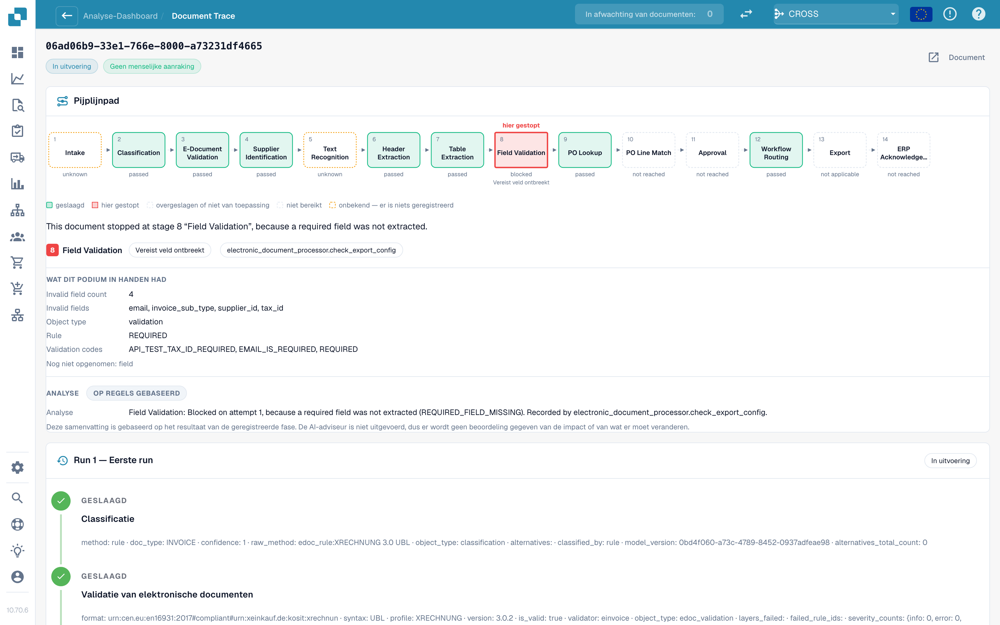

# Documentspoor

Voer een document-ID in bij **Document-ID** (Document ID), of open een voorbeelddocument uit een cluster, om te zien **wat er met dit ene document is gebeurd**.

<figure><figcaption>
Het Documentspoor: het pipelinetraject met de fase waar het document stopte, wat die fase in handen had, en eronder de runhistorie.
</figcaption></figure>

Bovenaan ziet u het **pipelinetraject** met 14 fasen: Intake, Classificatie, E-documentvalidatie, Leverancieridentificatie, Tekstherkenning, Headerextractie, Tabelextractie, Veldvalidatie, PO-opzoeking, PO-regelmatch, Goedkeuring, Workflowroutering, Export, ERP-bevestiging. Elk vak heeft een status:

| Status                                  | Betekenis                                      |
| --------------------------------------- | ---------------------------------------------- |
| **geslaagd** (groen)                    | De fase is goed verlopen                       |
| **hier gestopt** (rood)                 | De fase heeft het document geblokkeerd         |
| **overgeslagen of niet van toepassing** | De fase is niet van toepassing op dit document |
| **niet bereikt**                        | Het document is nooit zo ver gekomen           |
| **onbekend** (gestippeld)               | Voor deze fase is niets vastgelegd             |

Onder het traject noemt een zin de oorzaak. In de schermafbeelding: _This document stopped at stage 8 "Field Validation", because a required field was not extracted._ (Dit document stopte bij fase 8 "Field Validation", omdat een verplicht veld niet is geëxtraheerd.) Het blok **Wat deze fase in handen had** (What this stage had in its hands) toont de feiten: **Invalid field count 5** (aantal ongeldige velden 5) en de velden (`delivery_date`, `email`, `invoice_sub_type`, `payment_terms`, `supplier_id`), de regel (**REQUIRED**) en de validatiecodes. Het blok **Analyse** geeft aan of die **regelgebaseerd** is of door AI is geschreven.

De **runhistorie** eronder toont elke run (**Run 1 · Initial run**, daarna elke herstart) met elke fase en de vastgelegde feiten. Als het document is gecorrigeerd en opnieuw gestart, herinnert een opmerking u eraan dat het **als aangeraakt blijft tellen**.

**Voorbeeld.** De documenten van één leverancier stoppen allemaal bij fase 8. In het spoor ziet u steeds dezelfde vijf ongeldige velden. Dat is geen extractieprobleem van afzonderlijke documenten, maar een ontbrekende standaardwaarde in uw veldconfiguratie: los het één keer op en het hele cluster is herstelbaar.

## Gerelateerde pagina's

* [Touchless Intelligence](./)
* [Leveranciersdiagnose en probleemclusters](touchless-supplier-diagnosis.md)
* [PO-matchingdiagnose](touchless-po-matching-diagnosis.md)
