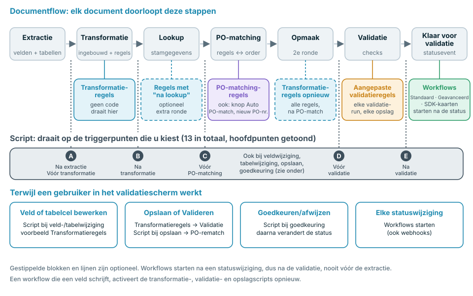
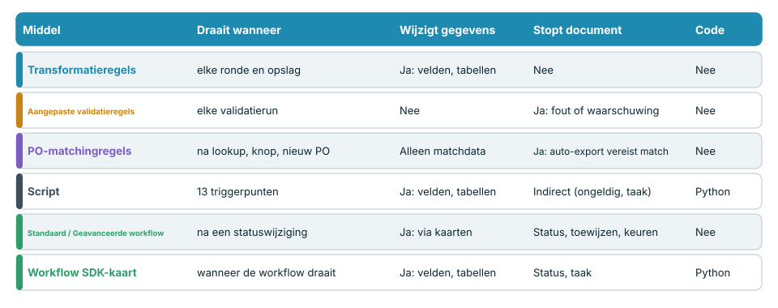
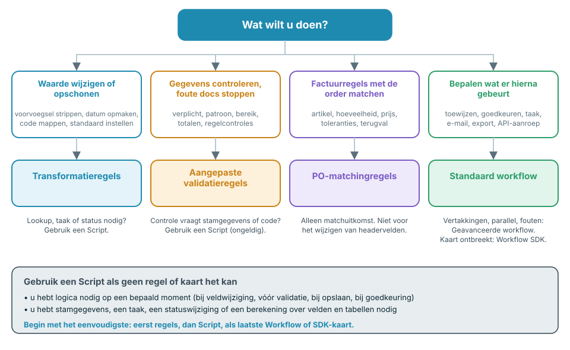

# Kies de juiste automatisering



De video (bijna zes minuten) behandelt dezelfde onderwerpen in vier delen: **0:00** waar elk hulpmiddel in de documentflow draait, **1:35** code, workflows en de vergelijking, **2:45** wat elk hulpmiddel wel en niet kan, **3:53** best practices en veelgemaakte fouten.

DocBits biedt meerdere manieren om documenten te wijzigen, te controleren en te routeren: **Transformatieregels**, **Aangepaste validatieregels**, **Regels voor het matchen van inkooporders**, **Scripts**, **Standaard workflows**, **Geavanceerde workflows** en **Workflow SDK-kaarten**. Ze overlappen elkaar met opzet. Deze pagina vertelt u welke u kiest, **wanneer elk ervan in de documentflow draait**, en wat het wel en niet kan.

## Het korte antwoord

| Ik wil …                                                                                                                                                | Gebruik                                                                                                                                           | Waarom                                                                      |
| ------------------------------------------------------------------------------------------------------------------------------------------------------- | ------------------------------------------------------------------------------------------------------------------------------------------------- | --------------------------------------------------------------------------- |
| Een waarde opschonen of herschrijven (trimmen, voorvoegsel, datumformaat, eenheidsmapping, standaardwaarde)                                             | [Transformatieregels](settings/global-settings/document-types/transformation-rules.md)                                                            | Geen code, live voorbeeld, draait bij elke verwerking en elke opslag        |
| Zorgen dat gegevens compleet en aannemelijk zijn, en documenten stoppen die dat niet zijn                                                               | [Aangepaste validatieregels](settings/global-settings/document-types/custom-validation-rules.md)                                                  | Declaratieve controles, fout of waarschuwing, blokkeert automatische export |
| Factuurregels matchen met inkooporderregels                                                                                                             | [Regels voor het matchen van inkooporders](settings/global-settings/document-types/more-settings/purchase-order/purchase-order-matching-rules.md) | Regelsets met toleranties, terugvalopties en een visueel diagram            |
| Iets doen wat een regel niet kan uitdrukken: een lookup, een berekening over velden en tabellen heen, een taak, een statuswijziging op een exact moment | [Script](settings/global-settings/document-types/script/)                                                                                         | Python op 13 triggerpunten in de flow                                       |
| Bepalen **wat er hierna gebeurt** met een document: toewijzen, goedkeuren, een taak aanmaken, een e-mail versturen, exporteren, een API aanroepen       | [Standaard workflow](workflow/standard-workflow-builder/)                                                                                         | Kaarten Wanneer / En / Dan op statusgebeurtenissen                          |
| Hetzelfde doen met vertakkingen, meerdere voorwaarden en foutpaden                                                                                      | [Geavanceerde workflow](workflow/advanced-workflow-builder/)                                                                                      | Visuele knooppuntengrafiek                                                  |
| Een actie nodig hebben die geen ingebouwde kaart biedt                                                                                                  | [Workflow SDK (Card SDK)](workflow/card-sdk.md)                                                                                                   | Uw eigen kaart, gecontroleerd door DocBits                                  |

**Vuistregel: gebruik het minst krachtige hulpmiddel dat de klus klaart.** Eerst regels, dan Script, als laatste Workflow of SDK-kaart. Regels zijn makkelijker te lezen, makkelijker te testen en kunnen een document niet kapotmaken; code kan meer en vraagt daarom meer zorg.

## Waar elk hulpmiddel in de documentflow draait

Elk document doorloopt dezelfde stappen. Elk hulpmiddel heeft zijn eigen plek in die flow, en die plek bepaalt wat het kan zien en wat het nog kan wijzigen.

<figure><figcaption></figcaption></figure>

In woorden:

1. **Extractie** leest headervelden en tabellen uit het document. Een Script kan **na de extractie** draaien.
2. **Transformatie** past de ingebouwde opmaak en uw **Transformatieregels** toe. Scripts kunnen ervoor en erna draaien.
3. **Stamgegevens-lookup** vult velden zoals de leverancier. Transformatieregels die zijn gemarkeerd als **na lookup uitvoeren** krijgen hier een extra ronde.
4. **PO-matching** draait alleen wanneer het matchen van inkooporders is geactiveerd voor het documenttype. **Regels voor het matchen van inkooporders** werken hier. Een Script kan **vóór de PO-matching** draaien.
5. **Opnieuw opmaken**: alle Transformatieregels draaien opnieuw, zodat waarden die door de lookup of de match zijn weggeschreven ook worden opgemaakt.
6. **Validatie** voert uw **Aangepaste validatieregels** uit. Scripts kunnen **vóór** en **na** de validatie draaien.
7. Het document krijgt de status **Klaar voor validatie**. Dit is het eerste moment waarop een **Workflow** kan starten. Workflows reageren op statuswijzigingen, dus ze draaien altijd **na** de validatie, nooit vóór de extractie.

Terwijl iemand in het validatiescherm werkt, gelden er meer triggers: het bewerken van een veld of een tabelcel voert Scripts voor veld- en tabelwijzigingen uit en ververst het voorbeeld van de Transformatieregels. **Opslaan** en **Valideren** voeren Transformatieregels, validatie en Scripts bij opslaan opnieuw uit en matchen de inkooporder opnieuw wanneer het PO-nummer is gewijzigd. **Goedkeuren** voert goedkeuringsscripts uit voordat de status verandert.


Een workflow die een veld schrijft, gedraagt zich als een persoon die het document opslaat: Transformatieregels, validatie, Aangepaste validatieregels en Scripts bij opslaan draaien opnieuw voor die schrijfactie. Houd hier rekening mee wanneer een workflow en een regel hetzelfde veld wijzigen.


## De hulpmiddelen vergelijken

<figure><figcaption></figcaption></figure>

|                              | Transformatieregels                          | Aangepaste validatieregels                                | Regels voor PO-matching                                                               | Script                                                                      | Standaard workflow                                             | Geavanceerde workflow                              | SDK-kaart                                      |
| ---------------------------- | -------------------------------------------- | --------------------------------------------------------- | ------------------------------------------------------------------------------------- | --------------------------------------------------------------------------- | -------------------------------------------------------------- | -------------------------------------------------- | ---------------------------------------------- |
| **Draait wanneer**           | Bij elke transformatieronde en elke opslag   | Bij elke validatierun                                     | Na lookup, **Automatische PO-match**, nieuw PO-nummer                                 | 13 triggerpunten                                                            | Na een statuswijziging                                         | Na een statuswijziging                             | Wanneer de workflow draait                     |
| **Kan lezen**                | Headervelden, tabelkolommen                  | Velden, tabelcellen, totalen over rijen                   | Tabellen, PO-nummers, inkooporderregels, toleranties                                  | Alle geëxtraheerde gegevens, lookups, gebruikers, groepen, full-text search | Documentgegevens, gebruikers, groepen, variabelen              | Hetzelfde, plus resultaten van eerdere knooppunten | Velden, tabellen, lookups, gebruikers, groepen |
| **Kan schrijven**            | Veld- en kolomwaarden, rijen, suborganisatie | Niets: alleen markeringen geldig / ongeldig               | Alleen matchgegevens                                                                  | Velden, tabellen, taken, status                                             | Velden, status, toewijzing, taken, export, e-mail, API-aanroep | Dezelfde kaarten, plus logica en variabelen        | Velden, tabellen, status, taken                |
| **Kan een document stoppen** | Nee                                          | Ja, fouten blokkeren automatische export en **Valideren** | Ja, zonder volledige match wacht de automatische export wanneer PO-matching actief is | Indirect: een veld ongeldig markeren, een taak aanmaken                     | Stelt status in, wijst toe, keurt goed, wijst af               | Hetzelfde                                          | Hetzelfde als het kaarttype                    |
| **Heeft code nodig**         | Nee                                          | Nee                                                       | Nee                                                                                   | Ja, beperkt Python                                                          | Nee                                                            | Nee                                                | Ja, Python in een sandbox                      |
| **Typisch gebruik**          | Waarden normaliseren                         | Verplichte velden, formaten, totalen                      | Regelmatching                                                                         | Speciale logica                                                             | Routering en goedkeuring                                       | Routering met vertakkingen                         | Acties van partners                            |

## Beslis met vier vragen

<figure><figcaption></figcaption></figure>

1. **Moet een waarde veranderen?** Gebruik **Transformatieregels**. Heeft de wijziging stamgegevens, een taak of een status nodig, gebruik dan een **Script**.
2. **Moet een waarde worden gecontroleerd?** Gebruik **Aangepaste validatieregels**. Ze stoppen een document, maar wijzigen het nooit. Heeft de controle stamgegevens of code nodig, dan kan een **Script** het veld ongeldig markeren.
3. **Moeten factuurregels met een order worden gematcht?** Gebruik **Regels voor het matchen van inkooporders**. Ze leveren alleen matchresultaten op. Om vóór het matchen een headerveld te corrigeren, gebruikt u een Transformatieregel.
4. **Hangt de volgende stap af van het document?** Gebruik een **Workflow**. Kies **Geavanceerd** wanneer u vertakkingen, meerdere voorwaarden of foutpaden nodig hebt. Kies een **SDK-kaart** alleen wanneer geen ingebouwde kaart doet wat u nodig hebt.

## Hulpmiddel voor hulpmiddel

### Transformatieregels

* **Gebruik ze wanneer** een waarde inhoudelijk klopt maar in de vorm niet: voorvoegsels, spaties, datumformaten, eenheidscodes, standaardwaarden, een PO-nummer in het verkeerde veld, of tabellen die tot een totaalregel moeten worden samengevoegd.
* **Ze draaien** in de eerste transformatieronde, in een optionele ronde na de stamgegevens-lookup, opnieuw na de PO-matching en bij elke opslag. Het validatiescherm toont een voorbeeld.
* **Ze kunnen** headervelden, tabelkolommen en -rijen en de suborganisatie wijzigen. Elke regel kan worden beperkt tot bepaalde leveranciers of voorwaarden.
* **Ze kunnen niet** een document stoppen, andere systemen aanroepen, stamgegevens-lookups gebruiken of taken aanmaken. Een regel die niet kan worden toegepast, laat de waarde ongewijzigd.
* **Meer lezen:** [Transformatieregels](settings/global-settings/document-types/transformation-rules.md)

### Aangepaste validatieregels

* **Gebruik ze wanneer** een document niet verder mag met foute gegevens: verplichte velden, patronen, getalbereiken, toegestane waarden, vergelijking tussen twee velden, totalen die moeten kloppen.
* **Ze draaien** bij elke validatie: in de pijplijn, bij elke opslag en nadat een workflow gegevens heeft geschreven.
* **Ze kunnen** een veld of een tabelcel markeren als **fout** (blokkeert automatische export en **Valideren**, tenzij omzeild) of als **waarschuwing** (zichtbaar, blokkeert niet).
* **Ze kunnen niet** gegevens wijzigen, stamgegevens opzoeken of services aanroepen. Corrigeer de gegevens eerst met een Transformatieregel en controleer ze daarna.
* **Meer lezen:** [Aangepaste validatieregels](settings/global-settings/document-types/custom-validation-rules.md)

### Regels voor het matchen van inkooporders

* **Gebruik ze wanneer** factuurregels met inkooporderregels moeten worden gematcht: enkele, meervoudige en totaalmatches, toleranties voor hoeveelheid en prijs, terugvalopties wanneer de eerste regel niet matcht.
* **Ze draaien** na de stamgegevens-lookup, wanneer u op **Automatische PO-match** klikt en wanneer het PO-nummer bij opslaan verandert.
* **Ze kunnen** het matchresultaat en de gegevens voor de goedkeuring opleveren. De diagramweergave toont welke regel in welke fase van toepassing is.
* **Ze kunnen niet** headervelden herschrijven, een status instellen of eigen logica uitvoeren. Zonder volledige match wacht de automatische export wanneer PO-matching actief is.
* **Meer lezen:** [Regels voor het matchen van inkooporders](settings/global-settings/document-types/more-settings/purchase-order/purchase-order-matching-rules.md)

### Script

* **Gebruik het wanneer** geen regel de logica kan uitdrukken: een berekening over velden en tabellen heen, een lookup, een taak voor een gebruiker, een statuswijziging op een exact moment, of een reactie op een bewerking in het validatiescherm.
* **Het draait** op de triggerpunten die u kiest: na de extractie, vóór en na de transformatie, vóór de PO-matching, vóór en na de validatie, bij veld- en tabelwijzigingen, bij opslaan en bij goedkeuring.
* **Het kan** het hele document lezen, stamgegevens-lookups en full-text search gebruiken, velden, vlaggen en tabellen wijzigen, taken aanmaken en de status wijzigen.
* **Het kan niet** modules importeren of externe services aanroepen. Het is beperkt Python. Een fout in een script wordt gelogd en stopt de verwerking van het document nooit, dus een script is **geen** betrouwbare manier om een document te blokkeren: markeer het veld als ongeldig of maak een taak aan.
* **Meer lezen:** [Script](settings/global-settings/document-types/script/)

### Standaard workflow

* **Gebruik hem wanneer** de volgende stap afhangt van het document: toewijzen aan een gebruiker of groep, goedkeuren of afwijzen, een taak aanmaken, een e-mail versturen, exporteren, een status instellen, een API aanroepen.
* **Hij draait** wanneer een document een status bereikt die u hebt gekozen, dus na de validatie. Hij kan ook starten vanuit een webhook, een schema of handmatig.
* **Hij kan** een keten van kaarten uitvoeren: **Wanneer** (start), **En** (voorwaarden, alle moeten slagen), **Dan** (acties in volgorde).
* **Hij kan niet** vertakken, op meerdere voorwaarden wachten of in een apart pad reageren op de fout van een kaart. Gebruik daarvoor een Geavanceerde workflow.
* **Meer lezen:** [Standaard workflow](workflow/standard-workflow-builder/)

### Geavanceerde workflow

* **Gebruik hem wanneer** één document verschillende paden nodig heeft: vertakkingen op voorwaarde, meerdere voorwaarden gecombineerd met ALL / ANY, en een pad voor fouten of mislukte voorwaarden.
* **Hij draait** op dezelfde gebeurtenissen als een Standaard workflow. Hij vereist het abonnement DocFlow Advanced.
* **Hij kan** dezelfde kaarten gebruiken als een Standaard workflow, plus logica- en variabelenkaarten, getekend als grafiek.
* **Hij kan niet** wat vóór de validatie gebeurt: hij start na een statuswijziging. Logica vóór de validatie hoort in een Script of een regel.
* **Meer lezen:** [Geavanceerde workflow](workflow/advanced-workflow-builder/)

### Workflow SDK (Card SDK)

* **Gebruik hem wanneer** u een kaart nodig hebt die niet bestaat, bijvoorbeeld een voorwaarde of actie die specifiek is voor een partnerapplicatie.
* **Hij draait** telkens wanneer een workflow draait die de kaart bevat.
* **Hij kan** velden en tabellen lezen en schrijven, het document opslaan, de status wijzigen en taken aanmaken.
* **Hij kan niet** netwerkverbindingen openen. Een run is beperkt tot 60 seconden en 200 SDK-aanroepen. Een kaart gaat pas live nadat DocBits hem heeft gecontroleerd en goedgekeurd.
* **Meer lezen:** [Card SDK](workflow/card-sdk.md)

## Best practices

* **Begin met het eenvoudigste hulpmiddel.** Een Transformatieregel is beter dan een Script voor opmaak. Een Aangepaste validatieregel is beter dan een Script voor een controle. Grijp pas naar een Script of een SDK-kaart wanneer een regel of ingebouwde kaart het niet kan.
* **Eerst corrigeren, dan controleren, als laatste routeren.** Transformatieregels en Scripts bereiden de gegevens voor, Aangepaste validatieregels beoordelen ze, Workflows bepalen wat er met het document gebeurt. Dit is de volgorde van de flow.
* **Eén eigenaar per veld.** Als een Transformatieregel en een Script hetzelfde veld schrijven, hangt het resultaat van de volgorde af. Geef elk veld één eigenaar.
* **Gebruik geen workflow om gegevens te herstellen.** Workflows starten na de validatie, dus een herstel komt laat en veroorzaakt een nieuwe validatie. Herstel gegevens in een regel of Script vóór de validatie.
* **Valideer met een regel, niet met een Script.** Een Scriptfout stopt een document nooit. Een Aangepaste validatieregel wel.
* **Houd scripts klein en benoem ze naar hun doel.** Eén script per taak, met het triggerpunt in de naam, is makkelijk uit te schakelen wanneer iets er niet goed uitziet.
* **Test eerst op dev of sandbox.** Gebruik een paar echte documenten, controleer het resultaat in het validatiescherm en activeer daarna de regel of workflow voor productie.
* **Controleer de logs.** Het documentlogboek en het workflowlogboek tonen wat er is uitgevoerd en wat er is gewijzigd.

## Veelgemaakte fouten

| Fout                                                               | Beter                                                              |
| ------------------------------------------------------------------ | ------------------------------------------------------------------ |
| Een Script dat waarden trimt en van een voorvoegsel voorziet       | Een Transformatieregel                                             |
| Een workflow die een veld instelt na de validatie                  | Een Transformatieregel of een Script vóór de validatie             |
| Een Script dat een ongeldig document zou moeten stoppen            | Een Aangepaste validatieregel                                      |
| Een Aangepaste validatieregel die een waarde zou moeten herstellen | Een Transformatieregel, daarna de validatieregel                   |
| Het PO-nummer herschrijven in een regel voor PO-matching           | Een Transformatieregel op het veld _Purchase Order_, vóór de match |
| Een Geavanceerde workflow voor één enkele _Wanneer → Dan_          | Een Standaard workflow                                             |
| Een SDK-kaart voor iets wat een ingebouwde kaart kan               | De ingebouwde kaart                                                |

## Gerelateerde pagina's

* [Transformatieregels](settings/global-settings/document-types/transformation-rules.md)
* [Aangepaste validatieregels](settings/global-settings/document-types/custom-validation-rules.md)
* [Regels voor het matchen van inkooporders](settings/global-settings/document-types/more-settings/purchase-order/purchase-order-matching-rules.md)
* [Script](settings/global-settings/document-types/script/)
* [Workflow](workflow/)
