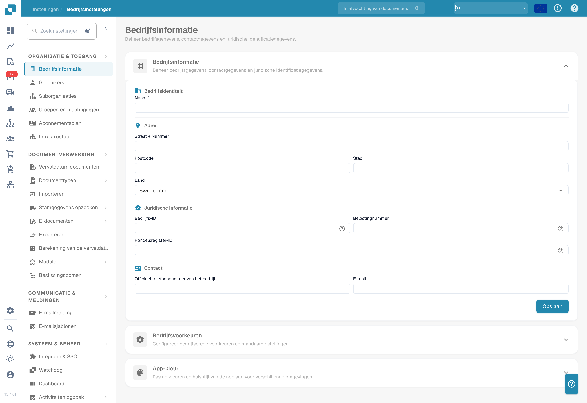

# Instellingen

<figure><figcaption>
Organisatie-instellingen met afgeschermde identificatiegegevens. Het getoonde land is een ingestelde waarde.
</figcaption></figure>

Het gedeelte Instellingen is uw centrale punt voor het configureren van DocBits. Het is ingedeeld in vijf hoofdonderdelen:

## 1. Organisatie & Toegang

Beheer het profiel van uw bedrijf en bepaal wie waartoe toegang heeft.

* **Bedrijfsinformatie**: Voer de bedrijfsnaam, het adres, het btw-nummer en andere juridische identificatiegegevens in.
* **Gebruikers**: Voeg gebruikersaccounts toe, bewerk of deactiveer ze en wijs rollen toe (Admin, Systeembeheerder).
* **Suborganisaties**: Maak suborganisaties aan en beheer ze voor opzetten met meerdere entiteiten.
* **Groepen en Machtigingen**: Definieer gebruikersgroepen en configureer gedetailleerde machtigingen voor elke groep.

## 2. Documentverwerking

Configureer hoe documenten worden geïmporteerd, verwerkt en geëxporteerd.

* **Documentverval**: Stel regels in voor het automatisch verwijderen van documenten (bijv. verwijderen na 48 uur, 1 week, enz.).
* **Documenttypes**: Definieer en configureer de documenttypes die DocBits verwerkt (facturen, bestellingen, pakbonnen, enz.), inclusief velden, tabelkolommen, scripts en meer.
* **Importeren**: Stel in hoe documenten DocBits binnenkomen: via e-mail (IMAP/Office 365), FTP of bestandsupload. Configureer bestandstypen en paginalimieten.
* **Regelbeheer**: Definieer regels voor conflictoplossing bij de afstemming van facturen op inkooporders, inclusief tolerantie-instellingen en goedkeuringsworkflows.
* **OCR-instellingen**: Configureer drempelwaarden voor de kwaliteit van Optical Character Recognition, het gebruik van E-Text, de AI-OCR-versie en het gedrag van tabelextractie.
* **Classificatie en Extractie**: Stel documentsplitsing, bedragnotatie, extractiemethoden voor tabellen, classificatieregels en AI-modellen in.
* **Masterdata Lookup**: Configureer hoe geëxtraheerde gegevens worden gevalideerd aan de hand van masterdata uit uw ERP-systeem (bijv. leveranciersrekeningen, inkooporders).
* **Waardenlijst**: Maak vooraf gedefinieerde waardenlijsten aan en beheer ze; deze worden gebruikt in keuzelijsten en bij gegevensvalidatie.
* **Exporteren**: Configureer hoe en waarheen verwerkte documenten worden verzonden: via Webhook, SFTP, SMB of Infor-integraties (IDM, ION, M3, LN).
* **Module**: Schakel optionele functies in of uit, zoals PO Dashboard, Auto Accounting, Leveranciersportaal, Workflow Builder, QR-code-extractie en meer.
* **Beslisbomen**: Bouw regelgebaseerde beslislogica met een visuele ontwerper. Ondersteunt meerdere beleidsvormen (Unique, First, Priority, Collect, enz.).
* **Agent Setup**: Maak automatiseringsagenten en communicatiekanalen aan en beheer ze voor geautomatiseerde documentverwerkingsworkflows.

## 3. Communicatie & Notificaties

Bepaal hoe DocBits met gebruikers communiceert en hoe inkomende e-mails worden verwerkt.

* **E-mailnotificatie**: Configureer e-mailwaarschuwingen voor gebeurtenissen en statuswijzigingen in de documentverwerking.
* **E-mailsjablonen**: Maak herbruikbare e-mailsjablonen voor notificaties aan en beheer ze, geordend per documenttype.
* **E-mailverwerking (Email Ingestion)**: Configureer hoe inkomende e-mails automatisch worden geclassificeerd en omgezet in documenten. Omvat regels voor classificatie, veldextractie, verwerking, afzenderbeheer en training, geordend per documenttype (Orders, Invoices, Quotes, Delivery Notes, COA, PO Confirm).

## 4. Systeem & Beheer

Bewaak de systeemstatus, beheer integraties en handhaaf de beveiliging.

* **Integratie & SSO**: Configureer API-sleutels voor externe integraties en stel Single Sign-On (SSO) in met identiteitsproviders.
* **Watchdog**: Stel de Watchdog-service in voor het automatisch importeren van documenten uit lokale mappen.
* **Dashboard**: Pas het gedrag van het dashboard aan: filters, exportinstellingen, actiemachtigingen en opties voor de statusweergave.
* **Activiteitenlogboek**: Bekijk systeemgebeurtenissen in realtime, gefilterd op ernst (Debug, Info, Warning, Error), tijdsbereik en service.
* **Analytics**: Open gedetailleerde analysedashboards, waaronder Logs Analytics, Auth Security-bewaking en API Metrics met Real User Monitoring (RUM).
* **Toegangsaudit**: Schakel audittrails in en bekijk ze; deze leggen alle acties voor aanmaken, bijwerken en verwijderen binnen uw organisatie vast voor naleving en beveiliging.
* **Systeemlicenties**: Bekijk en beheer informatie over API-licenties en het gebruik ervan.
* **Cachebeheer**: Configureer de intervallen (TTL) voor het automatisch wissen van de cache voor Ontvangen Levering, Inkooporder en Taak-/Notificatiecache.
* **Fulltext Search-instellingen**: Configureer full-text zoekmogelijkheden voor uw documenten en gegevens (vereist dat de module Fulltext Search is ingeschakeld).

## 5. Leveranciersinstellingen

Configureer het Leveranciersportaal en beheer leveranciergerelateerde workflows.

* **Algemene leveranciersinstellingen**: Stel de uitnodigingsvelden van het leveranciersportaal in, configureer de workflowstatussen (Not Invited, Open, Pending Registration, Approved, Rejected) en beheer de goedkeuringsinstellingen.
* **E-mailsjablonen**: Maak e-mailsjablonen specifiek voor leverancierscommunicatie aan en beheer ze.
* **Leveranciersindeling**: Pas de indeling en het uiterlijk van het Leveranciersportaal aan.
* **Exportconfiguratie**: Configureer hoe leveranciersgegevens naar externe systemen worden geëxporteerd.
* **Leveranciersgroep**: Maak leveranciersgroepen aan en beheer ze om uw leveranciers te categoriseren en te ordenen.
* **Koppeling van gebruikers en leveranciersgroepen**: Koppel interne gebruikers aan specifieke leveranciersgroepen om zichtbaarheid en toegang te bepalen.
