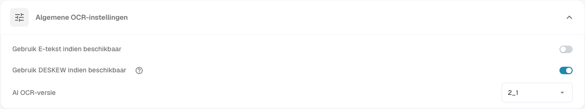

# Documentverwerking

De instellingen voor **Documentverwerking** bepalen hoe DocBits documenten leest, verrijkt en exporteert. Open **Instellingen** en kies het gewenste onderdeel onder **Documentverwerking**.

* [OCR-instellingen](ocr-settings.md): hoe tekst uit documenten wordt gelezen.
* [Stamgegevens opzoeken](master-data-lookup.md): hoe geëxtraheerde waarden worden vergeleken met uw stamgegevens.
* [Vervaldatumberekening](due-date-calculation.md): hoe vervaldatums worden berekend.
* [Exporteren](export.md): waarheen en hoe verwerkte documenten worden geëxporteerd.

Open bijvoorbeeld **OCR-instellingen** om **Algemene OCR-instellingen** te bekijken. De optie **Gebruik E-tekst indien beschikbaar** gebruikt ingesloten elektronische tekst. De optie **Gebruik DESKEW indien beschikbaar** zet gescande pagina’s recht. De optie **AI OCR-versie** selecteert de versie van de herkenningsengine. Zie [OCR-instellingen](ocr-settings.md) voor meer informatie over de bedieningselementen.

<figure><figcaption>
De algemene OCR-instellingen vormen één onderdeel van de documentverwerking. De geselecteerde waarden zijn afhankelijk van uw organisatie.
</figcaption></figure>

Andere onderdelen in deze sectie zijn [Importeren](import/README.md), [Classificatie en extractie](classification-and-extraction/README.md), [Regelbeheer](rule-manager/README.md), [Waardenlijsten](list-of-values.md) en [Module](module/README.md).

Als een instelling niet werkt zoals verwacht, controleer deze dan eerst met een testdocument. Een wijziging kan van invloed zijn op elk nieuw document van de organisatie.
