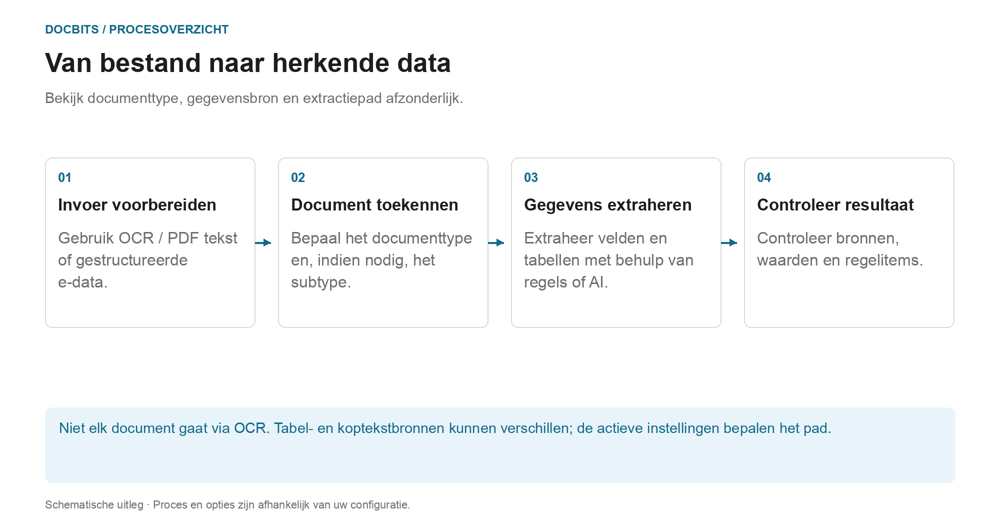
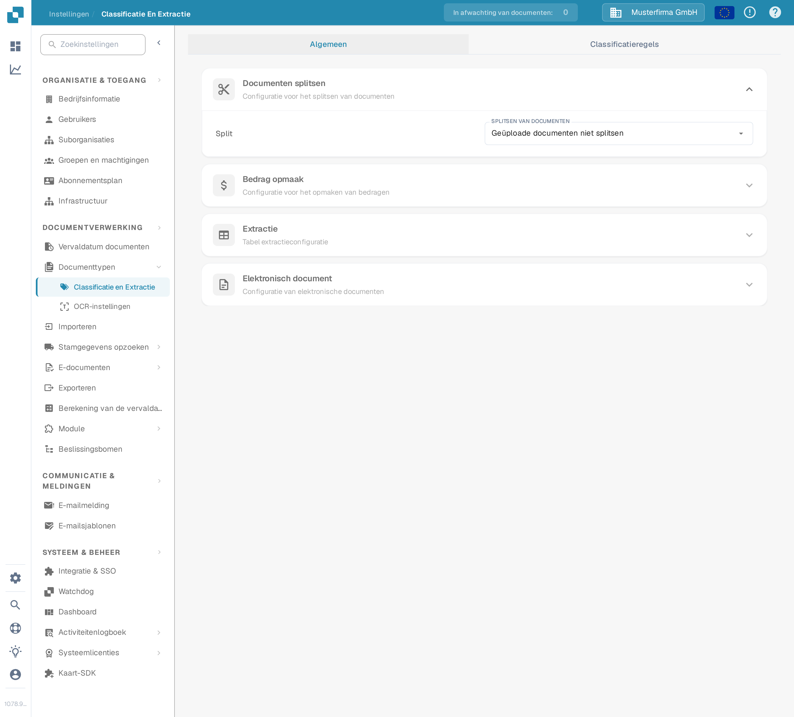

# Classificatie en extractie

## Welke instelling werkt bij welke processtap?

<figure><figcaption>
Bekijk documenttype, gegevensbron en extractiepad afzonderlijk. Het diagram is schematisch; de actieve instellingen van uw organisatie bepalen het daadwerkelijke gedrag.
</figcaption></figure>

Classificatie geeft antwoord op de vraag **“Wat voor soort document is dit?”**. Extractieantwoorden **“Welke waarden bevat het?”**. De instellingen op deze pagina zijn van invloed op verschillende verwerkingspunten en mogen niet worden opgevat als een enkele AI-schakelaar.

1. **Invoer voorbereiden:** Voor PDFs kan bestaande tekst of OCR worden gebruikt; ondersteunde elektronische documenten kunnen gestructureerde waarden bieden. Een geactiveerde splitsing kan een binnenkomend document scheiden op basis van de geconfigureerde barcode- of QR-criteria.
2. **Documenttype bepalen:** Classificatieregels en modellen wijzen documenten toe aan een type en eventueel een subtype. Deze opdracht is te onderscheiden van de latere veld- en tabelextractie.
3. **Waarden extraheren:** Tabellen kunnen verschillende paden volgen, afhankelijk van de configuratie en toepasselijke opgeslagen regels. Koptekstvelden hebben hun eigen bronindicatoren. Het geselecteerde AI-model alleen verklaart dus niet elke rij- of veldwaarde.
4. **Trace het resultaat:** Controleer in het validatiescherm welk tabeltabblad de rijen bevat en welke bronindicator een kopveld heeft. Als een verwerkingsstap ontbreekt, lees dan de documentlogboeken voordat u de instellingen wijzigt.

### Maak onderscheid tussen regelpad en AI-pad

Passende opgeslagen tabelregels kunnen de tabelextractie voor het betreffende sjabloon of de betreffende leverancier bepalen. Zonder geschikte regels kan het AI-pad worden gebruikt wanneer AI-tabelextractie is geactiveerd. Individuele kolommen kunnen hun eigen AI-opties hebben. Een AI-bron voor een kopveld betekent niet dat de hele tabel uit de AI komt.

In de diagnostische handleiding van de [Welk extractiepad werd gebruikt?](../../../../overview-and-basics/faq/document-processing/which-extraction-path-was-used.md) worden tabbladen, bron-ID's en logboeken uitgelegd. Op de pagina [AI-model](ai-model.md) worden de organisatiestandaard- en sjabloongerelateerde afwijkende instellingen uitgelegd.

## Overzicht

In de Instellingen voor **Classificatie en extractie** kun je:

* **Documenten splitsen** inschakelen op basis van QR-codes
* **Bedrag opmaak** configureren
* **Tabel extractie** instellen
* Verwerking van niet-ondersteunde **ZUGFeRD**-bestanden in- of uitschakelen
* Speciale classificatieregels definiëren
* Aangepast getrainde **AI-modellen** monitoren die in het classificatieproces worden gebruikt

Deze pagina biedt een gedetailleerde uitleg van alle beschikbare instellingen.

## Toegang tot Instellingen voor Classificatie en extractie

Ga naar de Instellingen voor **Classificatie en Extractie** via:\
**Instellingen → Documentverwerking → Classificatie en Extractie**

<figure><figcaption>
Open <strong>Instellingen → Documentverwerking → Classificatie en Extractie</strong>.
</figcaption></figure>

## Documenten splitsen

In de sectie **Documenten splitsen** kun je configureren of een geüpload document moet worden opgesplitst in meerdere documenten wanneer er een **streepjescode** op een van de pagina's verschijnt.

Om deze functie te activeren:

1. Ga naar de sectie **Documenten splitsen**.
2.  Open het keuzemenu.

    
3.  Selecteer **Gesplitst op barcode/QR-code**.

    

Je hebt vervolgens de optie om:

* Een of meer streepjescode-typen te selecteren die moeten worden gedetecteerd.
*   Een regex-patroon op te geven waaraan de streepjescode moet voldoen om het splitsen van documenten te activeren.

    

## Bedrag opmaak

In de sectie **Bedrag opmaak** heb je twee opties:

* **Afronding toestaan tijdens het vergelijken van bedragen:**\
  Indien ingeschakeld, is een tolerantie van ±0,5 toegestaan tijdens bedragvergelijking.\
  Indien uitgeschakeld, geldt een standaardtolerantie van ±0,05.
* **Vereist exacte overeenkomst voor bedragvergelijking:**\
  Indien ingeschakeld, moeten bedragen exact overeenkomen met nul tolerantie.\
  Indien uitgeschakeld, is een tolerantie van ±0,05 toegestaan.

<mark style="color:red;">**Opmerking**</mark>: Slechts één van deze instellingen kan tegelijk actief zijn.

## Tabel extractie


**Voorwaarden voor een werkende tabelextractie**

* Het documenttype heeft **tabelkolommen** (Instellingen → Globale instellingen → Documenttypen → [Tabelkolommen](../../global-settings/document-types/table-columns/README.md)). Zonder kolommen is er niets om naar te extraheren.
* **Tabel extractie** of **AI-tabel extractie** is hieronder ingeschakeld, voor de hele organisatie.
* Het document heeft leesbare tekst: OCR is uitgevoerd, of E-Text wordt gebruikt voor digitaal aangemaakte pdf's ([OCR-instellingen](../ocr-settings.md)).
* Training en AI-modellen gelden **per leverancier**. Een getrainde tabel geldt alleen voor documenten van de leverancier waarop ze is getraind.


Je kunt tabellen uit documenten extraheren door **Tabel extractie** of **AI-tabel extractie** in te schakelen. Een getrainde tabel (of deze nu AI-gebaseerd of handmatig is) wordt altijd gekoppeld aan een specifieke leverancier.

**Tabel extractie:** Activeert regelgebaseerde tabelextractie. Tabellen worden per leverancier getraind op het validatiescherm (*Ga naar tabelextractieweergave*).\
Meer informatie over training vind je [hier](../../../setup/document-training/training-line-fields-table-training/defining-tables-and-columns.md).

**AI-tabel extractie:** Gebruikt AI om de tabel van elke leverancier zonder training te extraheren. Als de resultaten voor één leverancier niet nauwkeurig genoeg zijn, train dan de tabel van die leverancier; de opgeslagen regels krijgen voor die leverancier dan voorrang op de AI.

**Gebruik tabelextractie via visie (AI):** De AI leest de paginaafbeelding in plaats van de tekstlaag. Helpt bij gescande documenten en tabellen zonder duidelijke tekststructuur; langzamer. Het keuzemenu naast de schakelaar bepaalt hoe intensief de paginaafbeelding wordt gebruikt:

* **Uit (alleen tekst)** – Er wordt alleen de tekstlaag gebruikt. Dit is de standaard.
* **Alleen afbeeldingen** – Er wordt alleen de paginaafbeelding gelezen.
* **Hybride (tekst en afbeeldingen)** – Tekstlaag en paginaafbeelding worden in dezelfde aanvraag gecombineerd.
* **Auto (per document beslist)** – DocBits beslist per document of de tekstlaag volstaat.

De modus wordt opgeslagen onder de voorkeurssleutel `TABLE_EXTRACTION_VISION_MODE`; de oude schakelaar `TABLE_EXTRACTION_USE_VISION` blijft bestaan en betekent in de praktijk *Alleen afbeeldingen*.

**Gebruik gestructureerde extractie (AI):** De AI geeft de tabel terug in een vaste structuur die direct op de geconfigureerde tabelkolommen wordt afgebeeld. Aanbevolen wanneer de kolomkoppen op de documenten sterk variëren. Als je op de instelling klikt, opent een voorbeeld van precies welke velden en kolommen er van de AI worden gevraagd: de kopvelden en de kolomvelden per regel worden weergegeven met hun bron (aangevraagde of uitgeschakelde standaardvelden) en de verwachte uitvoermodus (bijvoorbeeld *strict* – geen extra kolommen). Velden die wel voor het documenttype zijn geconfigureerd maar zijn uitgeschakeld, worden niet bij de AI opgevraagd.

**Tabelextractie voor kostenelement:** Wanneer ingeschakeld, kan DocBits kostenelementen uit tabellen op regelniveau extraheren en deze dienovereenkomstig classificeren.\
Een gedetailleerde uitleg is beschikbaar [hier](table-extraction-for-costing-element.md).

**Automatisch belastingcode ophalen:** Wanneer ingeschakeld, vult het systeem automatisch het veld **Belastingcode** op het Validatiescherm, mits er een belastingcodeveld is geconfigureerd.\
Meer informatie over deze instelling vind je [hier](auto-extract-tax-code.md).

**Extractieregels opslaan (alleen admin):** Alleen beheerders kunnen in de tabeltraining op *Regels opslaan* klikken. Schakel dit in wanneer gebruikers steeds regels opslaan die de extractie van een leverancier verstoren.

**AI-model:** Stelt het organisatiemodel in voor veld- en tabelextractie. Het menu biedt Full, Fast, Nexus, Nexus Flash, Auto en Auto Nexus. Controleer beschikbaarheid, kwaliteit, looptijd en kosten met representatieve documenten. Een laag is niet altijd de meest nauwkeurige of snelste voor elk document. Sjabloonoverschrijvingen kunnen de organisatie-instelling vervangen. De tabel onder de selector toont:

* Welke **leveranciers** welk AI-model gebruiken
* Of ze gestructureerde extractie (AI) en E-Text gebruiken
* Opties om een invoer te verwijderen en de leverancier zo terug te zetten naar de standaard

Deze instelling wordt in detail uitgelegd [hier](ai-model.md).

### Waarom ziet de tabel er per leverancier anders uit?

Tabelverwerking is afhankelijk van opgeslagen regels en instellingen in de relevante leveranciers- of sjablooncontext:

* **Opgeslagen regels** (tabeltraining): positie van de tabel en koppeling van de kolommen op de lay-out van die leverancier.
* **AI-tabeltags en opmaakregels**: aanwijzingen die de gebruiker voor de AI-tabel van die leverancier heeft opgeslagen.
* **Sjabloonspecifiek AI-model:** De gemaakte selectie op het validatiescherm wordt per organisatie en huidige extractiesjabloon opgeslagen. Het verandert niet automatisch elk sjabloon van dezelfde leverancier. Zonder overschrijving wordt de toepasselijke organisatie-instelling gebruikt.

Leverancier A met opgeslagen regels toont dus een deterministische tabel in het tabblad *Geëxtraheerde tabel* van het validatiescherm, terwijl leverancier B zonder regels de *AI Geëxtraheerde tabel* krijgt. Om leverancier B zich als A te laten gedragen, train je de tabel van B eenmalig. Om een leverancier te resetten, verwijder je de regels op het validatiescherm of reset je de trainingsgegevens in de AI-modeltabel.

### Voorkeurssleutels

Elke schakelaar in deze sectie wordt opgeslagen als een organisatievoorkeur. Gebruik de sleutel wanneer je de waarde instelt via de API (`/preferences/set_preference`), een script of de DocBits MCP (`get_preference` / `set_preference`).

| Instelling (UI-label) | Voorkeurssleutel | Waarden |
|---|---|---|
| Tabel extractie | `TABLE_EXTRACTION_SETTING` | `true` / `false` |
| AI-tabel extractie | `USE_AI_TABLE_EXTRACTION` | `true` / `false` |
| Gebruik tabelextractie via visie (AI) | `TABLE_EXTRACTION_VISION_MODE` | `off` (standaard), `vision`, `hybrid`, `auto` |
| Gebruik tabelextractie via visie (AI) – oude schakelaar | `TABLE_EXTRACTION_USE_VISION` | `true` / `false`; betekent in de praktijk `vision` |
| Gebruik gestructureerde extractie (AI) | `USE_STRUCTURED_EXTRACTION` | `true` / `false` |
| Tabelextractie voor kostenelement | `CHARGES_TABLE_EXTRACTION` | `true` / `false` |
| Automatisch belastingcode ophalen | `AUTO_EXTRACT_TAX_CODE` | `true` / `false` |
| Extractieregels opslaan (alleen admin) | `ONLY_ADMIN_CAN_SAVE_RULES` | `true` / `false` |
| AI-model | `AI_MODEL` | `gpt-6-sol` (Full), `gpt-6-luna` (Fast), `qwen3.8-max` (Nexus), `glm-5.3-flash` (Nexus Flash), `auto` (Auto), `auto-nexus` (Auto Nexus) |
| Tabelextractieversie (bevestigingsdialoog) | `TBL_EXT_VERSION` | versiestring |
| OCR-instellingen → Gebruik AI-gegevens voor tabellen indien beschikbaar | `USE_AI_DATA_FOR_TABLE` | `true` / `false` |
| OCR-instellingen → Gebruik E-Text indien beschikbaar | `USE_ETEXT_IF_AVAILABLE` | `true` / `false` |

Opmerkingen:

* Booleaanse voorkeuren worden opgeslagen als de strings `true` / `false`; een sleutel die nooit is ingesteld, telt als `false`. Als je `1` of `0` verstuurt, slaat DocBits `true` / `false` op.
* Een niet-ingestelde `AI_MODEL` betekent **Fast**.
* Een niet-ingestelde `TABLE_EXTRACTION_VISION_MODE` wordt afgeleid uit de oude schakelaar `TABLE_EXTRACTION_USE_VISION`: `true` geeft `vision`, elke andere waarde geeft `off`.
* Het wijzigen van een sleutel geldt voor documenten die daarna worden verwerkt. Start een document opnieuw om het met de nieuwe instelling opnieuw te extraheren.
* Sjabloonoverschrijvingen verschillen van organisatievoorkeuren. In de AI Model-gids wordt de exacte reikwijdte uitgelegd.

## Elektronisch document

**Proces Niet-ondersteund ZUGFeRD PDF:** Indien ingeschakeld, worden niet-ondersteunde **ZUGFeRD**-versies verwerkt als standaard-pdf's en wordt de ingesloten XML genegeerd.

De lijst met ondersteunde **ZUGFeRD**-versies vind je [hier](../../global-settings/document-types/edi/zugferd/README.md).

## Classificatieregels

In de sectie **Classificatieregels** kun je specifieke **regex**-patronen en criteria definiëren om het systeem te helpen documenten automatisch te classificeren tijdens de verwerking.

Om deze sectie te openen, klik op het tabblad **Classificatieregels** bovenaan de pagina.

### Nieuwe classificatieregel toevoegen

Om een nieuwe regel te maken:

1.  Klik rechtsboven op **Toevoegen**.

    
2. Vul de volgende velden in:
   * **Patroon**: Het regex-patroon waar het systeem naar moet zoeken om classificatie te activeren.
   * **Type**: Waar naar het patroon moet worden gezocht (bijv. **Streepjescode**).
   * **Suborganisatie** _(optioneel)_: Geef aan op welke suborganisatie de regel van toepassing is.
   * **Documenttype**: Definieer het documenttype dat moet worden toegewezen wanneer het patroon overeenkomt.
   *   **Subdocumenttype** _(optioneel)_: Geef een subtype op voor een gedetailleerdere classificatie.

       
3.  Klik op **Opslaan** om je classificatieregel op te slaan.

    

### Een classificatieregel bewerken

Om een bestaande regel te bewerken:

1.  Klik op de drie puntjes in de kolom **Acties**.

    
2.  Selecteer **Bewerking**.

    
3. Breng de gewenste wijzigingen aan.
4.  Klik op **Opslaan** om de updates toe te passen.

    

### Een classificatieregel verwijderen

Om een regel te verwijderen:

1.  Klik op de drie puntjes in de kolom **Acties**.

    
2.  Selecteer **Verwijderen**.

    

## AI-modellen

De sectie **AI-modellen** toont alle op maat getrainde modellen die specifiek voor jouw behoeften zijn verfijnd.

### Toegang tot de sectie AI-modellen

Om deze sectie te openen, klik op het tabblad **AI-modellen** bovenaan de pagina.

### Modelcategorieën

Modellen zijn georganiseerd in categorieën. Onder elke categorienaam wordt het aantal modellen weergegeven dat deze bevat.\
Klik op een categorie om de details te bekijken.

Bovenaan de pagina van de geselecteerde categorie zie je kerninformatie over elk model:

* **Type**: Het type model.
* **Alleen eerste pagina**: Geeft aan of het model alleen de eerste pagina van een document verwerkt.
* **Versie**: Het versienummer van het model.

### Modeltabel

Alle modellen binnen een categorie worden weergegeven in een tabel met de volgende informatie:

* **Naam**: De naam van het model.
* **Volgend model**: Het model dat de output van het huidige model verder zal verwerken.
* **Documenttype**: Het primaire documenttype dat door het model tijdens classificatie wordt toegewezen.
* **Document-subtypen**: De subtypen waarin het document verder wordt geclassificeerd.
* **Prioriteit**: Het prioriteitsniveau dat de positie van het model in de classificatiewachtrij bepaalt.

### Een model bewerken

Om een model te bewerken:

1.  Klik op het penpictogram in de kolom **Acties** naast het model dat je wilt bewerken.

    
2. Werk de beschikbare velden bij:
   * **Volgend model**: Selecteer het model dat de output van het huidige model moet verwerken.
   * **Documenttype**: Kies het documenttype waarmee het model de input moet classificeren.
3.  Klik op **Opslaan** om je wijzigingen toe te passen.

    
