# Classificatie en extractie

<figure>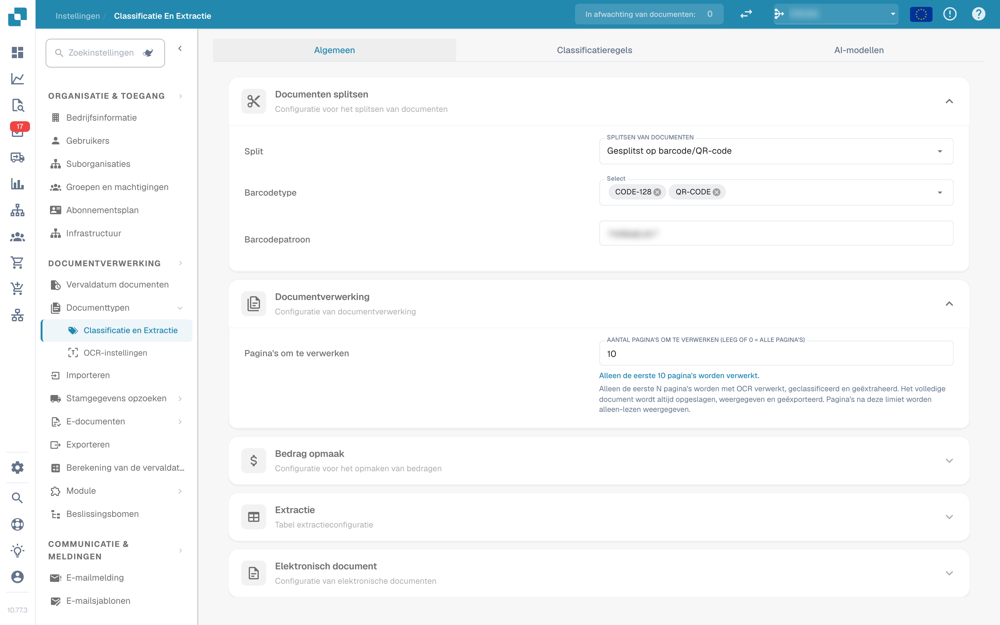<figcaption>
Instellingen voor classificatie en extractie
</figcaption></figure>

## Overzicht

In de instellingen **Classificatie en extractie** kunt u:

* bepalen hoe geüploade documenten worden **gesplitst** en hoeveel pagina's worden verwerkt
* de **bedragopmaak** voor het vergelijken van bedragen configureren
* de **tabelextractie** instellen, inclusief het AI-model per leverancier
* de verwerking van niet-ondersteunde **ZUGFeRD**-bestanden in- of uitschakelen
* **classificatieregels** definiëren die automatisch een documenttype toewijzen
* de **AI-modellen** en hun getrainde labels bekijken

De pagina heeft drie tabbladen: **Algemeen**, **Classificatieregels** en **AI-modellen**. Het tabblad *AI-modellen* wordt alleen getoond wanneer de module voor modellen en labels voor uw organisatie is ingeschakeld.

| Tabblad | Inhoud |
|---|---|
| Algemeen | Documenten splitsen, Documentverwerking, Bedrag opmaak, Extractie, Elektronisch document |
| Classificatieregels | Regex-regels die documenten classificeren op basis van de bronnaam |
| AI-modellen | Eigen getrainde modellen met hun labels, documenttypen en prioriteit |

## Toegang tot de instellingen voor classificatie en extractie

Ga naar **Instellingen → Documenttypen → Classificatie en Extractie**.

## Algemeen

Het tabblad **Algemeen** groepeert de instellingen in uitklapbare secties. Alle wijzigingen worden direct opgeslagen zodra u een waarde wijzigt; er is geen aparte opslaan-knop.

### Documenten splitsen

**Split** bepaalt of een geüpload document in meerdere documenten wordt gesplitst wanneer op een van de pagina's een barcode verschijnt. De keuzelijst biedt:

* **Geüploade documenten niet splitsen** – de standaardwaarde; het document wordt als één bestand verwerkt.
* **Gesplitst op barcode/QR-code** – het document wordt bij elke gedetecteerde barcode gesplitst.

<figure>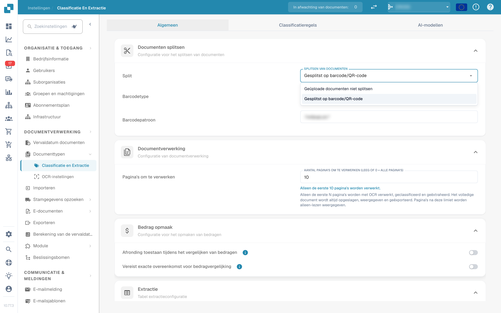<figcaption>
Split-opties in de sectie «Documenten splitsen»
</figcaption></figure>

Wanneer **Gesplitst op barcode/QR-code** is geselecteerd, verschijnen twee extra velden:

* **Barcodetype** – een of meer te detecteren barcodetypen, bijvoorbeeld *CODE-128* of *QR-CODE*.
* **Barcodepatroon** – een reguliere expressie waaraan de barcodewaarde moet voldoen voordat de splitsing wordt geactiveerd. Laat het veld leeg om op elke barcode van de gekozen typen te splitsen. Het patroon wordt gevalideerd voordat het wordt opgeslagen; een ongeldige expressie wordt direct gemeld.

Na een geslaagde splitsing wordt het bovenliggende document verwijderd en gaan de pagina's verder als aparte documenten die dezelfde batch delen.

### Documentverwerking

**Pagina's om te verwerken** beperkt hoeveel pagina's per document via OCR worden herkend, geclassificeerd en geëxtraheerd.

<figure>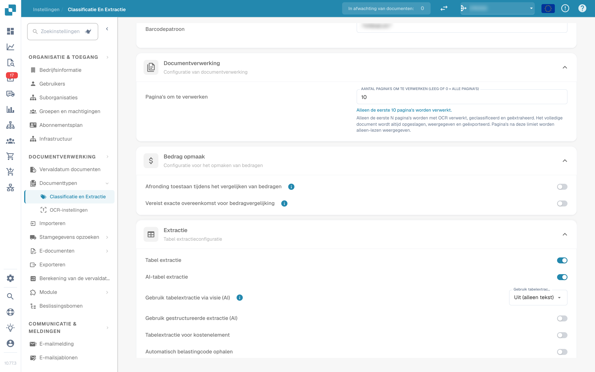<figcaption>
Pagina's om te verwerken in de sectie «Documentverwerking»
</figcaption></figure>

* Leeg of **0** betekent dat alle pagina's worden verwerkt.
* Een getal *N* beperkt OCR, classificatie en extractie tot de eerste *N* pagina's. Het volledige document wordt nog steeds opgeslagen, weergegeven en geëxporteerd; pagina's boven de limiet worden alleen-lezen weergegeven.

### Bedrag opmaak

Twee schakelaars bepalen hoe bedragen worden vergeleken met stamgegevens en inkooporders.

<figure>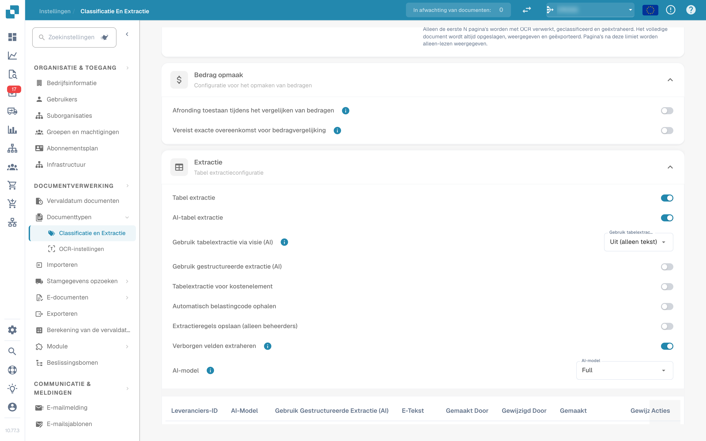<figcaption>
Sectie «Bedrag opmaak»
</figcaption></figure>

* **Afronding toestaan tijdens het vergelijken van bedragen** – indien ingeschakeld is een tolerantie van ±0,5 toegestaan. Indien uitgeschakeld geldt ±0,05.
* **Vereist exacte overeenkomst voor bedragvergelijking** – indien ingeschakeld moeten de bedragen exact overeenkomen, zonder tolerantie. Indien uitgeschakeld geldt ±0,05.

Slechts één van de twee schakelaars kan tegelijk actief zijn; het inschakelen van de ene schakelt de andere uit.

### Extractie


**Voorwaarden voor een werkende tabelextractie**

* Het documenttype heeft **tabelkolommen** (Instellingen → Algemene instellingen → Documenttypen → [Tabelkolommen](../../global-settings/document-types/table-columns/README.md)). Zonder kolommen is er niets om naar te extraheren.
* **Tabel extractie** of **AI-tabel extractie** is hieronder ingeschakeld, voor de hele organisatie.
* Het document bevat leesbare tekst: OCR is uitgevoerd, of voor digitaal aangemaakte PDF's wordt E-tekst gebruikt ([OCR-instellingen](../ocr-settings.md)).
* Training en AI-modellen gelden **per leverancier**. Een getrainde tabel wordt alleen toegepast op documenten van de leverancier waarvoor hij is getraind.


U kunt tabellen uit documenten extraheren door **Tabel extractie** of **AI-tabel extractie** in te schakelen. Een getrainde tabel (AI-gebaseerd of handmatig) is altijd aan een specifieke leverancier gekoppeld.

<figure>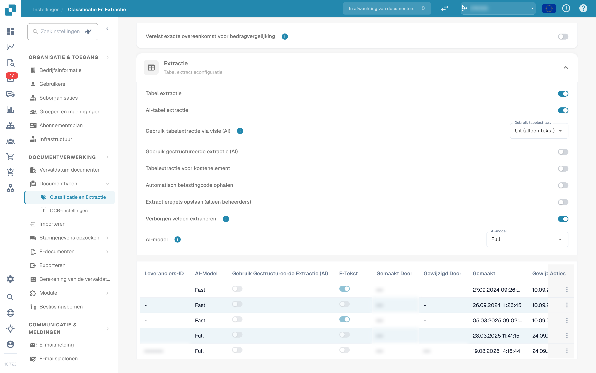<figcaption>
Schakelaars van de tabelextractie
</figcaption></figure>

**Tabel extractie:** Activeert regelgebaseerde tabelextractie. Tabellen worden per leverancier getraind op het validatiescherm (*Go to table extraction view*).\
Meer over training leest u [hier](../../../setup/document-training/training-line-fields-table-training/defining-tables-and-columns.md).

**AI-tabel extractie:** Gebruikt AI om de tabel van elke leverancier zonder training te extraheren. Zijn de resultaten voor een leverancier niet nauwkeurig genoeg, train dan de tabel van die leverancier; de opgeslagen regels hebben dan voorrang op de AI voor die leverancier.

**Gebruik tabelextractie via visie (AI):** De AI leest de pagina-afbeelding in plaats van de tekstlaag. Helpt bij gescande documenten en tabellen zonder duidelijke tekststructuur; langzamer. De keuzelijst naast de schakelaar bepaalt hoe sterk de pagina-afbeelding wordt gebruikt:

* **Uit (alleen tekst)** – Alleen de tekstlaag wordt gebruikt. Dit is de standaardwaarde.
* **Alleen afbeeldingen** – Alleen de pagina-afbeelding wordt gelezen.
* **Hybride (tekst en afbeeldingen)** – Tekstlaag en pagina-afbeelding worden in hetzelfde verzoek gecombineerd.
* **Automatisch (per document bepaald)** – DocBits bepaalt per document of de tekstlaag volstaat.

**Gebruik gestructureerde extractie (AI):** De AI levert de tabel in een vaste structuur die direct op de geconfigureerde tabelkolommen wordt afgebeeld. Aanbevolen wanneer de kolomkoppen op de documenten sterk verschillen. Een klik op de instelling opent een voorbeeld van precies welke velden en kolommen de AI worden gevraagd: kopvelden en regelkolommen worden met hun bron vermeld (aangevraagde of uitgeschakelde standaardvelden), evenals de verwachte uitvoermodus (bijvoorbeeld *strict* – geen extra kolommen). Velden die voor het documenttype zijn geconfigureerd maar uitgeschakeld zijn, worden niet bij de AI aangevraagd.

**Tabelextractie voor kostenelement:** Indien ingeschakeld kan DocBits kostenelementen op regelniveau uit tabellen extraheren en dienovereenkomstig classificeren.\
Een uitgebreide uitleg vindt u [hier](table-extraction-for-costing-element.md).

**Automatisch belastingcode ophalen:** Indien ingeschakeld vult het systeem automatisch het veld **Belastingcode** op het validatiescherm, mits een belastingcode-veld is geconfigureerd.\
Meer informatie over deze instelling vindt u [hier](auto-extract-tax-code.md).

**Extractieregels opslaan (alleen beheerders):** Alleen beheerders kunnen tijdens de training op *Save Rules* klikken. Schakel dit in wanneer gebruikers steeds regels opslaan die de extractie van een leverancier verstoren.

**Verborgen velden extraheren:** Velden die in de veldinstellingen als verborgen zijn gemarkeerd, worden ook geëxtraheerd. Handig wanneer een waarde nodig is voor een regel of een export, maar niet op het validatiescherm mag verschijnen.

**AI-model:** Selecteert het AI-niveau voor de tabelextractie. Er zijn zes opties: **Full** (hoogste nauwkeurigheid, het langzaamst, 2 tokens per document), **Fast** (standaard; 1 token per document), **Nexus** en **Nexus Flash** (alternatieve modelfamilie, optioneel), plus **Auto** en **Auto Nexus**, waarbij DocBits per document bepaalt hoe sterk een model moet zijn. De tabel onder de keuzelijst toont:

* welke **leveranciers** welk AI-model gebruiken
* of zij gestructureerde extractie (AI) en E-tekst gebruiken
* opties om een item te verwijderen en de leverancier zo op de standaard terug te zetten

Deze instelling wordt [hier](ai-model.md) uitgebreid uitgelegd.

#### Waarom ziet de tabel er per leverancier anders uit?

Alles wat DocBits over een tabel leert, wordt **per leverancier** opgeslagen:

* **Opgeslagen regels** (tabeltraining): positie van de tabel en afbeelding van de kolommen op de lay-out van die leverancier.
* **AI-tabeltags en opmaakregels**: hints die de gebruiker voor de AI-tabel van die leverancier heeft opgeslagen.
* **Leverancierspecifiek AI-model**: het niveau dat voor die leverancier onder *More settings* op het validatiescherm is gekozen.

Leverancier A met opgeslagen regels toont daarom een deterministische tabel op het tabblad *Extracted table* van het validatiescherm, terwijl leverancier B zonder regels de *AI Extracted table* krijgt. Om leverancier B zich als A te laten gedragen, traint u de tabel van B eenmalig. Om een leverancier terug te zetten, verwijdert u zijn regels op het validatiescherm of zet u zijn trainingsgegevens terug in de tabel AI-model.

#### Preference-sleutels

Elke schakelaar in deze sectie wordt opgeslagen als organisatie-preference. Gebruik de sleutel wanneer u de waarde instelt via de API (`/preferences/set_preference`), een script of de DocBits MCP (`get_preference` / `set_preference`).

| Instelling (UI-label) | Preference-sleutel | Waarden |
|---|---|---|
| Split | `SPLIT_DOCUMENT_ON_BARCODE` | `true` / `false` |
| Barcodetype | `SPLIT_DOCUMENT_BARCODE_TYPE` | lijst met namen van barcodetypen |
| Barcodepatroon | `SPLIT_DOCUMENT_BARCODE_PATTERN` | regex-string |
| Pagina's om te verwerken | `RESTRICT_TO_PAGES` | getal; leeg of `0` = alle pagina's |
| Afronding toestaan tijdens het vergelijken van bedragen | `AMOUNTS_ROUNDING` | `true` / `false` |
| Vereist exacte overeenkomst voor bedragvergelijking | `AMOUNTS_NO_ROUNDING` | `true` / `false` |
| Tabel extractie | `TABLE_EXTRACTION_SETTING` | `true` / `false` |
| AI-tabel extractie | `USE_AI_TABLE_EXTRACTION` | `true` / `false` |
| Gebruik tabelextractie via visie (AI) | `TABLE_EXTRACTION_VISION_MODE` | `off` (standaard), `vision`, `hybrid`, `auto` |
| Gebruik tabelextractie via visie (AI) – oude schakelaar | `TABLE_EXTRACTION_USE_VISION` | `true` / `false`; staat gelijk aan `vision` |
| Gebruik gestructureerde extractie (AI) | `USE_STRUCTURED_EXTRACTION` | `true` / `false` |
| Tabelextractie voor kostenelement | `CHARGES_TABLE_EXTRACTION` | `true` / `false` |
| Automatisch belastingcode ophalen | `AUTO_EXTRACT_TAX_CODE` | `true` / `false` |
| Extractieregels opslaan (alleen beheerders) | `ONLY_ADMIN_CAN_SAVE_RULES` | `true` / `false` |
| Verborgen velden extraheren | `EXTRACT_HIDDEN_FIELDS` | `true` / `false` |
| AI-model | `AI_MODEL` | `gpt-6-sol` (Full), `gpt-6-luna` (Fast), `qwen3.8-max` (Nexus), `glm-5.3-flash` (Nexus Flash), `auto` (Auto), `auto-nexus` (Auto Nexus) |
| Versie van de tabelextractie (bevestigingsvenster) | `TBL_EXT_VERSION` | versiestring |
| OCR-instellingen → AI-gegevens voor tabellen gebruiken indien beschikbaar | `USE_AI_DATA_FOR_TABLE` | `true` / `false` |
| OCR-instellingen → E-tekst gebruiken indien beschikbaar | `USE_ETEXT_IF_AVAILABLE` | `true` / `false` |

Opmerkingen:

* Booleaanse preferences worden als de strings `true` / `false` opgeslagen; een sleutel die nooit is ingesteld geldt als `false`. Als u `1` of `0` stuurt, slaat DocBits `true` / `false` op.
* Een niet-ingestelde `AI_MODEL` betekent **Fast**.
* Een niet-ingestelde `TABLE_EXTRACTION_VISION_MODE` wordt afgeleid van de oude schakelaar `TABLE_EXTRACTION_USE_VISION`: `true` geeft `vision`, al het andere geeft `off`.
* Een wijziging van een sleutel geldt voor documenten die daarna worden verwerkt. Start een document opnieuw om het met de nieuwe instelling opnieuw te extraheren.
* Leverancierspecifieke keuzes (E-tekst, AI-model, opgeslagen regels) zijn geen organisatie-preferences; ze worden op het validatiescherm onder *More settings* ingesteld voor een document van die leverancier.

### Elektronisch document

**Proces Niet-ondersteund ZUGFeRD PDF:** Indien ingeschakeld worden niet-ondersteunde **ZUGFeRD**-versies als standaard-PDF's verwerkt en wordt de ingesloten XML genegeerd.

De lijst met ondersteunde **ZUGFeRD**-versies vindt u [hier](../../global-settings/document-types/edi/zugferd/README.md).

## Classificatieregels

Het tabblad **Classificatieregels** somt de regels op die tijdens de verwerking automatisch een documenttype toewijzen. Elke regel vergelijkt een **regex-patroon** met de bronnaam van het document en stelt bij een treffer het documenttype en optioneel een subdocumenttype in.

Schakel naar het tabblad door boven aan de pagina op **Classificatieregels** te klikken.

<figure>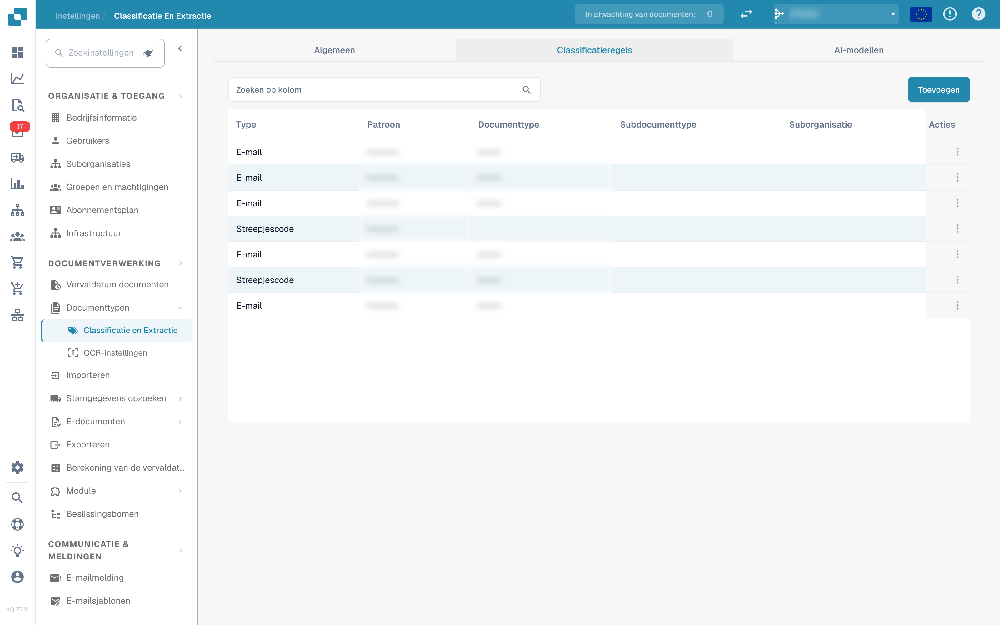<figcaption>
Tabblad «Classificatieregels» met de regeltabel
</figcaption></figure>

De tabel heeft één rij per regel met deze kolommen:

* **Type** – waar het patroon wordt toegepast. Er zijn twee typen: **Barcode** en **E-mail**.
* **Patroon** – de voor de regel opgeslagen reguliere expressie.
* **Documenttype** – het documenttype dat bij een treffer wordt toegewezen.
* **Subdocumenttype** – het subdocumenttype dat bij een treffer wordt toegewezen.
* **Suborganisatie** – de suborganisatie waartoe de regel beperkt is. Leeg betekent dat de regel voor alle suborganisaties geldt.
* **Acties** – het rijmenu met *Bewerking* en *Verwijderen*.

Het zoekveld boven de tabel filtert alle kolommen, inclusief de weergegeven labels van de keuzelijstkolommen.

### Een classificatieregel toevoegen

1.  Klik boven de tabel op **Toevoegen**.

    <figure>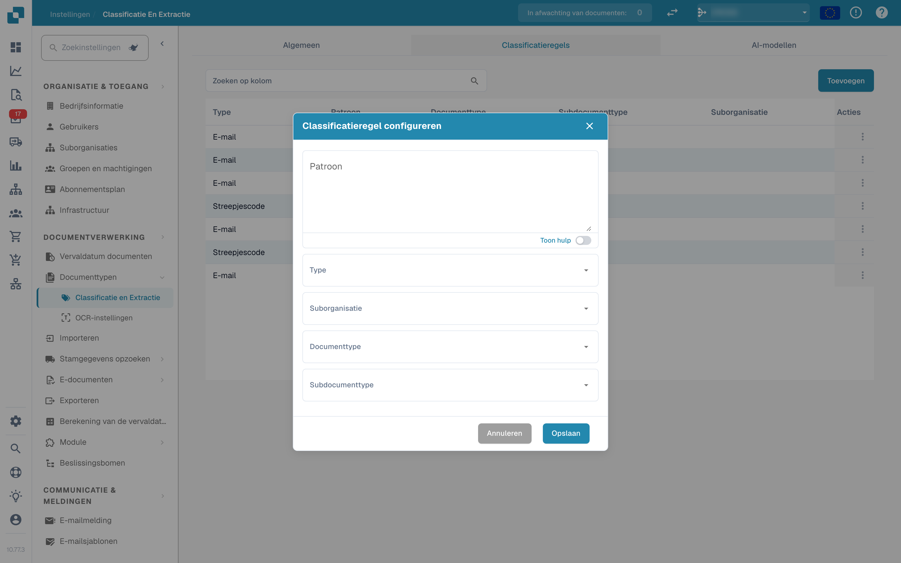<figcaption>
Venster «Classificatieregel configureren»
</figcaption></figure>
2. Vul de velden in:
   * **Patroon** (verplicht) – de reguliere expressie waarnaar de regel zoekt.
   * **Type** (verplicht) – **Barcode** of **E-mail**. Dit bepaalt tegen welke bronnaam het patroon wordt vergeleken.
   * **Suborganisatie** *(optioneel)* – beperkt de regel tot één suborganisatie.
   * **Documenttype** – het documenttype dat bij een treffer wordt toegewezen.
   * **Subdocumenttype** *(optioneel)* – een specifieker type; de lijst hangt af van het gekozen documenttype. Het wijzigen van het documenttype wist het subdocumenttype.
3.  Klik op **Opslaan**.

Het venster valideert het patroon voordat het wordt opgeslagen. Een patroon dat al door een andere regel wordt gebruikt, wordt geweigerd met *Patroon bestaat al*; een leeg patroon wordt geweigerd met de melding voor het verplichte veld.

#### Hulp bij het patroon

De schakelaar **Toon hulp** onder het patroonveld opent een inline-referentie met de formaten van de bronnaam waartegen het patroon wordt vergeleken:

* **O365** – `Gedeelde e-mail + map › Gedeelde e-mail › Map › E-mail › ID`
* **Gmail** – `E-mail + Map › Map › E-mail › ID`

<figure>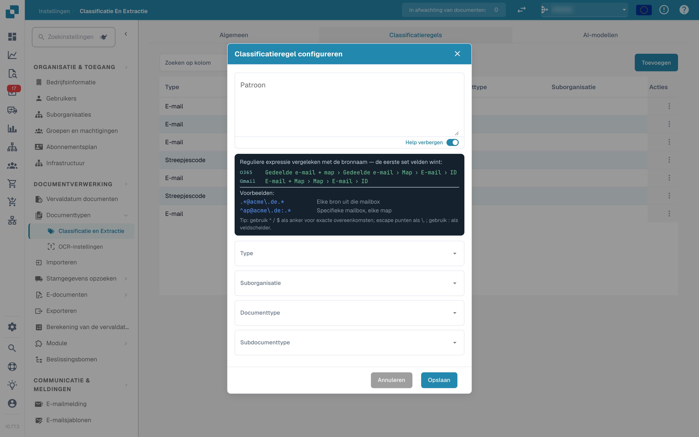<figcaption>
Help-paneel voor het patroon in het regelvenster
</figcaption></figure>

Voorbeelden in het paneel:

* `.*@acme\.de.*` – elke bron uit die mailbox
* `^ap@acme\.de:.*` – een specifieke mailbox, elke map

Tip: gebruik `^` / `$` als anker voor exacte overeenkomsten, escape punten als `\.` en gebruik `:` als veldscheider. De eerste set velden die in de bronnaam aanwezig is, wint.

Als u het type **E-mail** gebruikt, wordt het patroon vergeleken met de mailbox- en mapnamen van de geïmporteerde mail, niet met de documentinhoud.

### Een classificatieregel bewerken

1.  Klik op de drie stippen in de kolom **Acties** van de regel die u wilt wijzigen.

    <figure>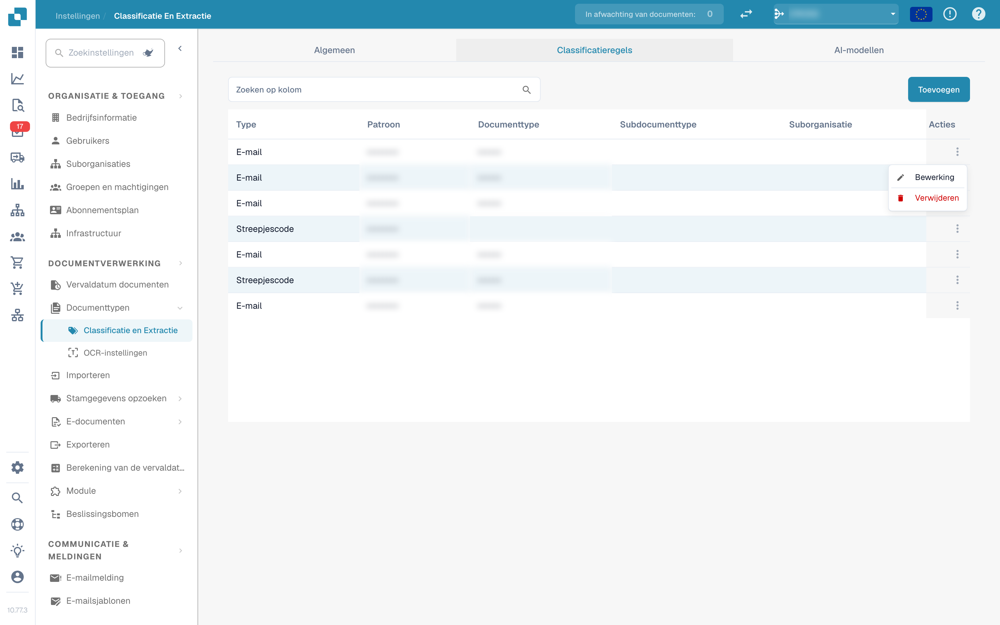<figcaption>
Rijmenu met Bewerking en Verwijderen
</figcaption></figure>
2.  Selecteer **Bewerking**. Het venster opent met de huidige waarden van de regel.

    <figure>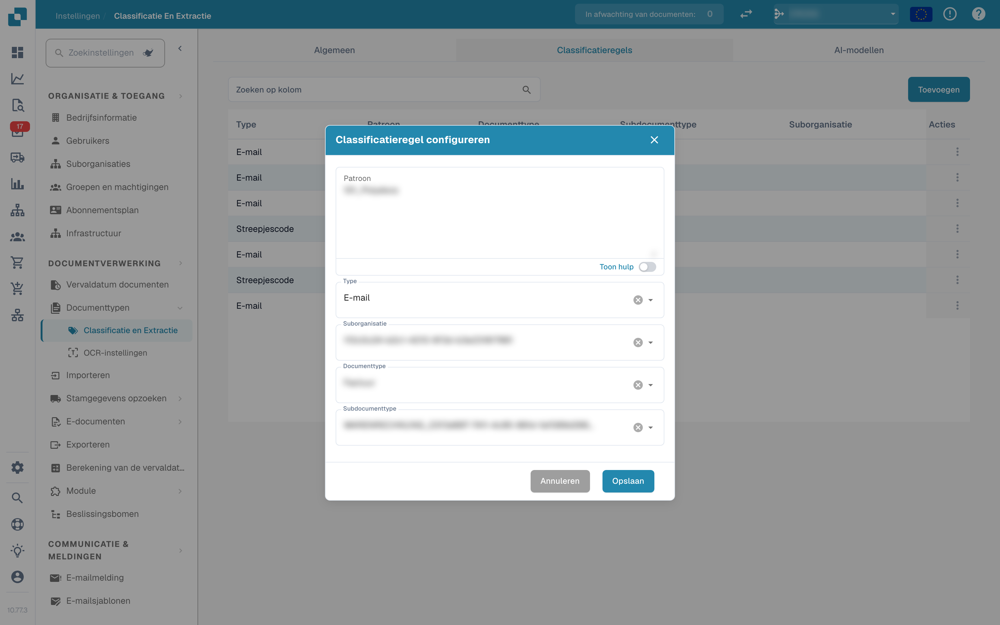<figcaption>
Een bestaande classificatieregel bewerken
</figcaption></figure>
3. Breng uw wijzigingen aan in patroon, type, suborganisatie, documenttype of subdocumenttype.
4.  Klik op **Opslaan**.

Dezelfde validatie geldt als bij het toevoegen: het patroon mag niet leeg zijn en mag het patroon van een andere regel niet dupliceren.

### Een classificatieregel verwijderen

1. Klik op de drie stippen in de kolom **Acties**.
2. Selecteer **Verwijderen**.

De regel wordt direct uit de lijst verwijderd. Het verwijderen van een regel wijzigt geen documenten die er al mee zijn geclassificeerd.

## AI-modellen

Het tabblad **AI-modellen** toont de eigen getrainde modellen die beschikbaar zijn voor documentclassificatie en hun labels. Het verschijnt alleen wanneer de module voor modellen en labels voor uw organisatie is ingeschakeld.

<figure>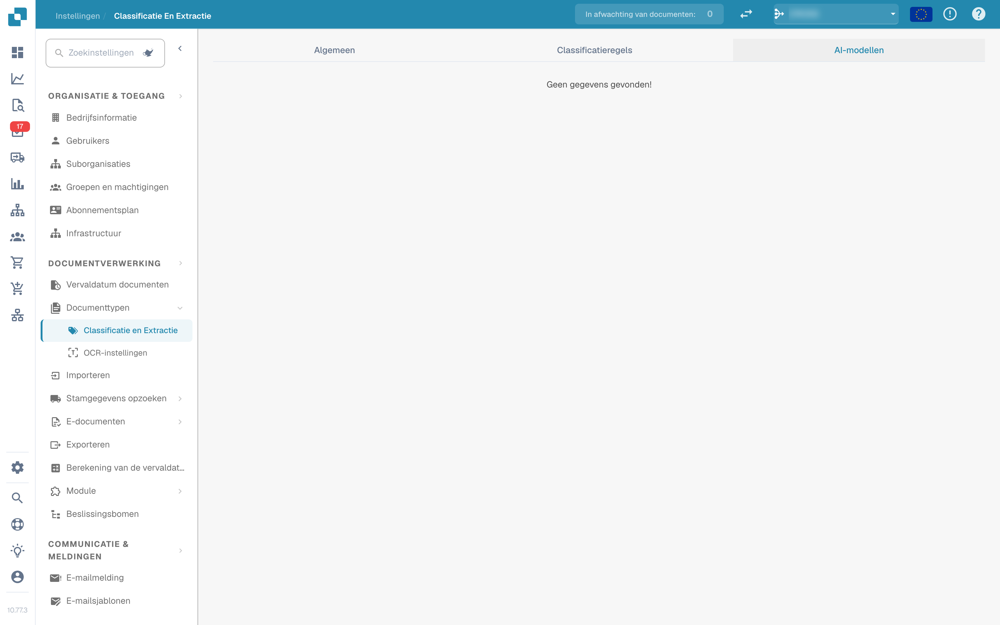<figcaption>
Tabblad «AI-modellen»
</figcaption></figure>

Is er voor de organisatie geen eigen model beschikbaar, dan toont het tabblad *Geen gegevens gevonden!*.

### Modellen

Elk model is een uitklapbaar item met:

* de **modelnaam** en de badge **Standaard** op het model dat wordt gebruikt wanneer niets anders van toepassing is.
* het aantal voor dat model getrainde **labels**.
* per model, na uitklappen: **Type**, **Alleen eerste pagina** en **Versie**.

Onder die informatie worden de labels van het model opgesomd.

### Labels

Labels zijn wat het model leert. Elk label koppelt een patroon dat het model herkent aan een documenttype.

* **Naam** – de naam van het label.
* **Volgend model** – een model dat de uitvoer van dit label verder verwerkt.
* **DOC-TYPE** – het documenttype dat het label toewijst.
* **Subdocumenttype** – een specifieker type voor het label.
* **Prioriteit** – de volgorde waarin de labels worden geëvalueerd; lagere getallen eerst.

Het zoekveld boven de labeltabel filtert de labels van het geselecteerde model.

### Een label bewerken

Klik op het potloodpictogram van een labelrij om het bewerkingsvenster te openen. Het biedt **Volgend model** en **Documenttype**; stel een van beide in, omdat het venster een volgend model of een documenttype vereist. Klik op **Opslaan** om de wijziging toe te passen.

## Gerelateerde pagina's

* [AI-model](ai-model.md) – de zes extractieniveaus en hoe een leverancier zijn eigen model krijgt
* [Automatisch belastingcode ophalen](auto-extract-tax-code.md)
* [Tabelextractie voor kostenelement](table-extraction-for-costing-element.md)
* [OCR-instellingen](../ocr-settings.md)
