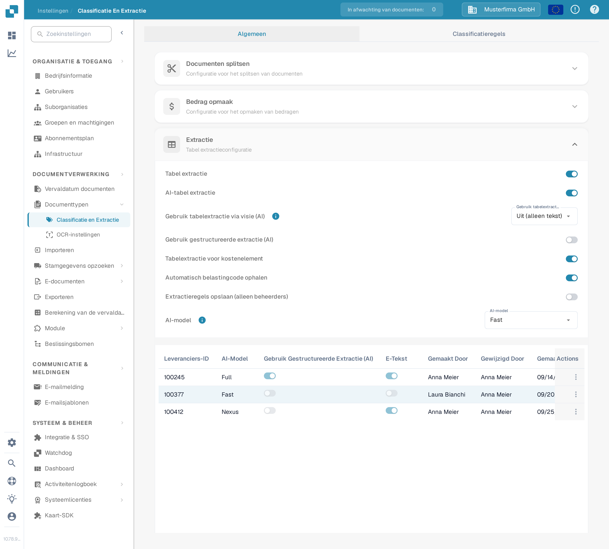
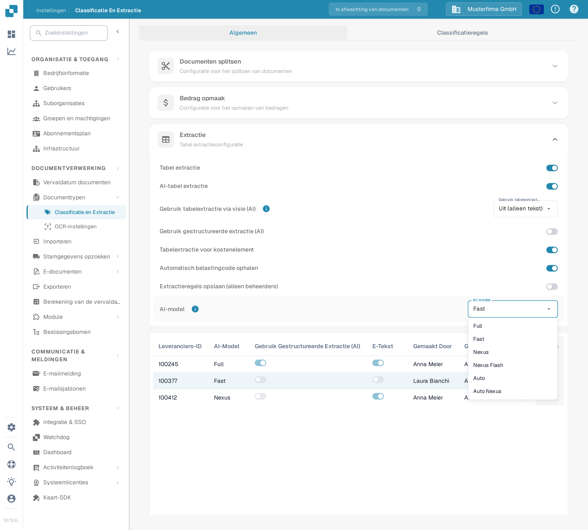
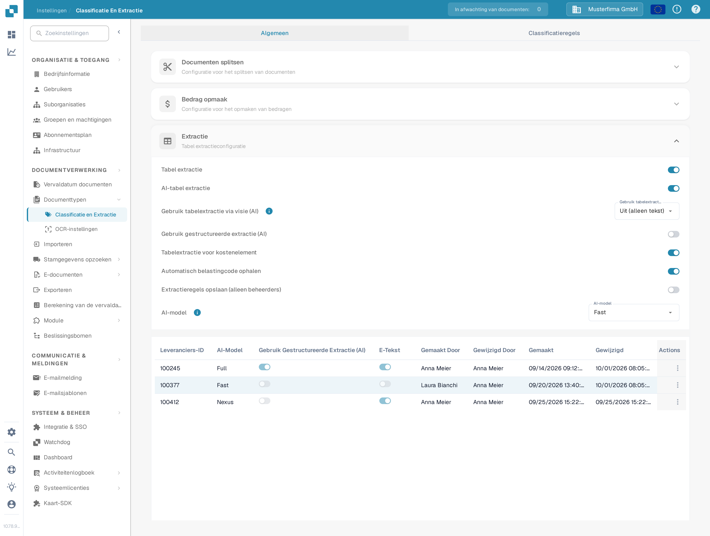
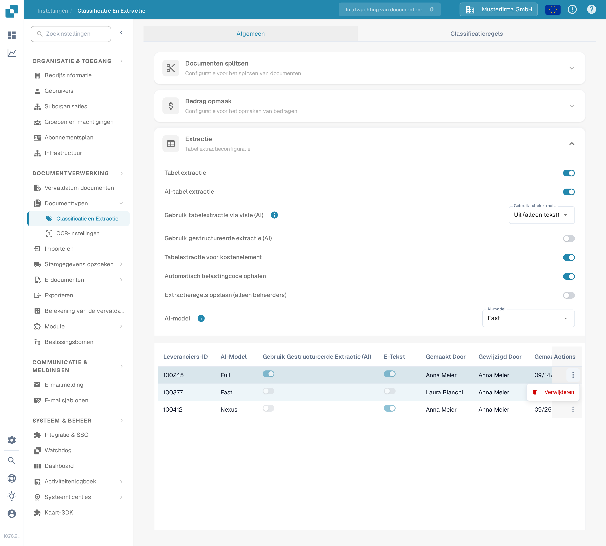
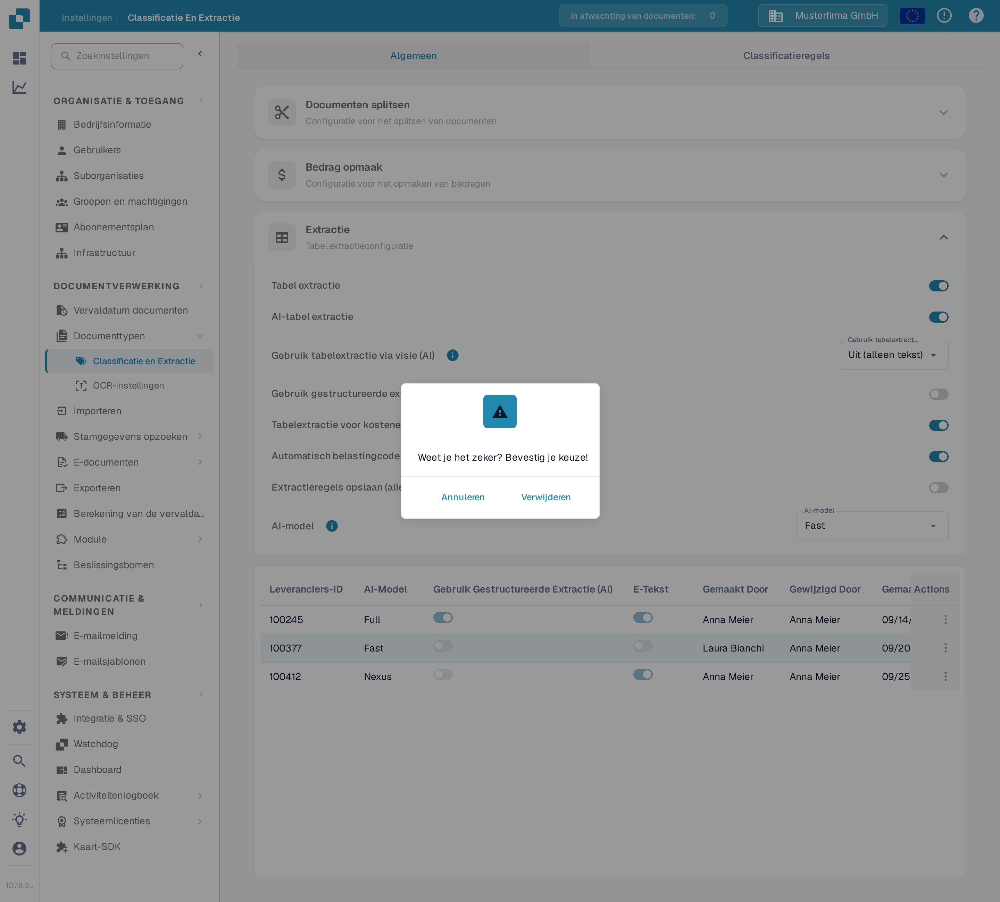

# AI-model

## Overzicht

De instelling **AI-model** stelt je in staat om te definiëren welk AI-model standaard wordt gebruikt voor **veldextractie** en **tabelextractie** tijdens documentverwerking.\
In deze sectie kun je de tokenkosten voor elk model bekijken en zien welk model momenteel aan elke leverancier is toegewezen.

## Toegang

1.  Ga naar **Instellingen** → **Documentverwerking** → **Classificatie en Extractie**

    <figure><figcaption>
Open <strong>Instellingen → Documentverwerking → Classificatie en Extractie</strong>.
</figcaption></figure>
2.  Scroll naar beneden naar de sectie **Extractie**

    <figure><figcaption>
De sectie <strong>Extractie</strong> bevat de instelling <strong>AI-model</strong> en de toewijzingstabel per leverancier.
</figcaption></figure>

## AI-model Opties

DocBits biedt zes AI-model-opties voor veld- en tabelextractie. Ze verschillen in de balans tussen **extractienauwkeurigheid**, **verwerkingssnelheid** en **tokenkosten per document** — zo kun je de optie afstemmen op het soort documenten dat je verwerkt. Beweeg over het info-icoon naast de instelling om de tokenkosten van de momenteel geselecteerde optie te zien. Als er voor een leverancier geen model is ingesteld, betekent niet ingesteld dat **Fast** wordt gebruikt.

* **Full** – De meest grondige optie, met de hoogste extractienauwkeurigheid. Het beste voor complexe lay-outs, scans van lage kwaliteit of documenten waarbij precisie het belangrijkst is. Als krachtigste optie is het ook de langzaamste, tegen **2 tokens per document**.
* **Fast** – Een evenwichtige optie die sterke nauwkeurigheid combineert met snellere verwerking tegen lagere kosten. Dit is de standaardtier: leveranciers zonder eigen AI-modelinstelling gebruiken Fast, tegen **1 token per document**.
* **Nexus** – Een optionele optie die op een andere modelfamilie draait (Qwen 3.8 Max). Nuttig wanneer je een second opinion wilt voor leveranciers waarbij Fast en Full van elkaar afwijken, of wanneer het alternatieve model een bepaalde lay-out beter leest, tegen **1 token per document**.
* **Nexus Flash** – Een snellere tier van de Nexus-familie (GLM-5.3 Flash). Verwerkt documenten sneller dan Nexus tegen dezelfde tokenkosten, tegen **1 token per document**.
* **Auto** – Geen eigen model: per document beslist DocBits of Fast volstaat of Full nodig is, zodat complexe documenten automatisch het sterkere model krijgen, tegen **1 token per document**.
* **Auto Nexus** – Zoals Auto, maar beperkt tot de Nexus-modelfamilie (Nexus Flash en Nexus). Documenten blijven volledig buiten de standaardmodelfamilie, tegen **1 token per document**.

| Optie           | Het beste voor                                                                | Nauwkeurigheid | Snelheid     | Tokenkosten  |
| --------------- | ----------------------------------------------------------------------------- | -------------- | ------------ | ------------ |
| **Full**        | Complexe lay-outs, slechte scans, behoefte aan hoge precisie                  | Hoogste        | Langzaamste  | 2 / document |
| **Fast**        | Alledaagse documenten (standaard wanneer niets is ingesteld)                  | Hoog           | Snel         | 1 / document |
| **Nexus**       | Leveranciers waarbij de alternatieve modelfamilie beter presteert (optioneel) | Hoog           | Snel         | 1 / document |
| **Nexus Flash** | Nexus-kwaliteit met snellere verwerking                                       | Hoog           | Sneller      | 1 / document |
| **Auto**        | Wisselende documentkwaliteit zonder handmatige instelling                     | Per document   | Per document | 1 / document |
| **Auto Nexus**  | Automatische beslissingen beperkt tot de Nexus-familie                        | Per document   | Per document | 1 / document |

<figure><figcaption>
De keuzelijst <strong>AI-model</strong> met de zes beschikbare opties.
</figcaption></figure>

## AI-model Toewijzingstabel

Je kunt ook leverancierspecifieke **AI-modellen** rechtstreeks in het **Validatiescherm** configureren, waarmee je de extractienauwkeurigheid voor individuele leveranciers kunt verfijnen.\
\
Voor meer informatie, raadpleeg de bijbehorende documentatie [hier](../../../../end-user-and-partner-section/end-user-section/validation-screen/supplier-specific-ai-model-for-field-and-table-extraction.md).

De toewijzingstabel toont de AI-modelinstellingen voor elke leverancier en bevat de volgende details:

* **Leveranciers-ID** – De unieke identificatie van de leverancier
* **AI-Model** – De AI-modeltier die momenteel aan de leverancier is toegewezen
* **Gebruik Gestructureerde Extractie (AI)** – Of gestructureerde extractie voor die leverancier is ingeschakeld
* **E-Tekst** – Geeft aan of de E-Text-functie is ingeschakeld
* **Gemaakt Door / Gewijzigd Door / Gemaakt / Gewijzigd** – Wie de invoer heeft ingesteld en wanneer
* **Actions** – Bevat de optie om de invoer te verwijderen

<figure><figcaption>
De toewijzingstabel toont per leverancier het tier-label, nooit de ruwe model-ID.
</figcaption></figure>

### Invoer verwijderen – Leveranciersspecifieke instellingen herstellen

Om de AI-modelinstelling van een leverancier terug te zetten naar de standaard:

1.  Klik op de drie puntjes in de kolom **Actions** naast de leveranciersinvoer en kies **Verwijderen**.

    <figure><figcaption>
Open het rijactiemenu en kies <strong>Verwijderen</strong>.
</figcaption></figure>
2.  Er verschijnt een bevestigingsdialoog—bevestig dat je de invoer wilt verwijderen.

    <figure><figcaption>
Bevestig de verwijdering in de dialoog.
</figcaption></figure>

Zodra de invoer is verwijderd, valt de leverancier terug op het standaard **AI-model** voor **veldextractie** en **tabelextractie**.
