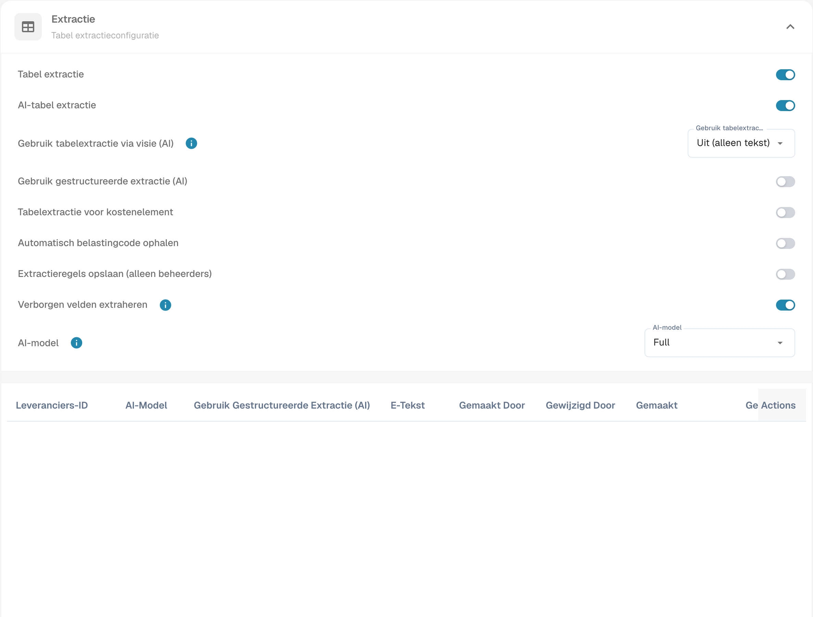

# De belastingcode automatisch uitlezen

Open de classificatie- en extractie-instellingen van het documenttype en zoek de automatische extractie van de belastingcode. Controleer de bedoelde configuratie voordat u de functie inschakelt en opslaat.

<figure><figcaption>
Instellingen voor automatische extractie van de belastingcode.
</figcaption></figure>

Als de functie actief is en een belastingcodeveld is geconfigureerd, kan DocBits dit tijdens validatie automatisch invullen. Vergelijk de gevonden code met het document en de ERP-configuratie. De afbeelding toont de instellingen en bewijst geen gecontroleerde belastingextractie. De tabel behoudt de technische codes en regels uit het integratievoorbeeld; controleer de waarden voor uw eigen organisatie.

<table data-full-width="true"><thead><tr><th>Factuurdocumenttype</th><th></th><th>Belastingcode</th><th>Of in tekstveld</th><th>Inkoopordernummer</th><th>Land van leverancier</th><th>Regel</th></tr></thead><tbody><tr><td>Kostenfactuur</td><td>Met belastingbedrag</td><td>NAGDH</td><td>LD + % (afgerond naar het hoogste absolute bedrag)</td><td>Leeg</td><td>De eerste twee tekens van het belastingnummer  of het land van het leveranciersadres: tccom120.cadr → tccom130.cadr, veld tcom130.ccty</td><td>Als het land gelijk is aan het bedrijfsland</td></tr><tr><td>Kostenfactuur</td><td>Zonder belastingbedrag</td><td>NAGD0</td><td>LD + % (afgerond naar het hoogste absolute bedrag)</td><td>Leeg</td><td>De eerste twee tekens van het belastingnummer  of het land van het leveranciersadres: tccom120.cadr → tccom130.cadr, veld tcom130.ccty</td><td>Als het land gelijk is aan het bedrijfsland</td></tr><tr><td>Kostenfactuur</td><td>Zonder belastingbedrag</td><td>EUDH</td><td>ED 0 %</td><td>Leeg</td><td>De eerste twee tekens van het belastingnummer  of het land van het leveranciersadres: tccom120.cadr → tccom130.cadr, veld tcom130.ccty</td><td>Als het land verschilt van het bedrijfsland en een EU-land is in de landentabel (tcmcs010)</td></tr><tr><td>Orderfactuur</td><td>Met belastingbedrag</td><td>NAHGH</td><td>IG + % (afgerond naar het hoogste absolute bedrag)</td><td>Niet leeg</td><td>De eerste twee tekens van het belastingnummer  of het land van het leveranciersadres: tccom120.cadr → tccom130.cadr, veld tcom130.ccty</td><td>Als het land gelijk is aan het bedrijfsland</td></tr><tr><td>Orderfactuur</td><td>Zonder belastingbedrag</td><td>NAHG0</td><td>IG + % (afgerond naar het hoogste absolute bedrag)</td><td>Niet leeg</td><td>De eerste twee tekens van het belastingnummer  of het land van het leveranciersadres: tccom120.cadr → tccom130.cadr, veld tcom130.ccty</td><td>Als het land gelijk is aan het bedrijfsland</td></tr><tr><td>Orderfactuur</td><td>Met belastingbedrag</td><td>EUGH</td><td>ED 0 %</td><td>Niet leeg</td><td>De eerste twee tekens van het belastingnummer  of het land van het leveranciersadres: tccom120.cadr → tccom130.cadr, veld tcom130.ccty</td><td>Als het land verschilt van het bedrijfsland en een EU-land is in de landentabel (tcmcs010)</td></tr><tr><td>Kostenfactuur</td><td>Zonder belastingbedrag</td><td>IMGD</td><td>ID 0 %</td><td>Leeg</td><td>De eerste twee tekens van het belastingnummer  of het land van het leveranciersadres: tccom120.cadr → tccom130.cadr, veld tcom130.ccty</td><td>Als het land verschilt van het bedrijfsland en geen EU-lid is in de landentabel (tcmcs010)</td></tr><tr><td>Orderfactuur</td><td>Met belastingbedrag</td><td>IMHG</td><td>IG 0 %</td><td>Niet leeg</td><td>De eerste twee tekens van het belastingnummer  of het land van het leveranciersadres: tccom120.cadr → tccom130.cadr, veld tcom130.ccty</td><td>Als het land verschilt van het bedrijfsland en geen EU-lid is in de landentabel (tcmcs010)</td></tr></tbody></table>
