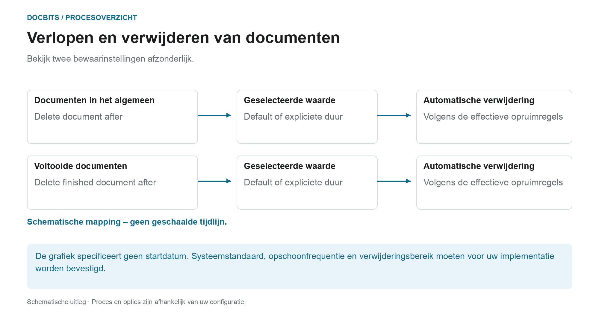
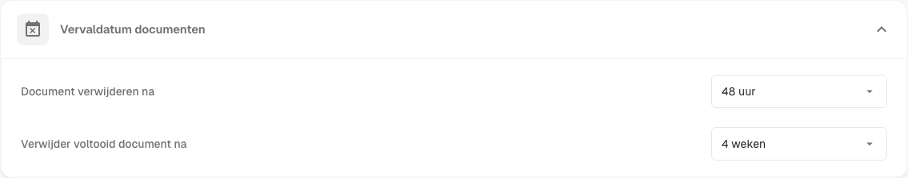
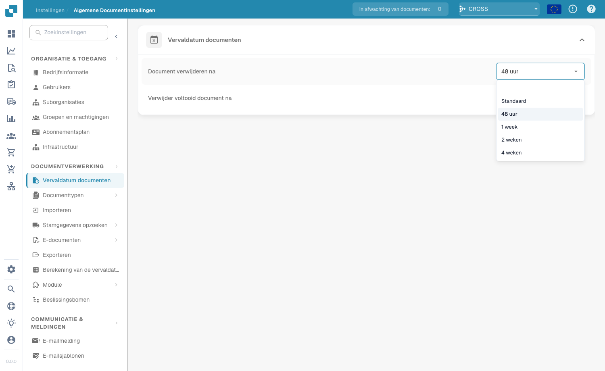

# Verloop van documenten

## Twee bewaarregels in plaats van een algemene verwijderingstermijn

<figure><figcaption>
Bekijk twee bewaarinstellingen afzonderlijk. Het diagram is schematisch; de actieve instellingen van uw organisatie bepalen het daadwerkelijke gedrag.
</figcaption></figure>

Bij het verlopen van documenten wordt onderscheid gemaakt tussen de algemene bewaring van documenten en de bewaring van voltooide documenten. Controleer beide instellingen samen met de vereisten van uw proces en het beoogde doelarchief.

| Instelling | Wat u moet verduidelijken |
| --- | --- |
| **Delete document after** | Welke documentretentiewaarde is daadwerkelijk effectief in uw organisatie? |
| **Delete finished document after** | Welke waarde geldt voor voltooide, volledig verwerkte en geëxporteerde documenten. |
| **Default** | Welke systeemstandaard is opgeslagen in uw implementatie. De naam alleen geeft niet de duur aan. |

Het diagram is **geen tijdlijn op schaal**. Er wordt niet gespecificeerd wat de technische start van de bewaartermijn is, noch welke instelling voorrang heeft. Met een dropdown-waarde alleen wordt geen verwijderingstijd tot op de seconde nauwkeurig vastgesteld. Voor een betrouwbare planning moet u ook bevestigen hoe vaak de opschoning wordt uitgevoerd.

### Afzonderlijke export, retentie en back-ups

Een succesvolle export bewijst niet dat de DocBits-kopie al is verwijderd. Omgekeerd verwijdert het verwijderen van een document in DocBits niet een onafhankelijk opgeslagen ERP of archiefkopie. Voor back-ups kunnen afzonderlijke bewaarregels gelden; het verwijderen van een document uit het livesysteem bewijst niet dat elke back-upkopie tegelijkertijd is verwijderd.

Controleer de deadlines voordat u wijzigingen doorvoert en maak afspraken over het doelarchief en de afhandeling van back-ups. In het [Gegevensopslag, retentie en verwijdering](../../../security/data-storage-and-retention.md)-overzicht worden de verschillen uitgelegd tussen documenten, OCR tussenbestanden, logs en back-ups.

<figure><figcaption>
Instellingen voor het verlopen van documenten
</figcaption></figure>

Onder Documentverwerking → Documenten verlopen, configureert u het bewaren van documenten. Controleer de effectieve instellingen, het doelarchief en het verwijderingsbereik voor uw organisatie voordat u deze wijzigt.

Twee instellingen bepalen de automatische verwijdering:

| Instelling | Wat het bepaalt |
|------------|-----------------|
| **Document verwijderen na** | Hoe lang een verwerkt document wordt bewaard voordat het automatisch wordt verwijderd. |
| **Voltooid document verwijderen na** | Hoe lang een voltooid (volledig verwerkt en geëxporteerd) document wordt bewaard voordat het automatisch wordt verwijderd. |

Voor elke instelling kiest u een periode in de vervolgkeuzelijst:

<figure><figcaption>
Beschikbare bewaarperiodes
</figcaption></figure>

| Optie | Betekenis |
|-------|-----------|
| **Standaard** | De standaard bewaarperiode van het systeem gebruiken (geen aangepaste overschrijving). |
| **48 uur** | Expliciete retentiewaarde van 48 uur; bevestig de start van de periode en het opruimschema afzonderlijk. |
| **1 week** | Expliciete retentiewaarde van één week. |
| **2 weken** | Expliciete retentiewaarde van twee weken. |
| **4 weken** | Expliciete retentiewaarde van vier weken. |

Deze instellingen ondersteunen het gepland bewaren van documenten. Ze vervangen niet het bevestigen van de effectieve bewaartermijnen, het doelarchief en de behandeling van back-ups voor uw organisatie.
