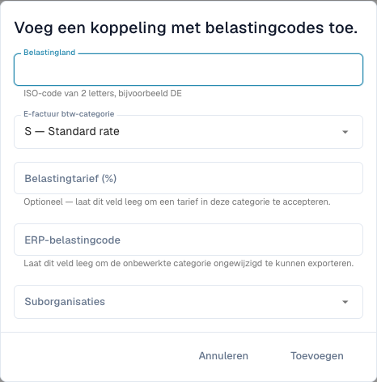

# Btw-categorieën van e-facturen aan ERP-belastingcodes koppelen

<figure><figcaption>
Belastingcodemapping voordat een regel wordt opgeslagen. Sommige categorieomschrijvingen blijven in de huidige interface Engels; de technische codes blijven gelijk.
</figcaption></figure>

Een e-factuur kan een btw-categorie zoals **S** bevatten in plaats van de ERP-belastingcode. De mapping bepaalt de omzetting. Dit staat los van belastingbedragen aanpassen en validatieregels wijzigen.

## Voorwaarden

Nodig zijn beheerdersrechten, belastingland, categorie en tarief van de factuur en een geldige code afgesproken met de ERP-beheerder. Controleer organisatie en suborganisatie. De pagina moet in uw versie beschikbaar zijn.

## Toevoegen en controleren

1. Open **Instellingen → Elektronische documenten → Belastingcodemapping** en bekijk bestaande regels.
2. Kies het toevoegen van een mapping.
3. Voer het belastingland in als ISO-code van twee letters, bijvoorbeeld `DE`.
4. Kies de categorie: **S** standaardtarief, **Z** nultarief, **E** vrijgesteld of **O** buiten de belastingheffing. Wissel ze niet om een fout te omzeilen.
5. Voer een percentage in voor een specifiek tarief. Leeg betekent elk tarief van die categorie, zoals het formulier aangeeft.
6. Vul ERP-code en relevante suborganisaties in. Een lege ERP-code staat expliciet toe de oorspronkelijke categorie ongewijzigd te exporteren; gebruik dit alleen als het doel die accepteert.
7. Voeg toe en controleer opgeslagen land, categorie, tarief, code, bereik en actieve status.
8. Test een passende e-factuur met een gecontroleerd exportdoel. Controleer werkelijke ERP-code en antwoord, plus een onjuiste/ontbrekende mapping als foutgeval.

Een Duitse factuur met `S` en tarief `19` vereist de daarvoor ingestelde ERP-code. Haal de echte code uit uw ERP; een voorbeeld is geen productiestandaard.

## Een fout oplossen

Vergelijk land, categorie, tarief, bereik en activering. Controleer het integratieantwoord voordat u een export met onzeker resultaat herhaalt. Verwijderen verandert toekomstige verwerking, maar draait eerdere exports niet terug.

Zie [Validatie van e-facturen](validation-rules.md) en [Export](../export.md).
