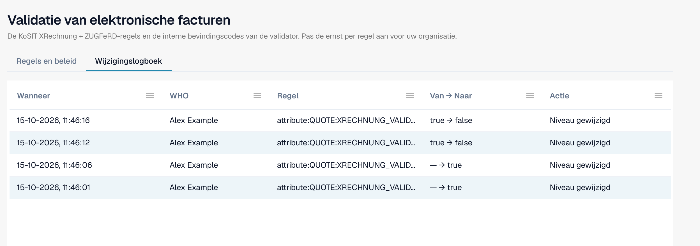

# Wijzigingslogboek

Het **Wijzigingslogboek** legt elke wijziging van de validatie-instellingen vast. Het hoort bij [Validatie van elektronische facturen](validation-rules.md). Alleen organisatiebeheerders kunnen het zien.

Open het tabblad **Wijzigingslogboek** naast **Regels en beleid**.

<figure><figcaption>
Het wijzigingslogboek met vier voorbeeldvermeldingen. De gebruikersnaam is vervangen door een voorbeeldnaam.
</figcaption></figure>

| Kolom | Wat ze toont |
| --- | --- |
| **Wanneer** | Het tijdstip van de wijziging. |
| **WHO** | De gebruiker die de wijziging heeft gemaakt. |
| **Regel** | De instelling of regel die is gewijzigd. |
| **Van → Naar** | De oude en de nieuwe waarde. |
| **Actie** | Het soort wijziging. Rijen van de installatiewizard kunt u openen om de afzonderlijke wijzigingen te zien. |

De lijst toont 50 vermeldingen per pagina.

Elke wijziging in de tabel [Validatie voor elk documenttype](validation-per-document-type.md) maakt een vermelding aan nadat u ze hebt bevestigd.
