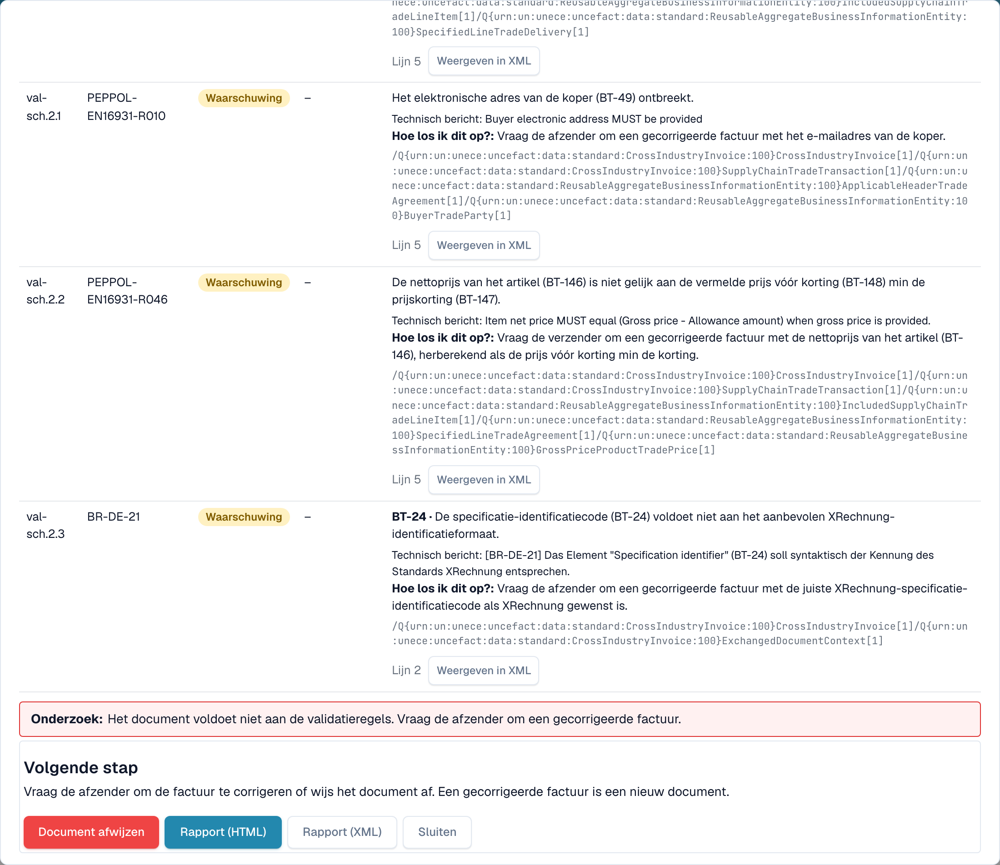
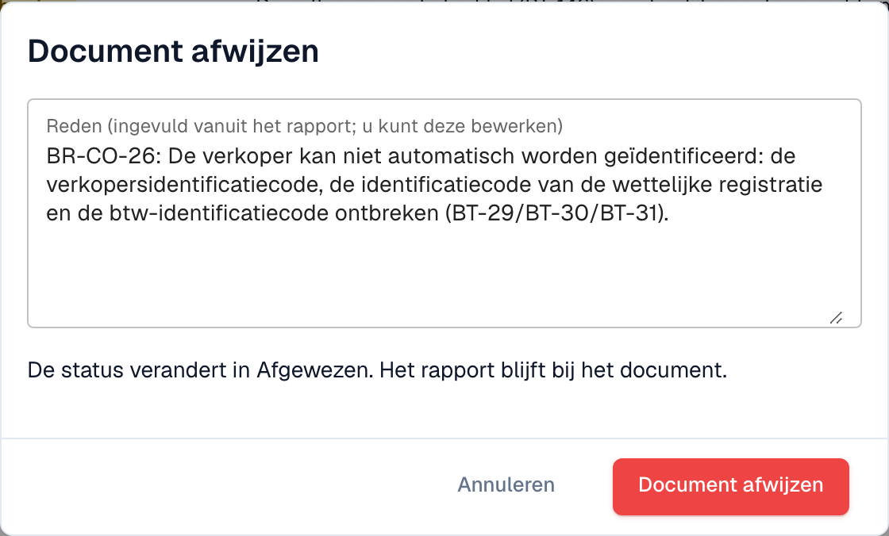

# Volgende stap en een document afwijzen

Nadat u het [validatierapport](validation-report.md) hebt gelezen, vertelt het rapport u wat u moet doen. U kunt het document ook afwijzen.

## Wat u hierna doet

<figure><figcaption>
De beoordeling, de volgende stap en de knoppen aan het einde van het rapport
</figcaption></figure>

Het blok **Onderzoek** zegt in één zin of de factuur conform is. Het blok **Volgende stap** vertelt u wat u moet doen:

| Resultaat | Volgende stap |
| --- | --- |
| Minstens één **fout** | Vraag de afzender om een gecorrigeerde factuur, of wijs het document af. Een gecorrigeerde factuur is een nieuw document. |
| Alleen **waarschuwingen** | U kunt met het document doorgaan. |

De knoppen aan het einde van het rapport:

* **Document afwijzen**: opent het dialoogvenster om af te wijzen (zie hieronder).
* **Rapport (HTML)** en **Rapport (XML)**: download het rapport, bijvoorbeeld om het naar de leverancier te sturen.
* **Sluiten**: keer terug naar het document.

## Een document afwijzen

<figure><figcaption>
De reden wordt ingevuld vanuit de fouten in het rapport. U kunt ze bewerken.
</figcaption></figure>

1. Selecteer in het rapport **Document afwijzen**.
2. Controleer de **Reden**. DocBits vult ze in vanuit de fouten in het rapport. U kunt de tekst bewerken.
3. Selecteer **Document afwijzen** om te bevestigen. De status verandert in **Afgewezen**. De reden wordt als notitie opgeslagen en het rapport blijft bij het document.

Selecteer **Annuleren** om het document ongewijzigd te laten.

> Alleen gebruikers die documenten mogen bewerken, zien **Document afwijzen**. De knop is verborgen wanneer het document al is afgewezen of voltooid.
