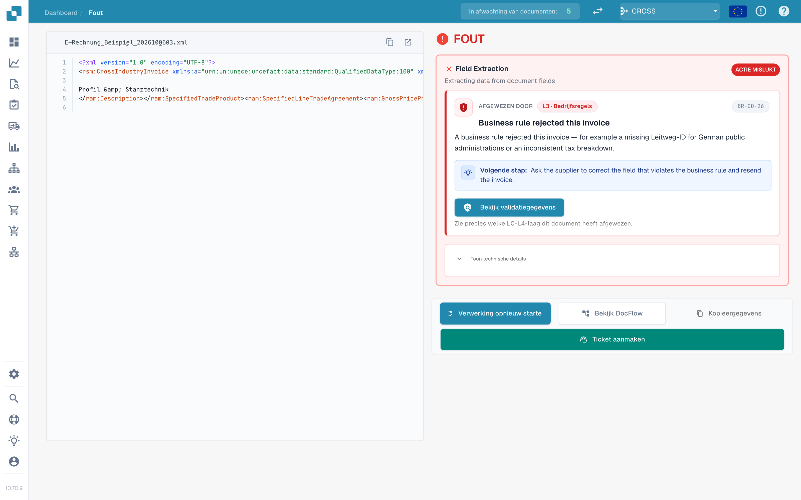
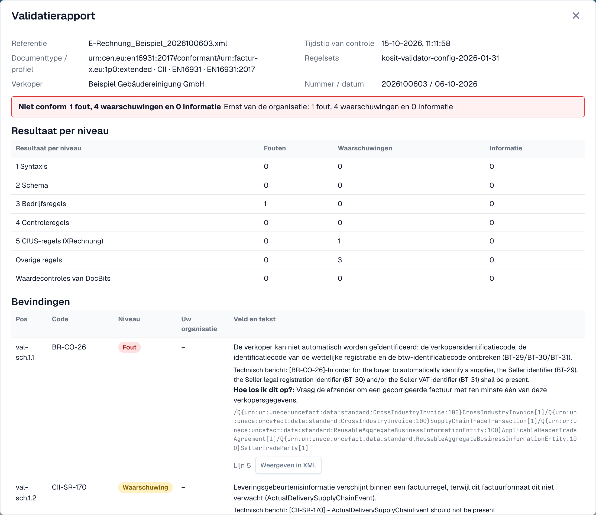
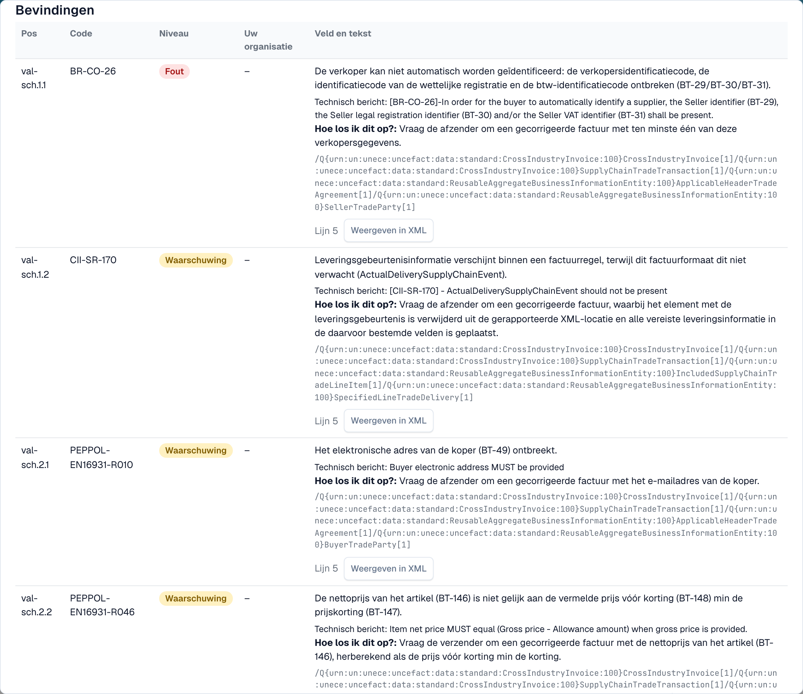

# Validatierapport

Wanneer DocBits een e-factuur afwijst, kunt u precies lezen waarom. Het **validatierapport** toont elke bevinding in begrijpelijke taal, vertelt u wat u moet herstellen en toont de volgende stap. U opent het vanuit het document, niet vanuit de instellingen. Het scherm waar u het vindt, wordt beschreven in [Het foutscherm voor een afgewezen e-factuur](validation-error-screen.md).

Deze pagina is bedoeld voor mensen die facturen verwerken. Beheerders stellen de regels in op de pagina [Validatie van elektronische facturen](validation-rules.md) en kiezen per documenttype of een mislukte controle de factuur blokkeert, zie [Validatie voor elk documenttype](validation-per-document-type.md).

## Wanneer een document een fout krijgt

Als validatie **aan** staat en **blokkeert** voor het documenttype, krijgt een factuur met een blokkerende bevinding de status **Fout**. Open het document vanuit het dashboard. De foutweergave toont links de XML en rechts de reden.

<figure><figcaption>
De foutweergave: de XML van de factuur en de eerste blokkerende bevinding met een volgende stap. Voorbeeldfactuur met fictieve namen.
</figcaption></figure>

De kaart rechts noemt de laag die de factuur heeft afgewezen (bijvoorbeeld **L3 · Bedrijfsregels**), de regelcode (bijvoorbeeld `BR-CO-26`), een korte uitleg en een **Volgende stap**. Selecteer **Bekijk validatiegegevens** om het volledige rapport te openen.

## Het rapport lezen

<figure><figcaption>
De bovenkant van het rapport: bestandsgegevens, het oordeel en het resultaat per niveau
</figcaption></figure>

Het rapport begint met de feiten over het bestand:

| Veld | Wat het toont |
| --- | --- |
| **Referentie** | De bestandsnaam van de factuur. |
| **Tijdstip van controle** | Wanneer DocBits de controle heeft uitgevoerd. Een opgeslagen rapport verandert later niet meer. |
| **Documenttype / profiel** | Het formaat van de factuur, bijvoorbeeld CII en EN 16931. |
| **Regelsets** | De versie van de regelsets die DocBits heeft gebruikt. |
| **Verkoper** | De verkoper, gelezen uit de XML. |
| **Nummer / datum** | Het factuurnummer en de factuurdatum, gelezen uit de XML. |

Onder de bestandsgegevens ziet u het **oordeel**, bijvoorbeeld **Niet conform**, met het aantal fouten, waarschuwingen en informatieve meldingen. Als uw organisatie de ernst van een regel heeft gewijzigd, toont een tweede regel **Ernst van de organisatie** de aantallen volgens de instellingen van uw organisatie.

### Resultaat per niveau

De tabel **Resultaat per niveau** toont hoeveel fouten, waarschuwingen en informatieve meldingen elke controle heeft gevonden. De controles bouwen op elkaar voort:

| Niveau | Wat het controleert |
| --- | --- |
| **1 Syntaxis** | De XML is goed gevormd. |
| **2 Schema** | De structuur volgt het officiële XML-schema. |
| **3 Bedrijfsregels** | Verplichte velden zijn aanwezig en correct (regels `BR-…`). |
| **4 Controleregels** | Velden komen met elkaar overeen, bijvoorbeeld bedragen. |
| **5 CIUS-regels (XRechnung)** | De aanvullende Duitse XRechnung-regels. |
| **Overige regels** | Andere regels, bijvoorbeeld de PEPPOL-regels. |
| **Waardecontroles van DocBits** | Controles die DocBits toevoegt, bijvoorbeeld IBAN en btw-nummer. |

> Bij facturen met het profiel EN 16931 of EXTENDED worden de XRechnung-specifieke regels getoond als **waarschuwingen**, niet als fouten.

## De bevindingen

<figure><figcaption>
Elke bevinding heeft een code, een niveau, een leesbare tekst en een tip om het op te lossen
</figcaption></figure>

Elke bevinding is één rij:

* **Pos** en **Code**: de positie in het rapport en de regelcode, bijvoorbeeld `BR-CO-26`.
* **Niveau**: **Fout**, **Waarschuwing** of **Informatie**.
* **Uw organisatie**: het niveau volgens de instellingen van uw organisatie. Een streepje betekent dat uw organisatie het niveau niet heeft gewijzigd.
* **Veld en tekst**: het probleem in begrijpelijke taal, het veld waar het om gaat (bijvoorbeeld *BT-29 Verkopersidentificatiecode*), het technische bericht van de validator en **Hoe los ik dit op?**.
* **Lijn** en **Weergeven in XML**: selecteer **Weergeven in XML** om het rapport te sluiten en naar de regel in de XML-viewer te springen.

DocBits heeft teksten in begrijpelijke taal voor de meest voorkomende regels. Voor een regel zonder zo'n tekst toont het rapport het technische bericht van de validator.

## Volgende

* [Volgende stap en een document afwijzen](validation-next-step-and-reject.md): wat u doet nadat u het rapport hebt gelezen.

## Gerelateerde pagina's

* [Validatie van elektronische facturen](validation-rules.md): geaccepteerde versies, profielen en de ernst van elke regel.
* [Validatie voor elk documenttype](validation-per-document-type.md): validatie inschakelen en blokkeren instellen.
* [Notificatierouting](notification-routing.md): wie welke bevinding afhandelt.
