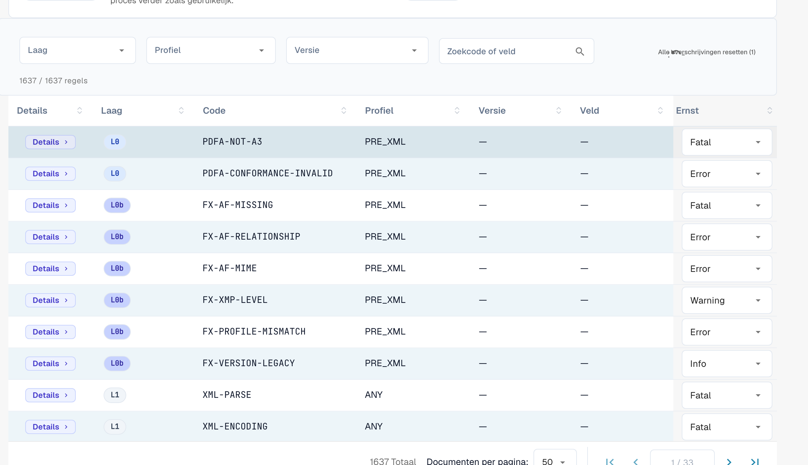

# Ernst van regels

Elke validatieregel heeft een ernst. U kunt de ernst van elke regel voor uw organisatie wijzigen. Deze pagina hoort bij [Validatie van elektronische facturen](validation-rules.md). Alleen organisatiebeheerders kunnen de ernst wijzigen.

<figure><figcaption>
De volledige regeltabel met ernst-overschrijving per regel
</figcaption></figure>

De regeltabel somt elke validatieregel op (in totaal meer dan 1.600). Filter op **Laag (Layer)**, **Profiel** of **Versie**, of zoek op code of veld. Voor elke regel kunt u de **Ernst** in de vervolgkeuzelijst overschrijven om ze af te stemmen op het beleid van uw organisatie — bijvoorbeeld een regel van `ERROR` naar `WARNING` verlagen zodat ze het document niet langer afwijst.

De betekenis van **FATAL**, **ERROR**, **WARNING** en **INFO** staat op [Validatie-instellingen en geaccepteerde versies](validation-setup.md#geaccepteerde-profielen-en-het-ernstmodel). Een gewijzigde ernst ziet u ook in het [validatierapport](validation-report.md) in de kolom **Uw organisatie**.
