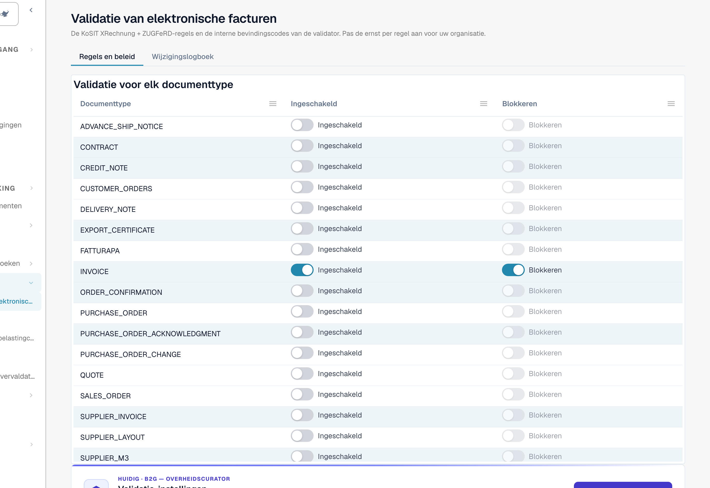

# Validatie van elektronische facturen



De pagina **Validatie van elektronische facturen** (**Instellingen → E-documenten → Validatie van elektronische facturen**, pad `/settings/einvoice-validation`; eerder _Validatieregels_ genoemd) bepaalt hoe DocBits binnenkomende e-facturen valideert. Ze is gebaseerd op de officiële **KoSIT XRechnung + ZUGFeRD**-regelset plus de interne bevindingscodes van de validator, en laat u de ernst van elke regel voor uw organisatie overschrijven.

> Deze pagina is voor **e-facturen** (XRechnung, ZUGFeRD, Factur-X). Ze is niet hetzelfde als **Datavalidatieregels**, die geëxtraheerde documentvelden controleren.

## Wat staat op deze pagina

<figure><figcaption>
De pagina Validatie van elektronische facturen. Het tabblad <strong>Regels en beleid</strong> begint met de tabel <strong>Validatie voor elk documenttype</strong>. Voorbeeldorganisatie.
</figcaption></figure>

| Onderwerp                                                                    | Wat het doet                                                                                                                                         | Wie                            |
| ---------------------------------------------------------------------------- | ---------------------------------------------------------------------------------------------------------------------------------------------------- | ------------------------------ |
| [Validatie-instellingen en geaccepteerde versies](validation-setup.md)       | De installatiewizard, de geaccepteerde XRechnung-versies, de geaccepteerde profielen en wat elke ernst betekent.                                     | Organisatiebeheerders          |
| [Ernst van regels](validation-rule-severities.md)                            | De regeltabel: wijzig de ernst van elke regel voor uw organisatie.                                                                                   | Organisatiebeheerders          |
| [Validatie voor elk documenttype](validation-per-document-type.md)           | Schakel validatie in (**Ingeschakeld**) en bepaal of een mislukte controle het document stopt (**Blokkeren**). Elke wijziging moet worden bevestigd. | Organisatiebeheerders          |
| [Wijzigingslogboek](validation-change-log.md)                                | Elke wijziging van de instellingen: wanneer, wie, welke regel, van → naar.                                                                           | Organisatiebeheerders          |
| [Het foutscherm voor een afgewezen e-factuur](validation-error-screen.md)    | Wat u ziet wanneer u een onjuiste XML uploadt: de uitleg, de foutieve regel en de volgende stap.                                                     | Iedereen die facturen verwerkt |
| [Validatierapport](validation-report.md)                                     | Wat een gebruiker ziet wanneer een factuur faalt: de bevindingen in begrijpelijke taal. Het opent vanuit het document, niet vanuit deze pagina.      | Iedereen die facturen verwerkt |
| [Volgende stap en een document afwijzen](validation-next-step-and-reject.md) | Wat u doet nadat u het rapport hebt gelezen, downloads van het rapport en **Document afwijzen**.                                                     | Iedereen die facturen verwerkt |
