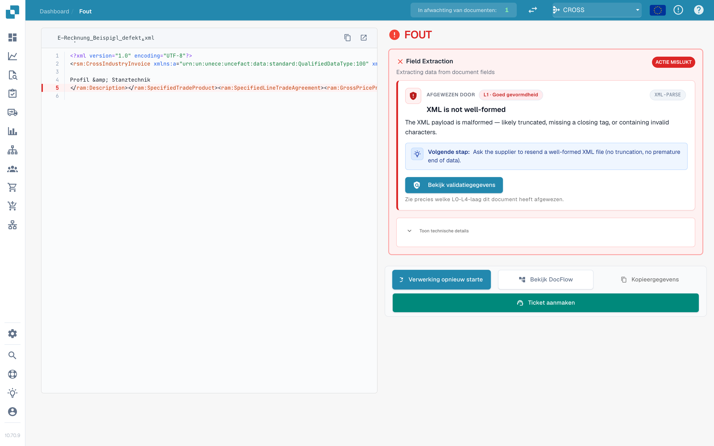
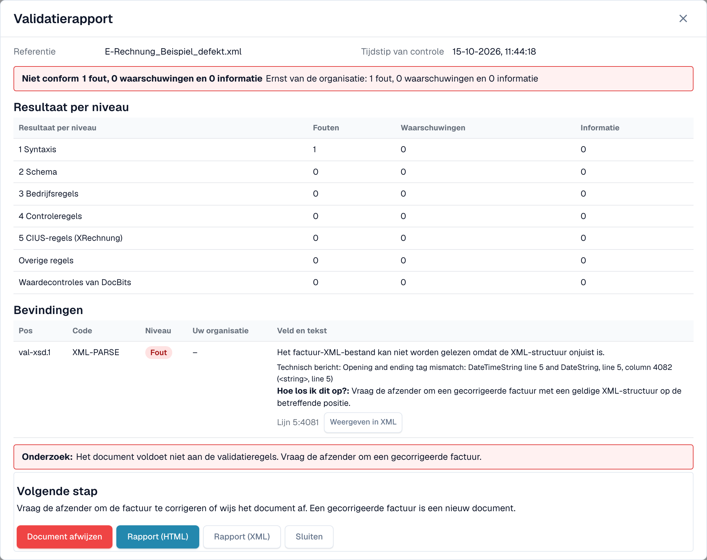

# Het foutscherm voor een afgewezen e-factuur

Wanneer u een onjuiste e-factuur uploadt, raakt DocBits die niet kwijt. Het document krijgt de status **Fout** en het foutscherm vertelt u wat er mis is, waar en wat u daarna kunt doen. Deze pagina toont twee voorbeelden: een XML-bestand dat niet goed gevormd is en een factuur die een bedrijfsregel schendt.

> Een factuur krijgt alleen de status **Fout** wanneer validatie **aan** staat en **blokkeert** voor het documenttype. Zie [Validatie voor elk documenttype](validation-per-document-type.md).

## Voorbeeld 1: het XML-bestand is beschadigd

Een leverancier stuurt een XML-bestand waarin een sluittag niet overeenkomt met de openingstag. Het bestand kan niet worden gelezen, dus DocBits stopt bij de eerste controle, **L1 · Goed gevormdheid**.

<figure><figcaption>
Het foutscherm voor een beschadigd XML-bestand. De foutieve regel is gemarkeerd in de XML. Voorbeeldbestand met fictieve gegevens.
</figcaption></figure>

Het scherm heeft twee kanten:

* **Links: het XML-bestand.** DocBits toont het bestand met regelnummers. De regel met het probleem is rood gemarkeerd. Met de knoppen boven het bestand kopieert u de XML of opent u die in een nieuw tabblad.
* **Rechts: de uitleg.** De kaart **Afgewezen door** noemt de controle die het bestand heeft gestopt (hier **L1 · Goed gevormdheid**) en de regelcode (hier `XML-PARSE`). Daaronder ziet u een titel (_XML is not well-formed_), een korte uitleg en het blok **Volgende stap**.

Selecteer **Bekijk validatiegegevens** om het volledige [validatierapport](validation-report.md) te openen.

<figure><figcaption>
Het rapport van het beschadigde bestand: één fout op niveau 1 Syntaxis, met het technische bericht en de positie
</figcaption></figure>

Het rapport noemt de exacte positie (hier regel 5, kolom 4081) en geeft het technische bericht van de XML-parser. Selecteer **Weergeven in XML** om naar die regel te springen. De hint **Hoe los ik dit op?** zegt dat u de afzender om een gecorrigeerd bestand moet vragen.

## Voorbeeld 2: de factuur schendt een bedrijfsregel

De XML is in orde, maar een verplicht veld ontbreekt. De verkoper kan bijvoorbeeld niet worden geïdentificeerd omdat er geen verkopersidentificatie, registratie-identificatie of btw-identificatie aanwezig is (regel `BR-CO-26`).

<figure><figcaption>
Het foutscherm voor een fout in een bedrijfsregel: de laag <strong>L3 · Bedrijfsregels</strong>, de regelcode en een volgende stap
</figcaption></figure>

Hier noemt de kaart de laag **L3 · Bedrijfsregels** en de code `BR-CO-26`. Het rapport toont alle bevindingen van de factuur, zie [Validatierapport](validation-report.md).

## De knoppen onder de kaart

| Knop                          | Wat hij doet                                                                                                                                        |
| ----------------------------- | --------------------------------------------------------------------------------------------------------------------------------------------------- |
| **Verwerking opnieuw starte** | Voert de verwerking van het document opnieuw uit, bijvoorbeeld nadat u een instelling hebt gewijzigd. De controle gebruikt de huidige instellingen. |
| **Bekijk DocFlow**            | Toont de workflow van het document.                                                                                                                 |
| **Kopieergegevens**           | Kopieert de foutgegevens, bijvoorbeeld voor een bericht aan uw beheerder.                                                                           |
| **Ticket aanmaken**           | Opent een supportticket met de foutgegevens.                                                                                                        |

Selecteer **Toon technische details** op de kaart voor de ruwe technische informatie.

## Wat u daarna doet

* **Fouten:** vraag de afzender om een gecorrigeerde factuur, of [wijs het document af](validation-next-step-and-reject.md). Een gecorrigeerde factuur is een nieuw document.
* **Alleen waarschuwingen:** het document wordt niet geblokkeerd. U kunt doorgaan.

## Gerelateerde pagina's

* [Validatierapport](validation-report.md): alle bevindingen, niveau voor niveau.
* [Volgende stap en een document afwijzen](validation-next-step-and-reject.md)
* [Validatie voor elk documenttype](validation-per-document-type.md): schakel validatie in en stel blokkeren in.
