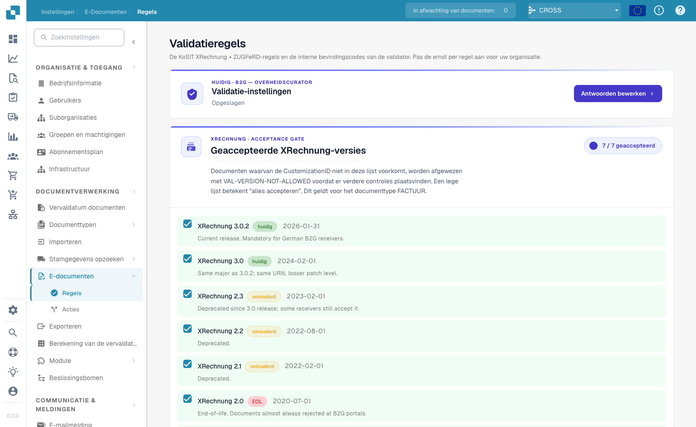
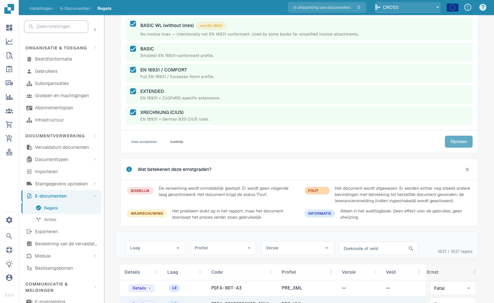

# Validatie-instellingen en geaccepteerde versies

Op deze pagina leest u over de installatiewizard, de geaccepteerde XRechnung-versies en de geaccepteerde profielen van de pagina [Validatie van elektronische facturen](validation-rules.md). Alleen organisatiebeheerders kunnen deze instellingen wijzigen.

## Validatie-instellingen

<figure><figcaption>
Validatie-instellingen en geaccepteerde XRechnung-versies
</figcaption></figure>

De kaart **Validatie-instellingen** toont uw huidige validatieprofiel (bijvoorbeeld *B2G — Public Sector Receiver*). Klik op **Antwoorden bewerken** om de installatiewizard opnieuw uit te voeren en de standaard te wijzigen waartegen u valideert.

## Geaccepteerde XRechnung-versies

De gate **Geaccepteerde XRechnung-versies** somt elke XRechnung-versie op. Vink de versies aan die u accepteert — documenten waarvan de CustomizationID buiten deze lijst valt, worden vóór elke andere controle afgewezen met `VAL-VERSION-NOT-ALLOWED`. Een lege lijst betekent "alles accepteren". Elke versie is gemarkeerd met **current**, **deprecated** of **EOL** samen met de releasedatum.

## Geaccepteerde profielen en het ernstmodel

<figure><figcaption>
Geaccepteerde profielen en wat elke ernst betekent
</figcaption></figure>

Kies welke **profielen** u accepteert (BASIC WL, BASIC, EN 16931 / COMFORT, EXTENDED, XRECHNUNG (CIUS)) met **Alles accepteren** / **Wissen** en daarna **Opslaan**.

Elke validatieregel heeft een **ernst** die bepaalt wat er gebeurt wanneer ze afgaat:

| Ernst | Effect |
|-------|--------|
| **FATAL** | Stopt de verwerking onmiddellijk. Geen volgende laag wordt gecontroleerd; het document gaat naar Fout. |
| **ERROR** | Het document wordt afgewezen. Andere bevindingen op hetzelfde document worden nog steeds getoond; de leveranciersmelding (indien ingeschakeld) wordt geactiveerd. |
| **WARNING** | Verschijnt in het validatierapport, maar het document gaat normaal door de pijplijn. |
| **INFO** | Alleen auditlog. Geen zichtbaar effect voor de gebruiker en geen afwijzing. |

### Wat de wizard wijzigt

De kaart **Validatie-instellingen** verderop op de pagina opent een wizard met **Antwoorden bewerken**. De wizard vervangt alle regel-overschrijvingen van uw organisatie. DocBits waarschuwt u voordat u opslaat. Controleer de stap voor het controleren en toepassen van de wijzigingen zorgvuldig.

Volgende: [Ernst van regels](validation-rule-severities.md) en [Validatie voor elk documenttype](validation-per-document-type.md).
