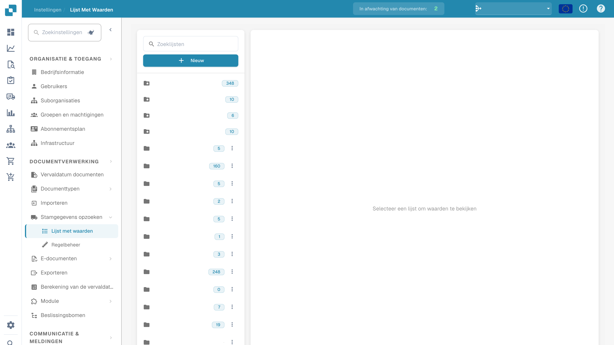
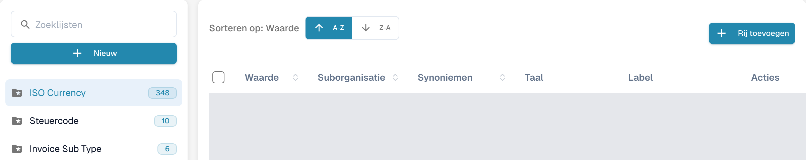
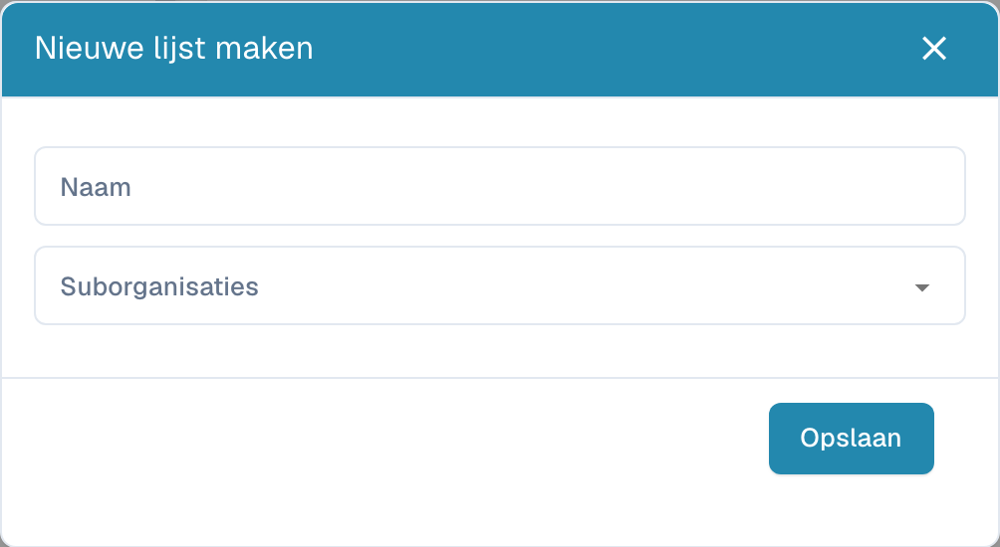
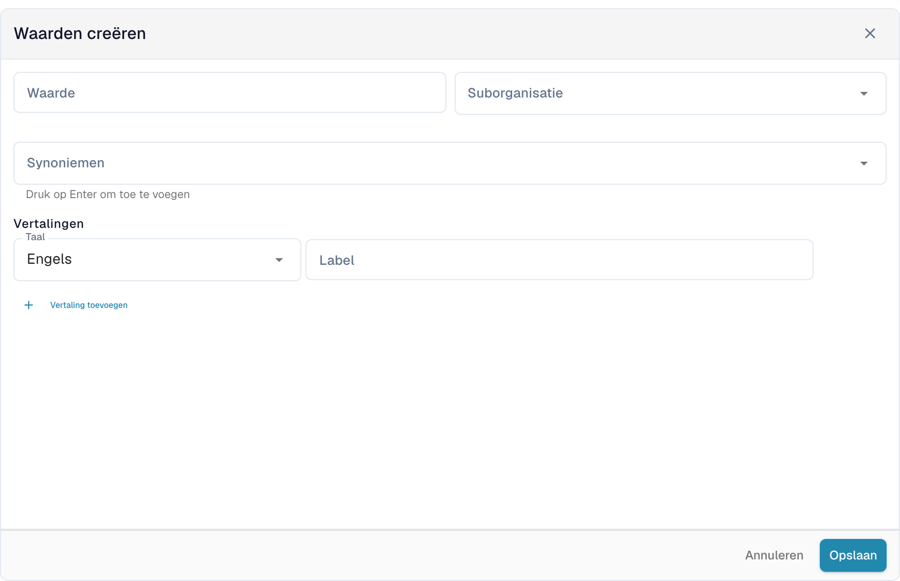

# Waardenlijsten

## Videotutorial: Stamgegevens en waardelijsten


Bronnen voor stamgegevens, waardelijsten en mastergegevensinstellingen in DocBits


De video toont de bronnen voor stamgegevens, de waardelijsten en de mastergegevensinstellingen van een documenttype.

Waardenlijsten bevatten vooraf ingestelde opties voor documentvelden. Een veld kan een lijst gebruiken om opties tijdens validatie te tonen. Labels kunnen worden vertaald; de technische waarde blijft in alle talen gelijk.

## Lijsten openen

Open in de instellingen de stamgegevens en selecteer de waardenlijsten. Met het veld **Zoeklijsten** links vindt u een lijst. Selecteer de naam om de waarden rechts te openen. Een map met een ster geeft een systeemlijst aan; het getal naast de naam is het aantal geladen waarden.

<figure><figcaption>
Waardenlijsten met afgeschermde geconfigureerde namen.
</figcaption></figure>

<figure><figcaption>
De geselecteerde systeemlijst opent de tabel met waarden. A-Z en Z-A sorteren de waarden; Rij toevoegen opent het formulier. Waarden en eigen namen zijn afgeschermd; systeemlijstnamen zoals ISO Currency zijn bestaande gegevens.
</figcaption></figure>

## Een lijst maken

1. Selecteer **Nieuw** boven de lijstnamen.
2. Voer de **Naam** in en selecteer zo nodig **Suborganisaties** om het bereik van de lijst te beperken.
3. **Opslaan** maakt de lijst. Het **X** sluit het venster zonder een lijst te maken.

<figure><figcaption>
Nieuw opent het lege venster Nieuwe lijst maken met Naam, Suborganisaties, X en Opslaan. Deze weergave toont geen opgeslagen lijst.
</figcaption></figure>

Gebruik voor een lijst van uw organisatie de verwijderoptie in het menu met drie punten naast de naam en bevestig alleen de bedoelde lijst. Systeemlijsten hebben dit verwijdermenu niet en kunnen niet worden verwijderd.

## Waarden toevoegen en wijzigen

1. Selecteer links de lijst en vervolgens **Rij toevoegen** boven de tabel.
2. Voer de opgeslagen **Waarde** en zo nodig de **Suborganisatie** in.
3. Voeg de gewenste **Synoniemen** toe. Bevestig elk synoniem met **Enter** om het aan het veld toe te voegen.
4. Selecteer onder **Vertalingen** een **Taal** en voer een niet-leeg **Label** in. Een nieuwe waarde vereist ten minste één volledige vertaling.
5. **Opslaan** maakt de waarde. **Annuleren** of het **X** sluit het formulier zonder op te slaan.

<figure><figcaption>
Rij toevoegen opent Waarden creëren onder de tabel: Waarde, Suborganisatie, Synoniemen, Taal, Label en Vertaling toevoegen. Opslaan maakt de waarde; Annuleren verwerpt het niet-opgeslagen concept.
</figcaption></figure>

Selecteer een rij of de bewerkoptie onder **Acties** om een waarde te wijzigen. Beveiligde velden blijven alleen-lezen; ook de opgeslagen waarde kan vergrendeld zijn als er al vertalingen bestaan. **Annuleren** verwerpt niet-opgeslagen wijzigingen.

De dupliceeroptie in het rijmenu maakt een andere waarde. Voor meerdere waarden selecteert u de selectievakjes en gebruikt u de kopieerknop boven de tabel. Verwijderen is beschikbaar voor waarden van uw organisatie en verwijdert de geselecteerde waarde; systeemwaarden hebben deze actie niet. Een systeemlijst kan zowel beveiligde waarden als waarden van uw organisatie bevatten.

## Importeren uit CSV

Deze interface biedt de vroegere CSV-import via het menu **Acties** niet aan. De oude stappen voor het uploaden van een CSV-bestand gelden niet voor dit scherm; gebruik **Rij toevoegen** om hier waarden in te voeren.

## Vertalingen toevoegen

Selecteer in het formulier van de waarde de **Taal** en voer het **Label** in. Gebruik **Vertaling toevoegen** voor een andere taal en het bijbehorende label. Vul extra lege vertaalregels in of verwijder ze voordat u opslaat. Als een vertaalregel kan worden verwijderd, haalt de prullenbak deze eerst uit het formulier; sla op om de wijziging toe te passen.

De weergegeven tekst kan per taal verschillen, maar de technische waarde blijft gelijk. Zonder label voor de actieve taal verschijnt de technische waarde. Systeemwaarden en overgenomen vertalingen kunnen beveiligde velden hebben; wijzig alleen gegevens van uw organisatie waarvan de velden bewerkbaar zijn.
