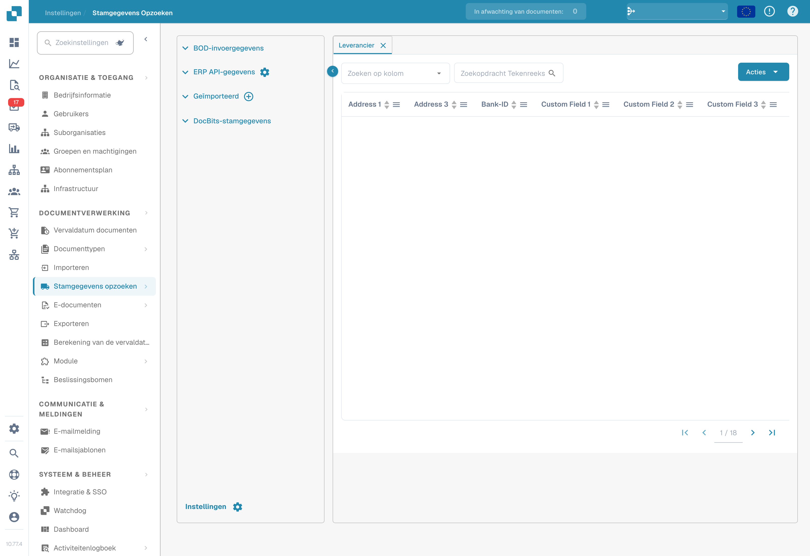
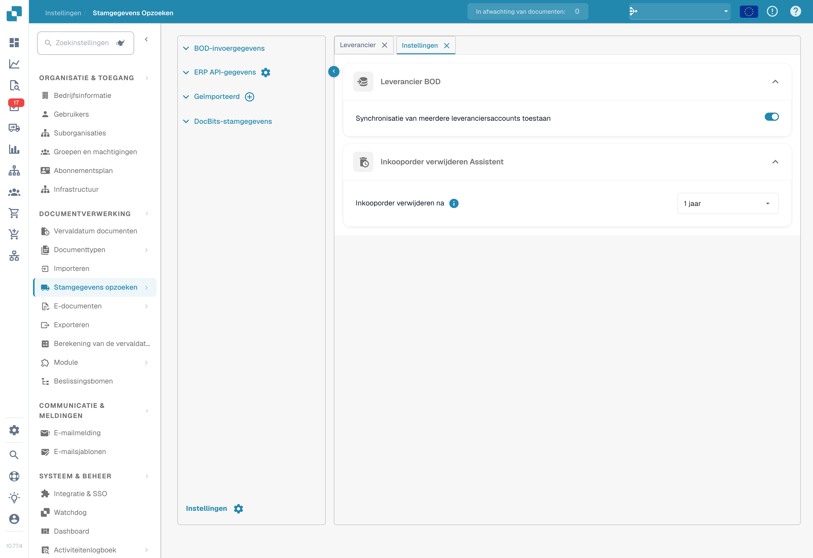

# Stamgegevens opzoeken




Met **Stamgegevens opzoeken** (zijbalk: **Lookup Master Data**) kunt u de stamgegevens bekijken en beheren die DocBits gebruikt om uit documenten geëxtraheerde gegevens te valideren tegen uw ERP-systeem. Dit is essentieel voor nauwkeurige PO matching, leveranciersvalidatie en het automatisch invullen van velden. Open de pagina via **Instellingen → Documentverwerking → Lookup Master Data**.

<figure><figcaption>
Stamgegevens opzoeken: gegevensbronnen en leverancierstabel met afgeschermde waarden.
</figcaption></figure>

## Gegevensbronnen

Het linkerpaneel toont vier categorieën gegevensbronnen:

| Bron | Beschrijving |
|------|--------------|
| **BOD Input Data** | Gegevens die via Infor-BOD-berichten (Business Object Document) worden ontvangen. |
| **ERP API Data** | Gegevens die rechtstreeks via een API uit uw ERP-systeem worden opgehaald. Klik op het tandwielpictogram om de API-verbinding te configureren. |
| **Imported** | Handmatig geïmporteerde gegevens (bijvoorbeeld via een CSV-upload). Klik op het **+**-pictogram om nieuwe gegevens toe te voegen. |
| **DocBits Master Data** | Interne stamgegevens die binnen DocBits worden beheerd. |

## Gegevenstabel

Wanneer u een gegevensbron selecteert, worden de bijbehorende gegevens rechts geopend in een doorzoekbare, sorteerbare tabel:

* **Tabbladen** – elk tabblad is een type stamgegevens (bijvoorbeeld Leverancier, Inkooporder, Artikel).
* **Zoeken** – filter op kolom (**Search by column**) of zoek op tekst (**Search String**).
* **Acties** – kolomlabels bijwerken, lege kolommen verbergen, aliassen bijwerken of de gegevens als CSV downloaden.
* **Paginering** – navigeer met de paginabesturingselementen door grote gegevenssets.

De tabellen Leverancier en Inkooporder bevatten kolommen zoals Leverancier-ID, Leveranciersnaam, Adres, Bank Id, PO-nummer, Artikel-ID, Omschrijving, Aantal, Eenheidsprijs, Totaalbedrag, Valuta en Status, plus eventuele aangepaste velden.

## Instellingen

Klik linksonder in het gegevensbronnenpaneel op **Settings** (tandwielpictogram) om de stamgegevens-instellingen te openen.

<figure><figcaption>
Stamgegevensinstellingen voor leverancierssynchronisatie en het bewaren van inkooporders.
</figcaption></figure>

### Leveranciers-BOD

**Synchronisatie van meerdere leveranciersaccounts toestaan**

* **Ingeschakeld**: een enkele leverancier kan meerdere `<FinancialParty>`-elementen in de BOD hebben (vaak vanwege meerdere IBAN's of financiële rekeningen). Alle `<FinancialParty>`-vermeldingen worden geëxtraheerd en opgeslagen in de leverancierstabel, zodat meerdere financiële attributen kunnen worden opgeslagen.
* **Uitgeschakeld**: alleen het laatst gevonden `<FinancialParty>`-element voor de leverancier wordt geëxtraheerd. Eerdere financiële attributen (bijvoorbeeld extra IBAN's) worden genegeerd en alleen de gegevens van het laatste voorkomen worden opgeslagen.

### Assistent voor het verwijderen van inkooporders

**Delete Purchase Order After** – kies wanneer afgesloten inkooporders moeten worden verwijderd. Na de geselecteerde periode worden de records automatisch verwijderd.


Lees hoe u stamgegevens in DocBits laadt onder [Stamgegevens importeren](../../../infor-integration-and-configuration/importing-customer-master-data/).

