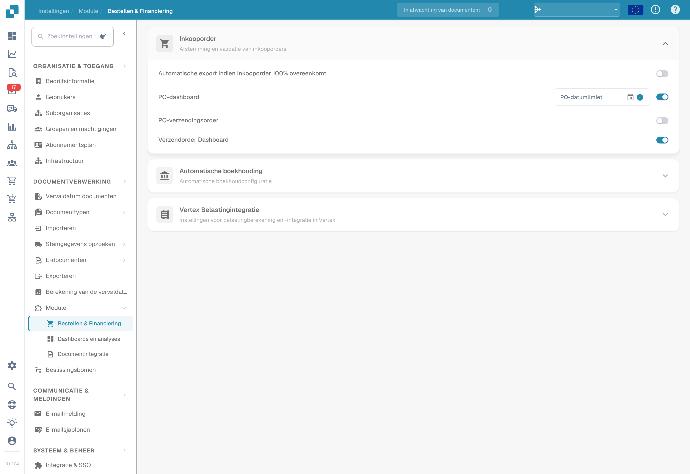
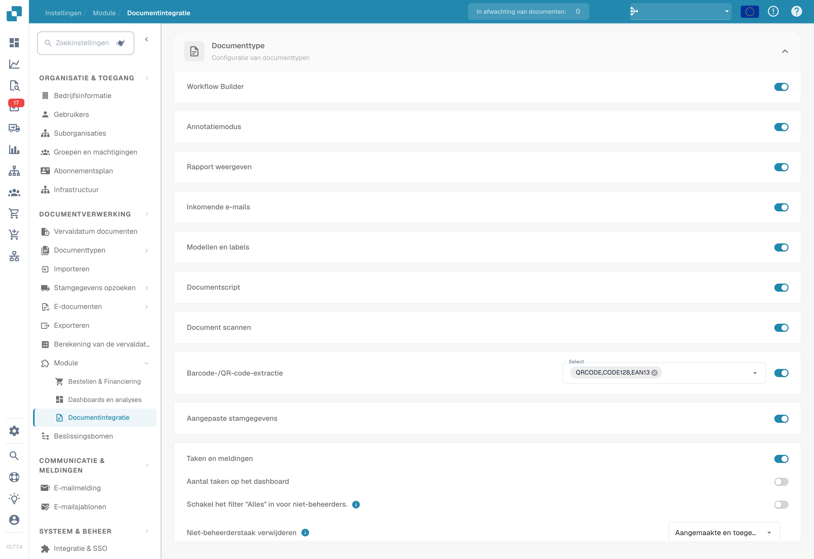
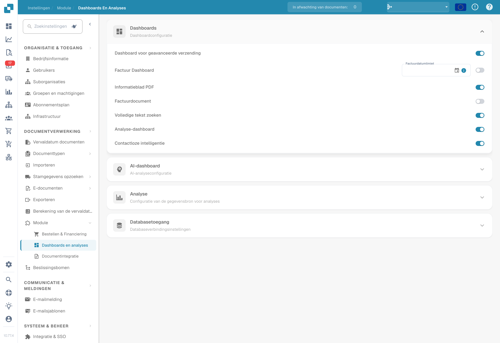

# Module

## Videotutorial: Instellingenoverzicht en modules


Instellingenoverzicht en modules in DocBits


De video toont de vijf groepen van het Instellingenoverzicht, de zoekfunctie en snelkoppelingen en wat de drie modulepagina's regelen.

<figure><figcaption>
Modules voor orders en financiën, weergegeven in hun bestaande instelling.
</figcaption></figure>

<figure><figcaption>
Modules voor documentintegratie, waaronder documentscripts, barcode-extractie en aangepaste stamgegevens. De ingestelde schakelaars zijn niet gewijzigd.
</figcaption></figure>

<figure><figcaption>
Modules voor dashboards en analyses, weergegeven in hun bestaande instelling.
</figcaption></figure>

Op de pagina Module schakelt u optionele functies in DocBits in of uit. Elk onderdeel groepeert gerelateerde modules die u aan of uit kunt zetten.

## Inkooporder

Instellingen voor PO Matching & Validatie.

| Instelling | Beschrijving |
|---------|-------------|
| **Auto Export if PO matched 100%** | Exporteert het document automatisch wanneer de PO-matching 100% bereikt. |
| **PO Dashboard** | Schakelt het Purchase Order-dashboard in. Bevat een veld **PO Date Limit** om PO-gegevens op datum te beperken. |
| **PO Shipment Order** | Schakelt de verwerking van verzendorders in die aan inkooporders zijn gekoppeld. |
| **Dashboard voor verzendingsorders** | Schakelt een speciaal dashboard voor verzendorders in. |

## Automatische boeking

| Instelling | Beschrijving |
|---------|-------------|
| **Auto Accounting** | Schakelt automatische boekhouding voor documenten in. Selecteer het ERP-type (bijv. LN, M3). |

## Dashboards

| Instelling | Beschrijving |
|---------|-------------|
| **Geavanceerd verzenddashboard** | Dashboard voor het monitoren van geavanceerde verzendactiviteiten. |
| **Invoice Dashboard** | Dashboard voor factuurmonitoring en -analyses. |
| **Zoeken in volledige tekst** | Schakelt full-text zoeken in alle documenten in. |
| **Analytics Dashboard** | Schakelt het analyseoverzichtsdashboard in. |

## Databasetoegang

| Instelling | Beschrijving |
|---------|-------------|
| **DB Access** | Schakelt directe databasetoegang voor de organisatie in. |

## AI-dashboard

| Instelling | Beschrijving |
|---------|-------------|
| **AI Document Warehouse** | AI-gestuurde analyses van het documentmagazijn. |
| **Dashboard v2** | Bijgewerkt dashboard met verbeterde functies. |
| **Clickhouse Direct Access** | Schakelt directe toegang tot de Clickhouse-database in. |
| **Supplier Statistics** | Schakelt statistieken en rapportage op leveranciersniveau in. |

## Verzending en leverancier

| Instelling | Beschrijving |
|---------|-------------|
| **Supplier Portal** | Schakelt het leveranciersportaal in voor samenwerking met leveranciers. |

## Documenttype

| Instelling | Beschrijving |
|---------|-------------|
| **Workflow Builder** | Bouw en pas workflows voor documentverwerking aan. |
| **Annotation Mode** | Staat gebruikers toe documenten te annoteren in de validatieweergave. |
| **Show Report** | Schakelt het genereren van rapporten voor documenten in. |
| **Inbound Emails** | Schakelt de verwerking van inkomende e-mails per documenttype in. |
| **Models & Labels** | Beheer AI-modellen en labels voor documentherkenning. |
| **Document Script** | Schakelt aangepaste scripts voor documentverwerking in. |
| **Document Scan** | Schakelt de functie voor het scannen van documenten in. |
| **Bar-Code/QR Code Extraction** | Extraheert barcode-/QR-codegegevens uit documenten. Selecteer de ondersteunde codetypen. |
| **Custom Master Data** | Schakelt aangepaste masterdatavelden in. |
| **Tasks & Notifications** | Schakelt taakbeheer en notificatiefuncties in. Bevat de schakelaar **Dashboard Tasks Count**. |
| **DocBits Operator** | Schakelt de browserautomatiseringsfunctie DocBits Operator in. |
| **DocNet** | Schakelt DocNet-documentnetwerken in. |
| **IDM ACL Updater** | Werkt de toegangscontrolelijsten (ACL's) van Infor Document Management bij. Upload een ION-Mapping-bestand en configureer de koppelingen van Infor-Doctype naar ACL. |
| **Barcode Assignment** | Schakelt het toewijzen van barcodes aan documenten in. |
| **Negatief teken instellen voor creditnota's** | Past automatisch negatieve tekens toe op bedragen van creditnota's. |

## BOD-verbindingsstroom

| Instelling | Beschrijving |
|---------|-------------|
| **BOD Connection Stream** | Schakelt de BOD-integratie (Business Object Document) in. Toont de **Stream Name** die voor de verbinding wordt gebruikt. |

## Analyse

| Instelling | Beschrijving |
|---------|-------------|
| **Use PostgreSQL for Quality Analytics** | Schakel tussen Prometheus (realtime, wordt bij elke deployment gereset) en PostgreSQL (permanent 90 dagen, trendanalyse, slechtst presterende velden). |

## Vertex-belastingintegratie

| Instelling | Beschrijving |
|---------|-------------|
| **Vertex-belastingintegratie** | Schakelt Vertex-belastingberekening in. Configureer **Base URL**, **Client ID** en **Client Secret**. Gebruik **Test Connection** om te verifiëren. |
