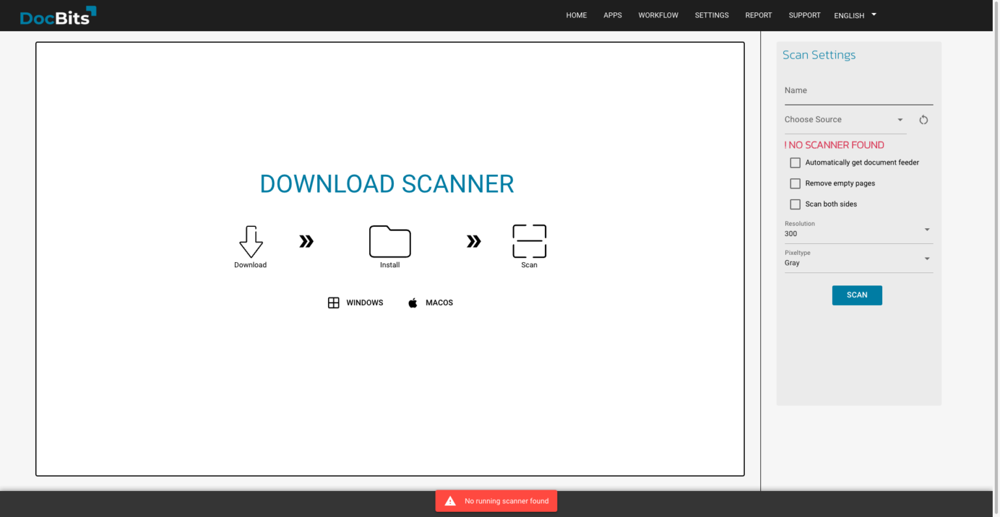
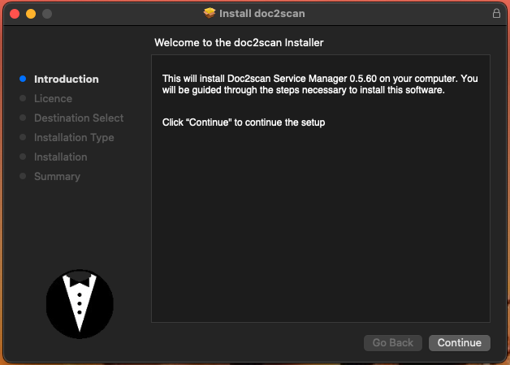
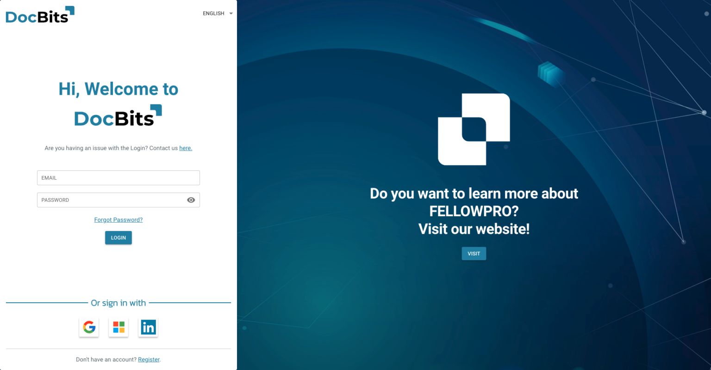

# Doc Scan

## Scannersoftware downloaden en installeren

Klik op het DocBits-dashboard op Scan Document.

<figure><figcaption></figcaption></figure>

Als de lokale scannersoftware nog niet is geïnstalleerd, toont DocBits een downloadmelding. Kies de download voor uw besturingssysteem.

<figure><figcaption></figcaption></figure>

Open het gedownloade installatiebestand. Het afgebeelde installatieprogramma is voor macOS; volg de instructies voor uw besturingssysteem.

<figure><figcaption></figcaption></figure>

Klik in het afgebeelde installatieprogramma op Continue, accepteer de softwarelicentie met Agree en ga verder. Controleer de bestemming en de benodigde ruimte en klik op Install. De getoonde 33,6 MB geldt voor die versie van het installatieprogramma; de benodigde ruimte kan per versie verschillen.

Sluit het installatieprogramma wanneer de installatie is voltooid.

<figure><figcaption></figcaption></figure>

Open https://local.polydocs.io:12500/ in uw browser om de lokale service te testen. Als de browser deze niet kan bereiken en u een FRITZ!Box gebruikt, controleer dan de hieronder beschreven instellingen voor DNS-rebindbeveiliging.

<figure><figcaption></figcaption></figure>

Klik op DocBits zodra de pagina van de lokale service verschijnt om DocBits te openen.

<figure><figcaption></figcaption></figure>

Meld u aan op de DocBits-aanmeldpagina om uw dashboard te openen.

<figure><figcaption></figcaption></figure>

Activeer Doc Scan in de instellingen onder Modules.

<figure><figcaption></figcaption></figure>

## Netwerkinstellingen van de FRITZ!Box

Als https://local.polydocs.io:12500/ niet bereikbaar is doordat een FRITZ!Box DNS-antwoorden met privéadressen blokkeert, kan de browser een DNS-time-out melden. De FRITZ!Box gebruikt deze beveiliging tegen DNS-rebinding. Voeg voor deze lokale service een uitzondering voor de hostnaam toe:

1. Open in de Duitse FRITZ!Box-interface Heimnetz (thuisnetwerk) en vervolgens Netzwerk (netwerk).
2. Open het tabblad Netzwerkeinstellungen (netwerkinstellingen).
3. Voeg onder DNS-Rebind-Schutz (DNS-rebindbeveiliging) local.polydocs.io toe aan de uitzonderingen voor hostnamen.
4. Klik op Übernehmen (toepassen) en test de lokale service opnieuw.

## Doc2Scan Service Manager verwijderen

Voer de volgende opdracht uit om Doc2Scan Manager op macOS te verwijderen:

```bash
sudo bash /Library/doc2scan/uninstall.sh
```

## Scannercompatibiliteit

sane-airscan is een SANE-backend voor Apple AirScan/eSCL en Microsoft WSD (WS-Scan, Web Services for Devices). Dit zijn protocollen voor scannen via het netwerk.

Raadpleeg de [bijgehouden compatibiliteitsinformatie van sane-airscan](https://github.com/alexpevzner/sane-airscan) voor gemelde ondersteuning van apparaten en protocollen. De beschikbaarheid van een protocol of een melding over sane-airscan garandeert niet dat elke apparaatfunctie in Doc Scan werkt. Test uw scanner met de benodigde Doc Scan-werkwijze.
