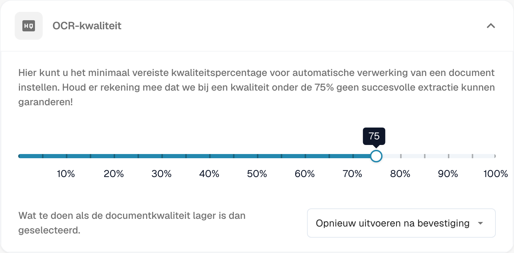
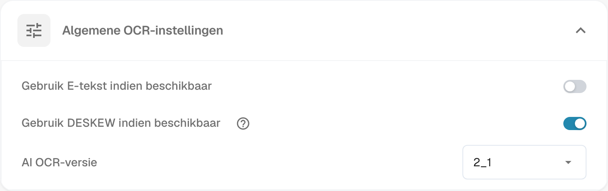
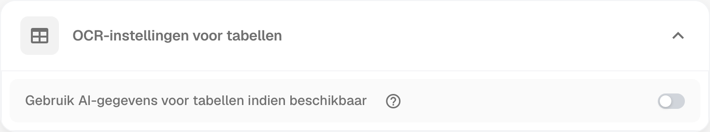
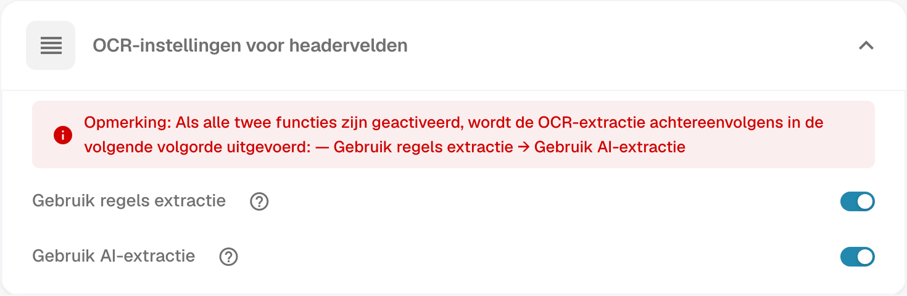

# OCR-instellingen


DocBits OCR & E-tekst uitgelegd: instellingen, kwaliteit en koptekstextractie


## Overzicht

In de **OCR (Optische Karakterherkenning)** instellingen kun je configureren hoe OCR wordt toegepast tijdens documentverwerking. Dit omvat het specificeren van de minimaal vereiste kwaliteit, het kiezen of je ingebedde tekst (e-tekst) wilt gebruiken, het selecteren van de OCR-versie, en meer. Deze pagina biedt een gedetailleerde uitleg van alle beschikbare instellingen.

## Hoe toegang te krijgen tot OCR-instellingen

Om toegang te krijgen tot de OCR-instellingen:

*   Navigeer naar: **Instellingen** → **Documentverwerking** → **OCR-instellingen**

## OCR-kwaliteit

In deze sectie kun je de minimale documentkwaliteit instellen die vereist is voor OCR-verwerking door de kwaliteitsregelaar aan te passen. Beweeg de regelaar naar links of rechts om de kwaliteitsdrempel respectievelijk te verlagen of te verhogen.

Als een document niet voldoet aan het gedefinieerde kwaliteitsniveau, biedt DocBits drie manieren om het document te verwerken:

* **Verwerken ondanks lage kwaliteit**\
  Het document wordt verwerkt, ongeacht de kwaliteit.
* **Opnieuw uitvoeren na bevestiging**\
  **DocBits** zal pauzeren en je vragen om te bevestigen of je door wilt gaan met de verwerking.
* **Stoppen met een foutmelding**\
  De documentverwerking stopt volledig en er wordt een foutmelding weergegeven, waarin staat dat het document niet voldeed aan de vereiste kwaliteitsdrempel.

<figure><figcaption>
Minimale OCR-kwaliteit en de verwerking van documenten onder de ingestelde drempel.
</figcaption></figure>

## Algemene OCR-instellingen

* **Gebruik E-tekst indien beschikbaar**\
  Wanneer ingeschakeld, zal **DocBits** ingebedde elektronische tekst (bijv. uit PDF's) gebruiken in plaats van OCR uit te voeren. Dit verbetert zowel de snelheid als de nauwkeurigheid, aangezien de tekst rechtstreeks wordt geëxtraheerd zonder dat OCR-verwerking nodig is.
* **Gebruik DESKEW indien beschikbaar**\
  Deze optie corrigeert automatisch de uitlijning van gescande documenten. Het rechtzetten van scheve afbeeldingen helpt de OCR-nauwkeurigheid te verbeteren.
*   **AI OCR-versie**\
    Hiermee kun je een specifieke versie van de AI-gebaseerde OCR-engine selecteren.\
    Dit kan nuttig zijn als:

    * Je de gewenste resultaten niet behaalt met de momenteel geselecteerde versie.
    * Je problemen oplost die verband houden met de OCR-prestaties of nauwkeurigheid.

<figure><figcaption>
Algemene OCR-instellingen voor E-tekst, het rechtzetten van scans en de OCR-versie.
</figcaption></figure>

## OCR-instellingen voor tabellen

* **Gebruik AI-gegevens voor tabellen indien beschikbaar**\
  Wanneer ingeschakeld, zal DocBits OCR-gegevens voor tabellen gebruiken in plaats van ingebedde elektronische tekst (E-tekst) — zelfs als de instelling **Gebruik E-tekst indien beschikbaar** is ingeschakeld.

<figure><figcaption>
OCR-instellingen voor het gebruik van AI-gegevens bij tabellen.
</figcaption></figure>

## OCR-instellingen voor headervelden

* **Gebruik regels extractie**\
  DocBits zal je vooraf gedefinieerde extractieregels toepassen voor het identificeren van headervelden.
* **Gebruik AI-extractie**\
  DocBits zal AI gebruiken om headervelden automatisch te detecteren en te extraheren.

<figure><figcaption>
OCR-instellingen voor regelgebaseerde extractie en AI-extractie van headervelden.
</figcaption></figure>

**Uitvoeringsvolgorde:**\
Als beide opties zijn ingeschakeld, zal **DocBits** extractie uitvoeren in de volgende volgorde:\
**Regels Extractie → AI Extractie**\
\
<mark style="color:red;">**Opmerking**</mark>: Voor de beste resultaten en consistente gedrag, schakel beide opties in. Dit stelt **DocBits** in staat om zowel regelgebaseerde als AI-gebaseerde methoden in combinatie te gebruiken tijdens de headerextractie.
