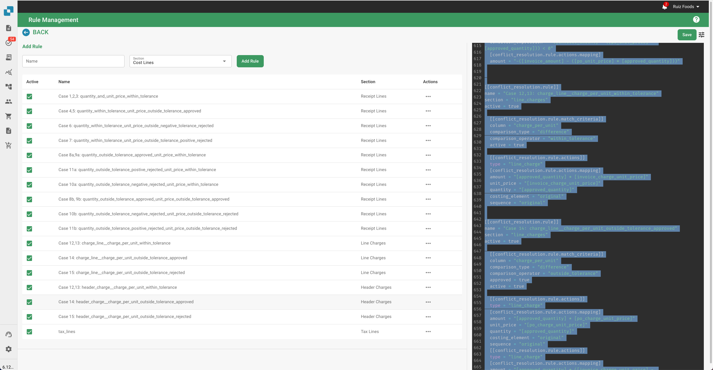
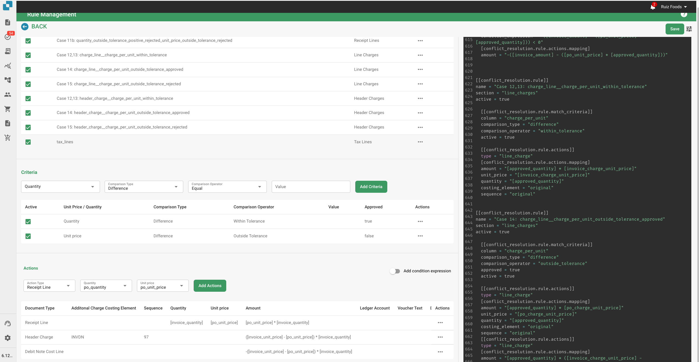

# Regelbeheerder

\
Dit document biedt een diepgaande uitleg van de regels voor geschillenbeslechting die worden gebruikt in het DocBits factureringssysteem. Deze regels zijn ontworpen om automatisch om te gaan met discrepanties tussen factuurgegevens en inkoopordedata (PO), en zorgen voor een nauwkeurige financiële reconciliatie. Het systeem past deze regels toe om factuurregels, kosten en belastingen te verwerken en genereert indien nodig passende aanpassingen of notities.

## Structuur van de Regels

### 1. Metadata

• versie: Identificeert de versie van het mappingbestand.

• revisie: Revisienummer voor het bijhouden van wijzigingen.

• auteur: Geeft de maker van het mappingbestand aan.

• beschrijving: Een korte beschrijving van het doel van het bestand.

• created\_at & updated\_at: Tijdstempels voor wanneer het bestand is gemaakt en voor het laatst is bijgewerkt.

### 2. Exportconfiguratie

De exportconfiguratie-sectie definieert de mapping tussen de datavelden in het systeem en de overeenkomstige velden in de exportbestanden.

• Header: Definieert de headervelden voor de geëxporteerde factuurgegevens.

• Belastingregels: Specificeert de velden voor belastingregelitems in de export.

• Orderheaderkosten: Maakt velden gerelateerd aan extra kosten op het niveau van de orderheader.

• Ontvangstregels: Maakt velden voor individuele regelitems in een ontvangst.

• Orderregelkosten: Definieert de velden voor kosten gerelateerd aan specifieke orderregels.

• Kostenregels: Specificeert velden voor kostenallocatieregels.

• Debetnota & Creditnota: Definieert velden voor het genereren van debet- en creditnota's in geval van discrepanties.

### 3. Regels voor Geschillenbeslechting

Deze regels behandelen discrepanties tussen factuurgegevens en de overeenkomstige PO-gegevens. Elke regel bestaat uit verschillende componenten:

• Naam: De beschrijvende naam van de regel, die aangeeft welk type discrepantie deze behandelt.

• Sectie: Geeft aan welk deel van de factuur (bijv. ontvangst\_regels, lijn\_kosten) de regel van toepassing is.

• Actief: Booleaanse waarde (waar of niet waar) die aangeeft of de regel momenteel actief is.

• Matchcriteria: Voorwaarden die de regel activeren op basis van vergelijkingen tussen de werkelijke factuurgegevens en de verwachte PO-gegevens.

• Acties: Definieert wat het systeem moet doen wanneer de regel wordt geactiveerd, inclusief het aanpassen van waarden, het toepassen van kosten of het genereren van credit/debetnota's.

## Gemeenschappelijke Elementen in de Regels

### Vergelijkingsoperatoren

Deze operatoren definiëren hoe de werkelijke factuurwaarden worden vergeleken met de verwachte PO-waarden:

• gelijk

• groter dan

• groter dan of gelijk aan

• kleiner dan

• kleiner dan of gelijk aan

• binnen tolerantie

• buiten tolerantie

### Goedkeuringsstatus

Geeft aan of een discrepantie goedgekeurd is of niet:

• goedgekeurd

• afgewezen

• elk

### Actietypen

Definieert specifieke acties die moeten worden ondernomen wanneer een discrepantie wordt gedetecteerd:

\
• ontvangstregel

• kostenregel

• headerkosten

• lijnkosten

• belastingregel

• debetnota ontvangstregel

• debetnota kostenregel

• debetnota headerkosten

• debetnota lijnkosten

• creditnota ontvangstregel

• creditnota kostenregel

• creditnota headerkosten

• creditnota lijnkosten

• creditnota belastingregel

### Voorbeelden van Regels

**Geval 1, 2, 3: Hoeveelheid en Eenheidsprijs Binnen Tolerantie**

\
• Doel: Behandelt scenario's waarin zowel de hoeveelheid als de eenheidsprijs op de factuur binnen de geaccepteerde tolerantielimieten liggen in vergelijking met de PO.

• Actie: Het systeem accepteert de factuurwaarden en berekent het totale bedrag.

**Geval 4, 5: Hoeveelheid Binnen Tolerantie, Eenheidsprijs Buiten Tolerantie (Goedgekeurd)**

• Doel: Van toepassing wanneer de hoeveelheid binnen tolerantie is, maar de eenheidsprijs buiten tolerantie ligt en is goedgekeurd.

• Actie: Het systeem past de eenheidsprijs aan om overeen te komen met de PO en past eventuele noodzakelijke lijnkosten toe.

**Geval 6: Hoeveelheid Binnen Tolerantie, Eenheidsprijs Buiten Negatieve Tolerantie (Afgewezen)**

• Doel: Behandelt gevallen waarin de eenheidsprijs lager is dan verwacht en buiten het tolerantiebereik ligt, wat leidt tot afwijzing.

• Actie: Het systeem past de eenheidsprijs aan om overeen te komen met de PO, genereert een creditnota voor het verschil en past headerkosten toe indien nodig.

### Behandeling van Kosten en Belastingen

### Kosten Per Eenheid Tolerantie

• Regels onder deze categorie behandelen discrepanties in kosten per eenheid, met specifieke acties op basis van of de kosten binnen of buiten de tolerantie liggen en of deze zijn goedgekeurd of afgewezen.

### Aanpassingen van Belastingregels

• Deze regels beheren belastingdiscrepanties door de belastingregels aan te passen of overeenkomstige credit- of debetnota's te genereren op basis van de verschillen tussen factuur- en PO-belastinggegevens.

### Enums en Opties

• Enums: Vooraf gedefinieerde lijsten van waarden die consistentie over de regels waarborgen (bijv. vergelijkingsoperatoren, goedkeuringssoorten).

• Opties: Vooraf gedefinieerde keuzes voor het omgaan met hoeveelheden of eenheidsprijzen, die flexibiliteit bieden in de definitie van regels.

## Uitleg van Screenshots

### Screenshot 1: Regelbeheerinterface

<figure><figcaption></figcaption></figure>

Deze screenshot toont de Regelbeheerinterface waar beheerders alle regels voor geschillenbeslechting kunnen bekijken en beheren. Belangrijke elementen zijn:

• Voeg Regel Toe Knop: Maakt het mogelijk om nieuwe regels toe te voegen.

• Lijst van Regels: Toont alle actieve regels met details zoals naam, sectie en actieve status.

• Sectie Dropdown: Filtert de regels op basis van de sectie waarop ze van toepassing zijn (bijv. Ontvangstregels, Lijnkosten).

### Screenshot 2: Gedetailleerde Regelbewerking

<figure><figcaption></figcaption></figure>

Deze screenshot illustreert het gedetailleerde overzicht van een specifieke regel die wordt bewerkt. Belangrijke elementen zijn:

• Criteria Sectie: Definieert de voorwaarden waaronder de regel wordt geactiveerd. Bijvoorbeeld, de criteria kunnen specificeren dat als de hoeveelheid en eenheidsprijs verschillen van de PO maar binnen tolerantie liggen, de regel moet worden toegepast.

• Acties Sectie: Specificeert welke acties moeten worden ondernomen wanneer aan de criteria wordt voldaan. Dit kan het aanpassen van de factuurregels, het genereren van credit- of debetnota's, of het toepassen van extra kosten omvatten.

• Documenttype en Kosten Elementen: Maakt het de beheerder mogelijk om specifieke acties te koppelen aan documenttypes en kostenelementen, wat flexibiliteit biedt bij het omgaan met verschillende scenario's.
