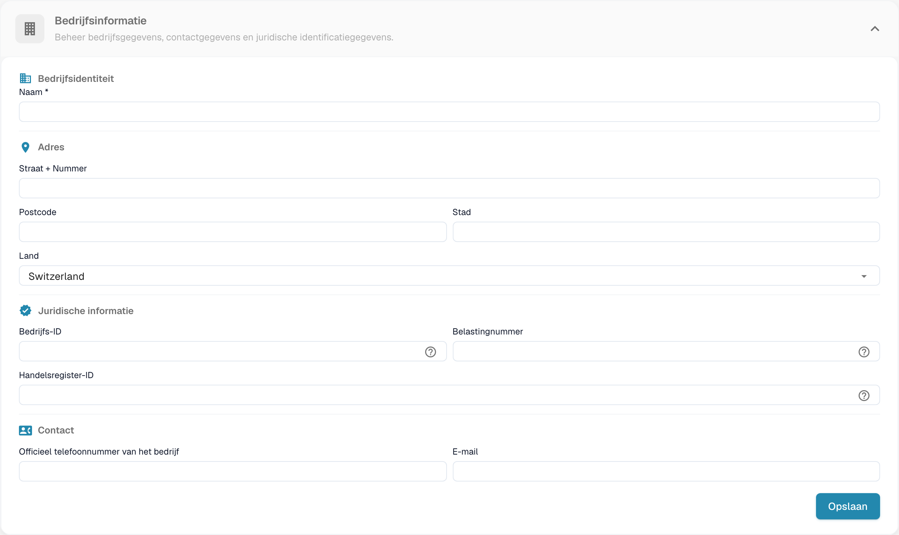
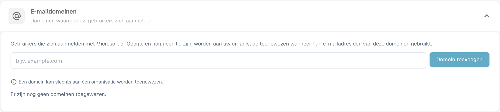

# Bedrijfsinformatie

<figure><figcaption>
Bedrijfsgegevens met afgeschermde organisatiewaarden.
</figcaption></figure>

Op de pagina Bedrijfsinformatie beheert u het profiel van uw bedrijf, voorkeuren en abonnementsgegevens. De pagina is ingedeeld in de volgende onderdelen:

## Bedrijfsinformatie

Dit onderdeel bevat de kerngegevens van uw bedrijf, gegroepeerd in vier gebieden:

### Bedrijfsidentiteit

* **Naam** *(verplicht)*: De juridische naam van uw bedrijf.

### Adres

* **Straat + Nummer**: Het straatadres van uw bedrijf.
* **Postcode**: Postcode.
* **Stad**: Plaatsnaam.
* **Land**: Selecteer uw land in de keuzelijst.

### Juridische informatie

* **Bedrijfs-ID**: Een unieke identificatie voor uw bedrijf, gebruikt voor integraties en interne verwijzing.
* **Belastingnummer**: Uw belastingidentificatienummer voor financiële rapportage.
* **Handelsregister-ID**: Uw handelsregisternummer voor juridische documentatie.

### Contact

* **Officieel telefoonnummer van het bedrijf**: Het primaire telefoonnummer van uw bedrijf.
* **E-mail**: Het belangrijkste e-mailadres voor officiële communicatie.

Klik na het invoeren of bijwerken van velden op **Opslaan** om uw wijzigingen toe te passen. De **?**-pictogrammen naast de juridische identificatiegegevens tonen extra uitleg bij het veld. Selecteer de kop van een onderdeel om het formulier uit of in te klappen.

## E-maildomeinen

Organisatiebeheerders kunnen **Instellingen → Bedrijfsinformatie → E-maildomeinen** openen om de domeinen te beheren die worden gebruikt voor automatische toewijzing aan een organisatie. Wanneer iemand zich aanmeldt met Microsoft of Google en nog geen lid is van een organisatie, kan DocBits die persoon aan deze organisatie toewijzen als het e-mailadres een van de vermelde domeinen gebruikt. Een domein kan slechts bij één organisatie horen.

<figure><figcaption>
E-maildomeinen van het bedrijf configureren.
</figcaption></figure>

Voer in het invoerveld alleen het domein in, zoals `example.com`, en selecteer **Domein toevoegen** of druk op Enter. Het eerste domein wordt het primaire domein. Als er meer domeinen worden vermeld, gebruikt u **Maak primair** bij een andere rij om het primaire domein te wijzigen, of het prullenbakpictogram om een domein te verwijderen. Fouten, zoals een ongeldig domein, een persoonlijke e-mailprovider of een domein dat al elders is toegewezen, verschijnen onder het invoerveld. **Nog geen domeinen toegewezen** betekent dat deze organisatie geen domeinregel heeft.

Controleer voordat u een domein toevoegt welke organisatie nieuwe aanmeldingen moet ontvangen. Om bestaande lidmaatschappen te beheren, gaat u verder bij [Gebruikers](../groups-users-and-permissions/users/README.md).

## Bedrijfsvoorkeuren

Configureer standaardinstellingen voor het hele bedrijf:

* **Datumpatroon**: Kies hoe datums overal in DocBits worden weergegeven (bijv. `%m/%d/%Y`, `%d.%m.%Y`).
* **Bedrag opmaak**: Selecteer de getalnotatie voor bedragen (bijv. Deutsch voor `1.000,00`, English voor `1,000.00`).
* **Dialoogvenster Nieuwe versie-info**: Schakel in of gebruikers een melding zien wanneer een nieuwe versie van DocBits wordt uitgebracht.

Klik na het aanbrengen van wijzigingen op **Opslaan**.

## Applicatiekleur

Pas de primaire kleur van de DocBits-interface aan. Dit is handig om verschillende omgevingen visueel van elkaar te onderscheiden (bijv. dev versus productie).

* **Kleur**: Voer een hexadecimale kleurcode in (bijv. `#2388AE`) of gebruik de kleurkiezer.
* Klik op **Opslaan** om toe te passen, of op **Herstellen** om de standaardkleur te herstellen.

## Abonnement

Bekijk uw actieve abonnementen en hun details:

* **Naam van het abonnement**: De naam van elk actief abonnement (bijv. DocBits, DocFlow Users, DocSearch).
* **nog dagen over**: Hoeveel dagen er resteren tot het abonnement verloopt.
* **Start Date / End Date**: De abonnementsperiode.
* **Aantal gebruikers**: Totaal aantal gebruikers in uw organisatie.
* **Aantal suborganisaties**: Aantal geconfigureerde suborganisaties.
* **Aantal leveranciers**: Aantal geregistreerde leveranciers.

## Abonnementsgebruik

Houd uw maandelijkse verbruik van tokens en workflows bij:

| Kolom | Beschrijving |
|--------|-------------|
| **Type** | Het gebruikstype (Document of Workflow). |
| **From / To** | De data van de factureringsperiode. |
| **Gebruikte tokens** | Aantal tokens dat in de huidige periode is verbruikt. |
| **Resterende tokens** | Tokens die in de huidige periode nog beschikbaar zijn. |

Gebruik de knop **Selecteer** om op specifieke datumbereiken te filteren.
