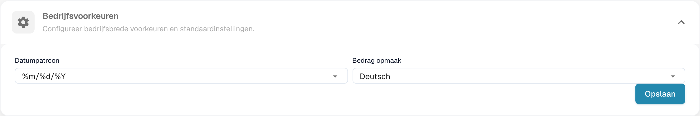
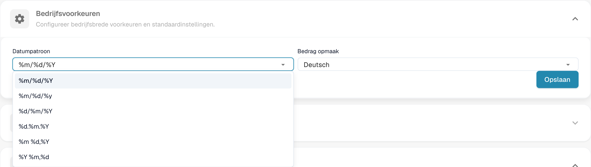

# Bedrijfsvoorkeuren

Open bij de bedrijfsgegevens de voorkeuren om de datum- en bedragformaten van de organisatie in te stellen.

<figure><figcaption>
Bedrijfsvoorkeuren en bedrag- en datumformaten.
</figcaption></figure>

Kies een datumformaat dat bij uw documenten past. De symbolen %d, %m en %Y zijn technische formaatcodes.

<figure><figcaption>
Datumformaat selecteren in de bedrijfsvoorkeuren.
</figcaption></figure>

Het bedragformaat staat hier los van; de geconfigureerde naam kan ongewijzigd blijven. Controleer beide formaten voordat u opslaat. Het oude venster met versie-informatie maakt geen deel uit van de huidige weergave. Voor deze afbeeldingen zijn geen voorkeuren gewijzigd.


