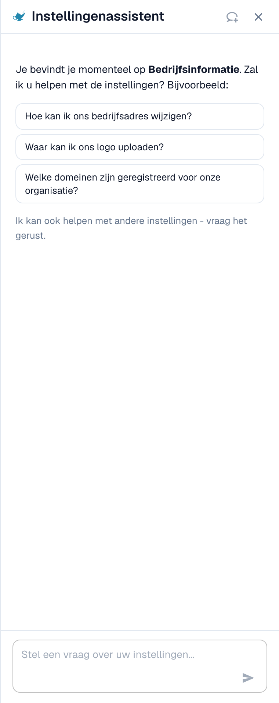
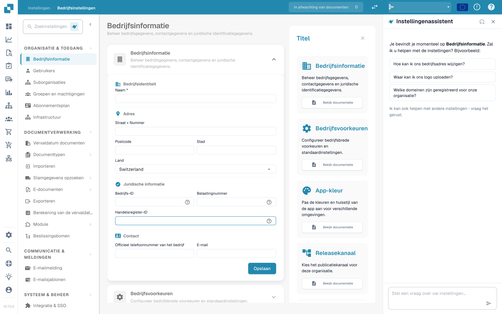

# Settings Assistant

De **Settings Assistant** (instellingenassistent) is een chatpaneel in het gedeelte Instellingen. U stelt een vraag in gewone taal, en de assistent leest de configuratie van uw organisatie, geeft antwoord en brengt u rechtstreeks naar de juiste instelling. Hij kan u ook waarschuwen wanneer iets in uw configuratie niet meer werkt en, met uw bevestiging, een instelling voor u wijzigen.

Hij helpt het meest wanneer u weet **wat** u wilt ("stop met het splitsen van documenten op barcodes") maar niet **waar** de instelling staat, of wanneer u zich afvraagt **waarom** iets niet gebeurt ("Why isn't PO matching active?", waarom is PO-matching niet actief?).

<figure><figcaption>
De Settings Assistant op de pagina Bedrijfsinformatie: een begroeting voor de huidige pagina, drie voorbeeldvragen en het vraagveld. Boven de begroeting verschijnt een waarschuwingskaart wanneer een import niet meer werkt (zie <a href="settings-assistant-chat.md#bevindingen-de-assistent-waarschuwt-u">Bevindingen</a>).
</figcaption></figure>

De assistent staat **standaard uit**. Deze pagina laat zien waar u hem inschakelt en hoe u hem opent. Wat u hem kunt vragen en wat hij kan wijzigen, staat op de pagina [Settings Assistant: wat de chat kan doen](settings-assistant-chat.md).

## Wie het kan gebruiken

* De **organisatiebeheerder** schakelt de assistent in of uit voor de hele organisatie.
* Zodra hij aan staat, kan elke beheerder die **Instellingen** kan openen het paneel voor zichzelf tonen of verbergen.
* Wijzigingen (een aanbeveling toepassen, een importverbinding uitschakelen of verwijderen, een regel aanmaken) zijn beperkt tot **organisatiebeheerders**. Andere gebruikers krijgen de melding *Available to administrators only.* (alleen beschikbaar voor beheerders).

## Inschakelen

1. Ga naar **Instellingen → Globale instellingen → Bedrijfsinformatie**. De paginakop toont **Company Settings** (bedrijfsinstellingen).
2. Open de sectie **Assistants** (assistenten).
3. Schakel **Enable the settings assistant** (de instellingenassistent inschakelen) in.

<figure><figcaption>
De sectie Assistants. De instellingenassistent heeft een eigen schakelaar. De validatieassistent en de voice-over van de uitlegvideo's zijn afzonderlijke functies.
</figcaption></figure>

Een korte melding bevestigt **Settings assistant enabled** (instellingenassistent ingeschakeld). De instelling staat standaard uit. Zolang ze uit staat, verschijnen het paneel en de bijbehorende knop nergens.


De **Validation assistant** (validatieassistent) in dezelfde sectie is een andere functie. Hij legt blokkerende velden in een document uit en kan geen enkele instelling wijzigen. Het omschakelen van de ene heeft geen invloed op de andere.


## Het paneel openen en sluiten

Op elke pagina van het gedeelte Instellingen vindt u naast het zoekveld voor instellingen een kleine **knop met een geestenlamp**. Klik erop om de assistent te **tonen** of te **verbergen**.

<figure><figcaption>
De assistent staat aan de <strong>rechterkant</strong> van elke instellingenpagina: navigatie links, de pagina in het midden, de assistent ernaast. Hier op <strong>Company Settings → Company Information</strong>. De knop om hem te tonen of te verbergen is het lampicoon naast <strong>Search Settings</strong> bovenaan de navigatie.
</figcaption></figure>

* Het paneel onthoudt uw keuze per gebruiker, dus het blijft open wanneer u terugkomt.
* Op een breed scherm (1280 pixels en meer) staat het naast de pagina. U kunt aan de rand slepen om de breedte te wijzigen.
* Op een smal scherm opent het als overlay. **Esc** of een klik erbuiten sluit het.
* **Nieuwe chat** (het spraakballonpictogram in de kop) wist het gesprek. Het gesprek blijft ook bewaard na het opnieuw laden van de pagina, maar niet na het sluiten van het browsertabblad.

## Wat u hierna kunt doen

* Stel uw eerste vraag: zie [Settings Assistant: wat de chat kan doen](settings-assistant-chat.md).
* De assistent draait op het AI-niveau **Fast**. Er is geen organisatie-instelling om een ander model te kiezen.

## Probleemoplossing

| Probleem | Oorzaak en oplossing |
| --- | --- |
| Er is geen knop met een geestenlamp in het gedeelte Instellingen | De schakelaar van de organisatie staat uit. Een organisatiebeheerder schakelt hem in onder **Bedrijfsinformatie → Assistants** |
| De sectie **Assistants** ontbreekt in Bedrijfsinformatie | Alleen organisatiebeheerders zien haar |
| Het paneel zegt **The assistant is being set up** (de assistent wordt ingesteld) | De functie is nog niet beschikbaar in uw omgeving |
| Het paneel is er, maar de antwoorden zeggen *Available to administrators only.* | Uw account is geen organisatiebeheerder |

## Gerelateerde pagina's

* [Settings Assistant: wat de chat kan doen](settings-assistant-chat.md)
* [Bedrijfsvoorkeuren](company-preferences.md)
