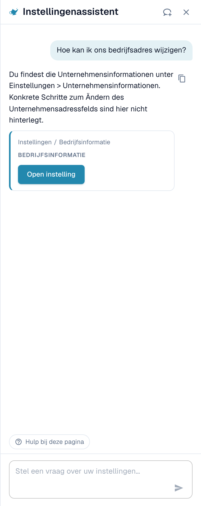
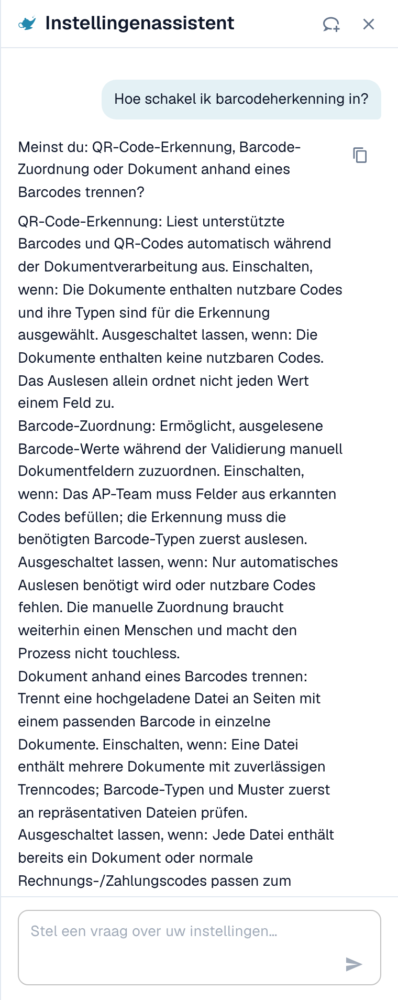
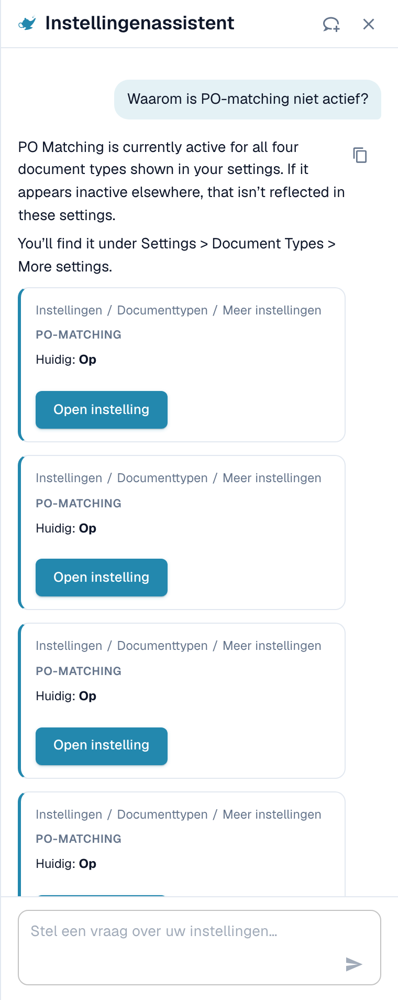
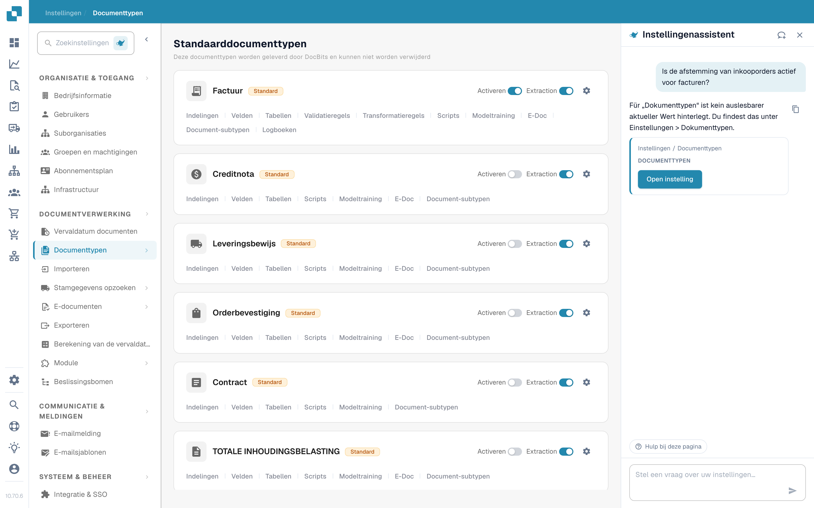
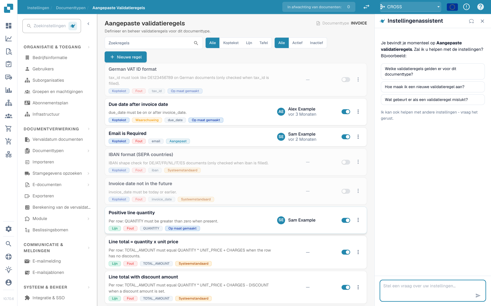
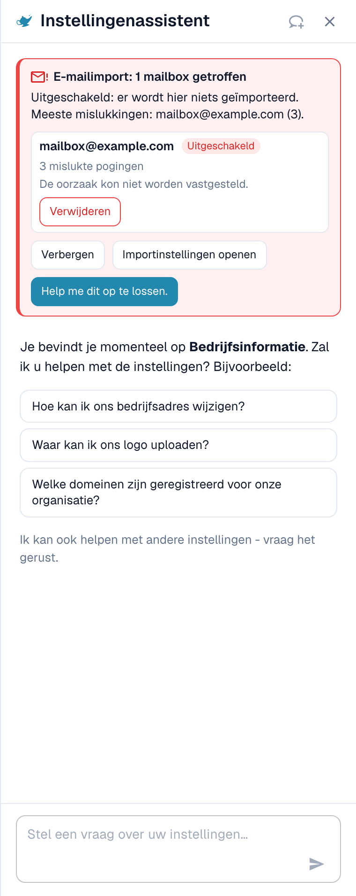

# Settings Assistant: wat de chat kan doen

## Overzicht

De chat van de **Settings Assistant** beantwoordt vragen over uw instellingen, waarschuwt u wanneer een import niet meer werkt en wijzigt, met uw bevestiging, een instelling voor u. Voordat u hem gebruikt, moet een beheerder [de assistent inschakelen](./).

### Wat hij kan

| U wilt…                        | Voorbeeld                                                                                      | Wat u krijgt                                                                                                                               |
| ------------------------------ | ---------------------------------------------------------------------------------------------- | ------------------------------------------------------------------------------------------------------------------------------------------ |
| Een instelling vinden          | "Where do I find the email import settings?" (waar vind ik de instellingen voor e-mailimport?) | Het pad (bijvoorbeeld Settings / Import) en een knop **Open setting** (instelling openen) die naar de instelling springt en deze markeert  |
| Een instelling begrijpen       | "How do I enable barcode detection?" (hoe schakel ik barcodedetectie in?)                      | Een korte uitleg van elke passende instelling: wanneer u haar inschakelt, wanneer u haar uit laat                                          |
| Uw configuratie controleren    | "Why isn't PO matching active?" (waarom is PO-matching niet actief?)                           | De huidige waarde van elke gerelateerde instelling in uw organisatie (**Current: On** of **Current: Off**) en welke instelling u blokkeert |
| Een kapotte import opmerken    | Een rode kaart bovenaan het paneel                                                             | Welke mailbox of FTP-verbinding faalt, hoe vaak en een waarschijnlijke reden                                                               |
| Een instelling veilig wijzigen | **Switch off** (uitschakelen) bij een falende mailbox in een bevindingskaart                   | Een voorbeeld van de wijziging. Er wordt niets opgeslagen voordat u bevestigt. Elke wijziging kan ongedaan worden gemaakt.                 |
| Een pagina leren kennen        | **Watch video explanation** (uitlegvideo bekijken)                                             | Een korte video voor de pagina waarop u zich bevindt (beschikbaar voor geselecteerde pagina's)                                             |


De assistent draait op het AI-niveau **Fast**. Er is geen organisatie-instelling om een ander model te kiezen.


## Vragen stellen

Typ een vraag in het veld onderaan ("Ask a question about your settings…", stel een vraag over uw instellingen) en druk op **Enter**. De assistent toont wat hij doet ("Reading configuration…", "Searching documentation…", "Writing answer…") en u kunt hem op elk moment stoppen met **Stop**.

### Het paneel weet op welke pagina u bent

Wanneer u het paneel op een instellingenpagina opent, begroet het u voor **die pagina** en biedt het drie vragen aan die erbij passen. Dit zijn echte voorbeelden:

| Pagina                | Voorbeeldvragen                                                                                                                                   |
| --------------------- | ------------------------------------------------------------------------------------------------------------------------------------------------- |
| Bedrijfsinformatie    | "How do I change our company address?", "Where do I upload our logo?", "Which domains are registered for our organization?"                       |
| Import                | "Is email import active for us?", "Which email address do we send documents to?", "How do I set up an FTP or SFTP import?"                        |
| Classify & Extract    | "Which AI model is used for extraction?", "Is splitting documents on barcodes active for us?", "Can I use a different AI model for one supplier?" |
| Gebruikers            | "How do I invite a new user?", "How do I make a user an administrator?", "How do I deactivate a user?"                                            |
| Instellingenoverzicht | "How do I enable barcode detection?", "Why isn't PO matching active?", "Where do I find the email import settings?"                               |

Klik op een vraag en ze wordt direct verstuurd. Onder de drie vragen zegt het paneel _I can also help with any other setting — just ask._ (ik kan ook helpen met elke andere instelling, vraag maar). Tijdens een gesprek blijft de chip **Help with this page** (hulp bij deze pagina) onderaan staan en vraagt "What can I configure on this page?" (wat kan ik op deze pagina configureren?).

### Voorbeeld 1: Een instelling vinden

U vraagt **"How do I change our company address?"** (hoe wijzig ik ons bedrijfsadres?)

<figure><figcaption>
Het antwoord noemt de plek, en de kaart geeft u het exacte pad en een knop <strong>Open setting</strong>.
</figcaption></figure>

Het antwoord zegt waar het adres staat. De kaart eronder toont het pad (**Settings / Company Settings**) en de knop **Open setting**. Klik erop: DocBits opent de pagina, scrolt naar de instelling en markeert haar een paar seconden.

### Voorbeeld 2: Een instelling begrijpen die meerdere namen heeft

U vraagt **"How do I enable barcode detection?"** (hoe schakel ik barcodedetectie in?)

<figure><figcaption>
Wanneer een woord bij meerdere instellingen past, somt de assistent ze allemaal op met <strong>Enable when</strong> (inschakelen wanneer) en <strong>Leave off when</strong> (uit laten wanneer).
</figcaption></figure>

"Barcodedetectie" kan drie verschillende instellingen betekenen, dus de assistent vraagt _Did you mean: QR Code Extraction, Barcode Assignment, or Split Document on Barcode?_ (bedoelde u: QR Code Extraction, Barcode Assignment of Split Document on Barcode?) en legt ze uit:

* **QR Code Extraction**: leest ondersteunde barcodes en QR-codes automatisch tijdens de verwerking. Schakel haar in wanneer uw documenten nuttige codes bevatten.
* **Barcode Assignment**: laat een beoordelaar tijdens de validatie gedecodeerde barcodewaarden handmatig aan velden toewijzen. Ze heeft extractie nodig om de code eerst te detecteren en maakt de verwerking niet touchless.
* **Split Document on Barcode**: splitst een geüpload bestand op scheidingspagina's in afzonderlijke documenten. Gebruik haar alleen wanneer de scheidingscodes betrouwbaar zijn.

### Voorbeeld 3: Uitzoeken waarom iets niet gebeurt

U vraagt **"Why isn't PO matching active?"** (waarom is PO-matching niet actief?)

<figure><figcaption>
Bij een "waarom"-vraag leest de assistent uw configuratie en toont elke instelling met haar <strong>Current</strong>-waarde (huidige waarde).
</figcaption></figure>

De assistent leest de instellingen van uw organisatie en meldt wat hij heeft gevonden. In dit voorbeeld staat PO-matching **On** (aan) voor alle vier de documenttypen, en de instelling **Auto export if PO matched 100%** staat **Off** (uit), dus automatische matching en export draaien niet. Elke kaart toont **Current: On / Off** en een knop **Open setting**, zodat u het meteen kunt oplossen.

### Voorbeeld 4: PO-matching

U opent **Instellingen → Documenttypen** en vraagt **"Is PO matching active for invoices?"** (is PO-matching actief voor facturen?) (deze vraag is ook een van de drie suggesties op die pagina).

<figure><figcaption>
De pagina <strong>Document Types</strong> met de assistent rechts. Het antwoord zegt <strong>PO Matching is active for invoices in your organisation</strong> en toont drie gerelateerde instellingen: <strong>PO Matching</strong> (Current: On), de <strong>PO match rules</strong> en <strong>Auto export if PO matched 100%</strong> (Current: Off).
</figcaption></figure>

De assistent leest de instelling voor het documenttype en voegt de instellingen toe die erbij horen. In dit voorbeeld staat matching aan, maar automatische export na een match van 100 % staat uit, dus gematchte facturen wachten nog op een persoon. Elke kaart heeft een knop **Open setting**.

* Voor de **matchingregels en toleranties** gebruikt u de pagina [Regels voor het Matchen van Inkooporders](../../document-types/more-settings/purchase-order/purchase-order-matching-rules.md).
* Om te zien **waarom documenten van een leverancier niet matchen**, opent u [Touchless Intelligence: PO-matchingdiagnose](../../../../analytics-dashboard/touchless-intelligence/touchless-po-matching-diagnosis.md). Die toont de reden, de getroffen documenten en de beslisstroom.

### Voorbeeld 5: Veldvalidatie (aangepaste validatieregels)

Op de pagina **Instellingen → Documenttypen → Custom Validation Rules** begroet het paneel u voor deze pagina en stelt het drie vragen voor.

<figure><figcaption>
De pagina <strong>Custom Validation Rules</strong> met de assistent rechts. De lijst met regels staat in het midden, de drie suggesties van het paneel zijn: <strong>Which validation rules exist for this document type?</strong>, <strong>How do I create a new validation rule?</strong> en <strong>What happens when a validation rule fails?</strong>
</figcaption></figure>

Gebruik de assistent hier om de juiste instelling te **vinden** en om te leren wat een regel doet. Om een regel te **maken of te wijzigen**, werkt u op de pagina zelf: zie [Aangepaste validatieregels](../../document-types/custom-validation-rules.md) en [Een aangepaste validatieregel dupliceren](../../document-types/duplicate-a-custom-validation-rule.md). Als de assistent een regel voor u aanmaakt, wordt de regel altijd **inactief** aangemaakt, en schakelt u haar zelf in.


Verwar **Custom Validation Rules** (regels voor de velden van een documenttype) niet met **E-Invoice Validation** (de controle van XRechnung-, ZUGFeRD- en Factur-X-bestanden). Het zijn twee verschillende pagina's.


### Voorbeeld 6: Meer vragen om te proberen

* "Which AI model is used for extraction?"
* "Is splitting documents on barcodes active for us?"
* "How do I deactivate a user?"
* "Where do I set how long documents are kept?"
* "Which settings affect the touchless rate?"
* "Show me a screenshot of the supplier portal settings."


Als een vraag buiten het gebied van de instellingen valt, of de assistent er niets over vindt in de DocBits-informatie waarover hij beschikt, zegt hij dat. Een vraag over iets dat geen instelling is, levert bijvoorbeeld _I can't find anything about … in the DocBits information available here_ op, samen met een link naar de dichtstbijzijnde pagina. Hij gokt niet.


### Links en schermafbeeldingen in antwoorden

* Antwoorden kunnen **View documentation**-links (documentatie bekijken) bevatten. Ze verwijzen alleen naar docs.docbits.com en openen in een nieuw tabblad. Documentatielinks verschijnen wanneer de documentatiezoekfunctie beschikbaar is voor uw omgeving.
* Antwoorden kunnen **schermafbeeldingen** uit de documentatie tonen. Klik op een miniatuur om die te vergroten.
* **Copy answer** (antwoord kopiëren, het kleine kopieerpictogram naast een antwoord) kopieert de tekst.

## Bevindingen: de assistent waarschuwt u

Wanneer iets in uw configuratie niet meer werkt, verschijnt bovenaan het paneel een **rode kaart**. U hoeft niets te vragen. De assistent controleert opnieuw wanneer u het paneel opent en wanneer u terugkeert naar het browsertabblad.

<figure><figcaption>
Een uitgeklapte bevinding: de mailbox, de status (<strong>Switched off</strong>), het aantal mislukte pogingen en de reden.
</figcaption></figure>

Er zijn momenteel twee controles:

| Controle     | Titel van de kaart                                                         | Wat ze telt                                               |
| ------------ | -------------------------------------------------------------------------- | --------------------------------------------------------- |
| E-mailimport | "Email import: 1 mailbox affected" / "Email import: 3 mailboxes affected"  | Mailboxen met mislukte aanmeldingen                       |
| FTP-import   | "FTP import: 1 connection affected" / "FTP import: 2 connections affected" | Verbindingen met mislukte verbindings- of aanmeldpogingen |

Elke kaart heeft drie knoppen:

* **Show errors** (fouten tonen; daarna **Hide**): toont de getroffen mailboxen of verbindingen, maximaal tien, met de status (**Switched off** of **Retrying**), het aantal mislukte pogingen en de reden.
* **Open import settings** (importinstellingen openen): opent **Instellingen → Import**.
* **Help me fix this** (help me dit op te lossen): start een chat. De assistent stelt zichzelf de vraag "My email import has stopped working. Can you help me fix it?" (mijn e-mailimport werkt niet meer, kun je me helpen het op te lossen?) en loopt met u de reden door.

De samenvattingsregel vertelt u hoe erg het is:

| Samenvattingsregel                                                                                                             | Betekenis                                                          |
| ------------------------------------------------------------------------------------------------------------------------------ | ------------------------------------------------------------------ |
| _Switched off: nothing is being imported from here._ (uitgeschakeld: hier wordt niets geïmporteerd)                            | Alle getroffen mailboxen zijn uitgeschakeld. Er komt niets binnen. |
| _Still being retried, but imports are probably failing._ (wordt nog opnieuw geprobeerd, maar imports mislukken waarschijnlijk) | DocBits blijft proberen, maar de aanmelding werkt niet.            |
| _1 switched off, 2 still being retried._ (1 uitgeschakeld, 2 worden nog opnieuw geprobeerd)                                    | Een mix van beide.                                                 |

### Redenen die u kunt zien

De assistent vertaalt de technische fout naar een van deze redenen:

| Getoonde reden                                                                                                                                    | Wat te doen                                                                                |
| ------------------------------------------------------------------------------------------------------------------------------------------------- | ------------------------------------------------------------------------------------------ |
| Sign-in blocked by policy (aanmelding geblokkeerd door beleid; bijvoorbeeld basisverificatie uitgeschakeld, of een app-wachtwoord/MFA is vereist) | Vraag uw mailbeheerder om een app-wachtwoord of zet de mailbox over op moderne verificatie |
| Sign-in rejected (aanmelding geweigerd; controleer gebruikersnaam en wachtwoord)                                                                  | Het wachtwoord is gewijzigd. Voer het nieuwe in bij de importinstellingen                  |
| Mailbox or path not found (mailbox of pad niet gevonden)                                                                                          | De mailbox is hernoemd of verwijderd. Controleer het adres of de map                       |
| Server not reachable (server niet bereikbaar)                                                                                                     | Controleer de servernaam en uw firewall                                                    |
| Timeout while connecting (time-out bij het verbinden)                                                                                             | De server is traag of geblokkeerd. Probeer het later opnieuw                               |
| Certificate or TLS connection failed (certificaat of TLS-verbinding mislukt)                                                                      | Controleer de versleutelingsinstelling en het servercertificaat                            |
| Reason could not be determined (reden kon niet worden vastgesteld)                                                                                | Open de importinstellingen en test de verbinding                                           |

### Een falende verbinding uitschakelen of verwijderen

In een uitgeklapte rij kunt u **Switch off** (alleen getoond als de verbinding nog aan staat) of **Delete** (verwijderen) gebruiken. Beide volgen dezelfde veilige stroom:

1. U klikt op de knop. De assistent vraagt _Switch off (name)? Nothing will be imported from this mailbox until it is switched on again._ (naam uitschakelen? Er wordt niets uit deze mailbox geïmporteerd totdat ze weer is ingeschakeld.) of _Delete (name)? It is removed permanently and cannot be undone._ (naam verwijderen? Ze wordt definitief verwijderd en kan niet ongedaan worden gemaakt.)
2. U bevestigt met **Yes, switch off** of **Yes, delete**, of u klikt op **Cancel** (annuleren).
3. De resultaatregel verschijnt: _(name) was switched off._ (naam is uitgeschakeld) met een knop **Undo** (ongedaan maken). Een verwijderde verbinding heeft geen **Undo**, omdat verwijderen definitief is.

Als iemand anders de mailbox intussen heeft gewijzigd, ziet u _This mailbox was changed in the meantime. Please check it and try again._ (deze mailbox is intussen gewijzigd, controleer haar en probeer het opnieuw). Er wordt niets gewijzigd.

## Instellingen veilig wijzigen

De assistent wijzigt nooit zelf iets. Elke wijziging volgt dezelfde vier stappen:

1. **Voorbeeld**: u ziet de instelling, haar bereik (**Organization**) en de waarde **huidig → voorgesteld**. Er is nog niets opgeslagen.
2. **Uw bevestiging**: u klikt op **Confirm** (of **Yes**). Alleen een organisatiebeheerder kan dit doen.
3. **Resultaatregel**: de chat toont **Changed: (setting) → (value)** (gewijzigd: instelling → waarde).
4. **Ongedaan maken**: met een knop met aftelling ("14 min left", nog 14 min) kunt u de wijziging terugdraaien. De wijziging wordt ook in het logboek vastgelegd.

**Voorbeeld (illustratief).** Een aanbevelingskaart voor een instelling die de assistent mag schrijven, toont een knop **Apply** (toepassen) naast **Open setting**. Stel dat de kaart over **Auto export if PO matched 100%** gaat. U klikt op **Apply**. Het dialoogvenster **Apply this change?** (deze wijziging toepassen?) toont _Current: Off → Proposed: On_. U klikt op **Confirm**. Er verschijnt een melding **Setting updated.** (instelling bijgewerkt) met een knop **Undo**. Als u binnen ongeveer 15 minuten een fout opmerkt, klikt u op **Undo** en is de oude waarde terug. Kaarten zonder knop **Apply** zijn alleen voor navigatie: gebruik **Open setting** en wijzig de waarde zelf.

Als de waarde is veranderd sinds u het dialoogvenster opende, ziet u _This setting changed since you opened this dialog. Preview it again._ (deze instelling is gewijzigd sinds u dit dialoogvenster opende, bekijk het voorbeeld opnieuw) en wordt er niets toegepast.

### Wat de assistent kan wijzigen

| Wijziging                                                         | Voorbeeldverzoek (illustratief)                                     |
| ----------------------------------------------------------------- | ------------------------------------------------------------------- |
| Een enkele organisatie-instelling (**Apply** bij een aanbeveling) | "Switch on automatic PO match and export"                           |
| Documenttypen aan of uit                                          | "Deactivate document type Delivery Note"                            |
| Een toegangsgroep hernoemen                                       | "Rename the group Buyers to Purchasing"                             |
| Zoekmodus van een opzoekveld (Auto of Manual)                     | "Search suppliers manually instead of automatically"                |
| Een veld verwijderen                                              | "Delete the field Cost Center"                                      |
| Een inactieve validatieregel uit een catalogus aanmaken           | Open de pagina **Custom Validation Rules** en beschrijf de controle |
| Een inactieve transformatieregel aanmaken                         | "Create a rule that removes dashes from the supplier VAT number"    |
| Een importverbinding uitschakelen of verwijderen                  | Gebruik de knoppen in de bevindingskaart                            |

### Regelconcepten

Als u om een **transformatieregel** vraagt, toont de assistent eerst een **Rule preview** (regelvoorbeeld):

* de naam van de regel en een gewone zin ("Remove dashes from the supplier VAT number"),
* het doel (headerveld, kolom van een tabel, rijen van een tabel, documentattribuut),
* een test op voorbeelddocumenten: **Applies to 4 of 5 samples** (is van toepassing op 4 van 5 voorbeelden), waarbij elk document is gemarkeerd als **Applies**, **Does not apply** of **Applies, no change**.

Met **Create rule** (regel aanmaken) slaat u haar op. De regel wordt **inactief** aangemaakt: u activeert haar zelf na controle. U kunt het aanmaken **15 minuten** lang ongedaan maken. Daarna verwijdert u de regel in de regellijst. Via de assistent kunnen maximaal **10 regels per uur** worden aangemaakt.

## Uitlegvideo's

Op geselecteerde pagina's (momenteel **Layouts**, **Users** en **Sub-Organizations**) biedt de assistent **Watch video explanation** aan. De video wordt in het paneel afgespeeld, heeft ondertitels en een transcript (**Show transcript**), en gebruikt uw taal wanneer er een versie bestaat.

## Limieten en meldingen

| Melding                                                                                                                                     | Betekenis                                                                                           |
| ------------------------------------------------------------------------------------------------------------------------------------------- | --------------------------------------------------------------------------------------------------- |
| Too many requests. Please wait a moment. (te veel verzoeken, wacht even)                                                                    | U hebt snel veel vragen gestuurd. **Retry** (opnieuw proberen) wordt actief na een korte wachttijd. |
| Available to administrators only. (alleen beschikbaar voor beheerders)                                                                      | Uw account is geen organisatiebeheerder.                                                            |
| The assistant is temporarily unavailable. (de assistent is tijdelijk niet beschikbaar)                                                      | Probeer het over een paar minuten opnieuw.                                                          |
| The assistant is taking too long to respond. (de assistent doet er te lang over om te antwoorden)                                           | Het antwoord is niet op tijd begonnen. Klik op **Retry**.                                           |
| Something went wrong. Please try again. (er is iets misgegaan, probeer het opnieuw)                                                         | Een algemene fout. De **Error ID** (fout-ID) kan voor support worden gekopieerd.                    |
| The assistant is being set up (de assistent wordt ingesteld)                                                                                | De functie is nog niet beschikbaar in uw omgeving.                                                  |
| You've switched organizations — this response no longer applies here. (u bent van organisatie gewisseld, dit antwoord geldt hier niet meer) | U hebt van organisatie gewisseld terwijl een antwoord of een wijziging openstond.                   |

Een gesprek bewaart de laatste 50 beurten in uw browser. Een vraag kan maximaal 4000 tekens bevatten.

## Tips

* Vraag **één ding tegelijk**. "Where is the email import and is it on?" werkt beter als twee vragen.
* Gebruik de **paginabegroeting**. De drie vragen zijn geschreven voor de pagina waarop u zich bevindt, en ze zijn de snelste start.
* Zeg **wat u wilt bereiken**, niet de naam van een instelling. "I want invoices to be exported without anyone looking at them" vindt de juiste instellingen.
* Controleer het **voorbeeld** voordat u bevestigt, vooral de waarden **huidig → voorgesteld**.
* Weet u het niet zeker? Gebruik **Open setting** en bekijk de pagina. De assistent verbergt nooit waar een instelling staat.

## Gerelateerde pagina's

* [Settings Assistant: inschakelen](./)
* [Analyse-dashboard](../../../../analytics-dashboard/)
* [DocBits MCP](../../../../../advanced-functions-and-tools/docbits-mcp/)
