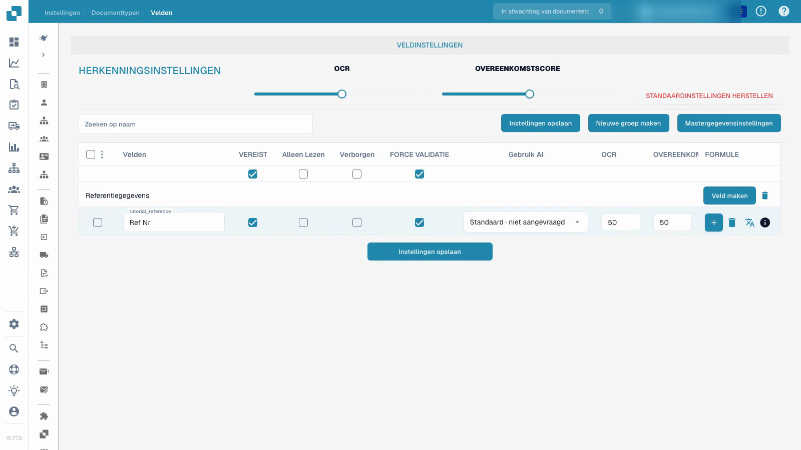

# Documenttypen

De video demonstreert het configureren van velden in een geïsoleerd aangepast testtype.


Documenttypen


[Bekijk met ondertiteling](https://docbits-videos.fra1.cdn.digitaloceanspaces.com/settings-assistant/document-types-fields-admin/v1/nl.html)

Opmerking: Sommige native productlabels zijn mogelijk niet vertaald. De opname behoudt de daadwerkelijke gebruikersinterface.

## Overzicht

Documenttypen definiëren de configuratie die wordt gebruikt voor verschillende soorten documenten. DocBits biedt standaardtypen zoals facturen en creditnota's. Met aangepaste typen kan een beheerder een andere categorie zakelijke documenten configureren. Standaardtypen kunnen niet worden verwijderd; beheer aangepaste typen binnen de machtigingen van de organisatie.

## Bedieningselementen op een documenttypekaart

| Bedieningselement | Doel |
| --- | --- |
| Activeren | Schakel het documenttype in of uit voor verwerking. |
| Extraction | Kies de extractiemodus die wordt weergegeven door het native bedieningselement: Flex of Fix. Dit is een modusselectie, los van de Activeren-schakelaar. |
| Instellingen, weergegeven als een tandwiel | Open verdere configuratie voor dat documenttype. |

De beschikbare links zijn afhankelijk van het type, de machtigingen en de ingeschakelde modules. De huidige interface kan lay-outs, velden, tabellen, scripts, modeltraining en document-subtypen bieden. Transformatie-regels, validatieregels en configuratie van elektronische documenten zijn beschikbaar waar hun respectievelijke functies van toepassing zijn. Andere configuratie-opties kunnen zich in de instellingen van het documenttype bevinden in plaats van op een apart tabblad onder elke kaart.

## Velden en vereiste informatie configureren

De video gebruikt een reeds gemaakt, geïsoleerd aangepast testtype. Het wijzigt het referentieveld van dat type; het wijzigt de bestaande factuurconfiguratie niet.

1. Open het documenttype en selecteer de velden ervan.
2. Controleer de veldgroep en de stabiele technische veldnaam. Een leesbaar weergavelabel is een aparte instelling; het wijzigen ervan creëert geen nieuwe veld-ID.
3. Maak het referentieveld verplicht terwijl het zichtbaar en bewerkbaar blijft. Vereiste informatie moet worden verstrekt; de instelling verzint geen ontbrekende waarde of garandeert geen correcte extractie.
4. Configureer expliciete veldbeoordeling afzonderlijk van de vereiste waarde. Alleen-lezen, verborgen, OCR-drempels en Match Score-drempels hebben hun eigen effecten; het zijn geen uitwisselbare schakelaars.
5. Sla de configuratie op, open deze opnieuw en controleer het opgeslagen weergavelabel en de instellingen.

<figure><figcaption>
Opgeslagen velden in een geïsoleerd testtype.
</figcaption></figure>

Het gedemonstreerde resultaat bewijst dat de veldconfiguratie is opgeslagen en opnieuw is geladen. Het vormt geen modeltraining, factuurgoedkeuring, export of een validatietest verder in het proces. Voordat u een configuratie in productie gebruikt, test u representatieve documenten en de beoogde workflow voor gewone gebruikers.

## Aangepaste validatieregels

Waar deze functie beschikbaar is, opent u de validatieregels van het documenttype. Om een bestaande regel te hergebruiken, volgt u [Aangepaste validatieregel dupliceren](duplicate-a-custom-validation-rule.md). Dit staat los van de individuele veldeigenschappen die in de video worden getoond.

## Een aangepast documenttype maken

Open de sectie aangepaste documenttypen, kies Nieuw en voer een duidelijke naam in. Voltooi de aangeboden instellingsstappen voor de beoogde extractiemodus, velden, groepen en eventuele tabellen. Modeltraining en extractieconfiguratie staan los van het louter opslaan van de instelling voor een verplicht veld.


Zie [Documenttype instellen](../../../setup/document-types/) voor de instellingsprocedure.


## Extra opname


Documenttypen

