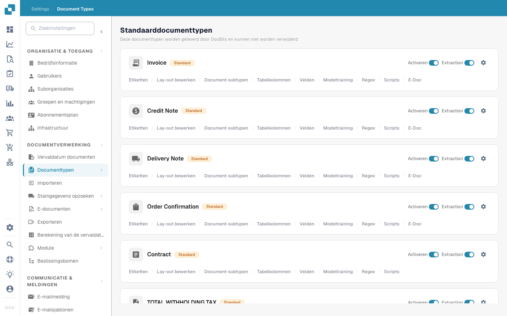

# Documenttypes


DocBits Document Types Explained: Create, Configure & Assign Processing Settings


<figure><figcaption>
Pagina Documenttypes
</figcaption></figure>

## Overzicht

De pagina Documenttypes toont alle documenttypes die door DocBits worden herkend en verwerkt. De pagina is verdeeld in twee onderdelen:

* **Default Document Types**: Vooraf geconfigureerde types die door DocBits worden geleverd (Invoice, Credit Note, Delivery Note, Order Confirmation, Contract, ZUGFeRD, enz.). Deze kunnen niet worden verwijderd.
* **Custom Document Types**: Types die u aanmaakt voor uw specifieke zakelijke behoeften. Deze kunnen worden bewerkt en verwijderd.

## Bedieningselementen per documenttype

Elke kaart van een documenttype toont:

| Bedieningselement | Beschrijving |
|---------|-------------|
| **Activate** | Schakelaar om dit documenttype voor verwerking in of uit te schakelen. |
| **Extraction** | Schakelaar om AI-gebaseerde gegevensextractie voor dit type in of uit te schakelen. |
| **Settings** (tandwielpictogram) | Opent aanvullende configuratieopties voor het documenttype. |

## Configuratietabbladen

Onder elk documenttype hebt u toegang tot de volgende configuratietabbladen:

| Tabblad | Beschrijving |
|-----|-------------|
| **Labels** | Beheer weergavelabels en vertalingen voor het documenttype. |
| **Edit layout** | Wijzig hoe het document in de validatieweergave wordt getoond, inclusief veldposities. |
| **Document Sub Types** | Configureer subcategorieën voor dit documenttype (bijv. verschillende factuurformaten). |
| **Table columns** | Pas aan welke gegevenskolommen in de tabel met regelitems verschijnen. |
| **Fields** | Beheer de gegevensvelden die uit het document worden geëxtraheerd (velden toevoegen, bewerken of verwijderen). |
| **Model Training** | Configureer en train het AI-model dat wordt gebruikt voor het herkennen en extraheren van gegevens. |
| **Regex** | Stel reguliere expressies in voor patroongebaseerde gegevensextractie. |
| **Scripts** | Schrijf aangepaste verwerkingsscripts die tijdens de documentverwerking worden uitgevoerd. |
| **E-Doc** | Configureer standaarden voor elektronische documenten (XRechnung, ZUGFeRD, EDI, FatturaPA). |

## Aangepaste validatieregels

Open een documenttype en selecteer **Custom Validation Rules** om de eigen validatieregels van dat type te beheren. Om een bestaande regel te hergebruiken zonder haar opnieuw te bouwen, volgt u [Een aangepaste validatieregel dupliceren](duplicate-a-custom-validation-rule.md). De handleiding legt de regelnaam, de regelsleutel en de bevestigingsknoppen uit.

## Een aangepast documenttype aanmaken

1. Scroll omlaag naar het onderdeel **Custom Document Types**.
2. Klik op **+ New**.
3. Voer een naam in voor het nieuwe documenttype.
4. Configureer de velden, de lay-out en de extractie-instellingen naar behoefte.


Zie [Documenttype instellen](../../../setup/document-types/) voor gedetailleerde installatie-instructies.

