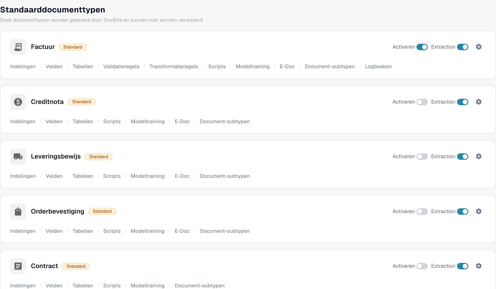

# Een documenttype activeren of deactiveren

Beheerders kunnen kiezen welke documenttypes voor hun organisatie beschikbaar zijn. U kunt dit wijzigen op de pagina **Documenttypen**, zonder het type of de configuratie ervan te verwijderen.

1. Open **Instellingen → Documenttypen**.
2. Zoek het documenttype, bijvoorbeeld **Factuur**, onder **Standaarddocumenttypen** of **Aangepaste documenttypen**.
3. Gebruik de schakelaar met het label **Activeren** op de kaart van dat type. Een gekleurde schakelaar betekent dat het type actief is; een grijze schakelaar betekent dat het inactief is. Wacht op de bevestigingsmelding voordat u de pagina verlaat. Voor deze schakelaar is er geen aparte knop Save.

<figure><figcaption>
Documenttypen en activeringsopties.
</figcaption></figure>

De schakelaar **Extractie** naast **Activeren** is een andere instelling. Hiermee kiest u de extractiemodus (Flex of Fix); het activeert of deactiveert het documenttype niet. Het tandwielpictogram opent meer instellingen voor dat type. De links onder de naam van het type openen de lay-outs, velden, tabellen, scripts en andere beschikbare configuratiegebieden.

DocBits levert de standaarddocumenttypes, die niet kunnen worden verwijderd. U kunt ook aangepaste types aanmaken en beheren. Zie [Documenttypes toevoegen en bewerken](adding-editing-document-types.md) voor de volgende installatiestappen en [Tabelkolommen](table-columns/README.md) om geëxtraheerde regelitems te configureren.
