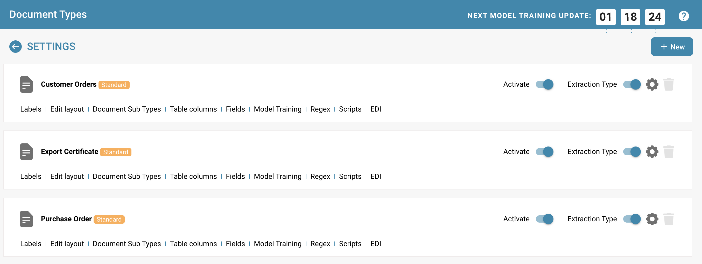
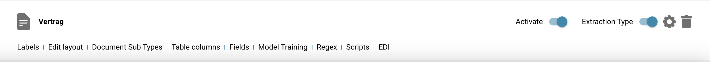
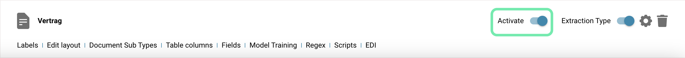
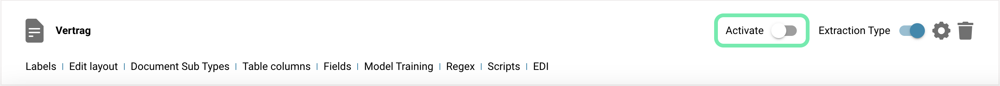

# Activation

## Enabling or disabling document types in a document management system like Docbits allows an organization to keep only the document types it needs active to ensure efficient management and clarity.

### Here are the steps to enable and disable document types, along with an explanation of the toggle function in the user interface:

#### **Access Document Type Management**

* Log in: Log in to DocBits with administrator rights.
* Navigate: Go to Settings.
* Document Types: Find the Document Types section.

**Access Document Types List**

* Access the list of existing document types. This list shows all defined document types, both active and inactive.

<figure><figcaption></figcaption></figure>

**Activating or deactivating a document type Select Document Type:**

* Select the document type you want to enable or disable.

<figure><figcaption></figcaption></figure>

**Use the toggle function:**

* In the user interface, there is a toggle switch next to each document type that allows activation and deactivation.

**Activation:**

* If the document type is currently deactivated, the switch may show a gray or off position.
* Click the switch to activate the document type. The switch changes its position and color to indicate activation.

<figure><figcaption></figcaption></figure>

**Deactivation:**

* If the document type is currently activated, the switch shows a colored or on position.
* Click the switch to deactivate the document type. The switch changes its position and color to indicate deactivation.

<figure><figcaption></figcaption></figure>

**Save:**

* Make sure all changes are saved. Some systems save changes automatically, while others require explicit confirmation.

### Notification and documentation

**Inform users:**

* Inform users about the activation or deactivation of the document type, especially if it impacts their work processes.

**Update documentation:**

* Update system documentation to reflect the current status of document types.

Conclusion The ability to enable or disable document types depending on the organization's needs is a useful tool for managing document processing in Docbits. By simply using the toggle function in the user interface, administrators can react flexibly and efficiently and ensure that the system is optimally aligned with current business needs.
