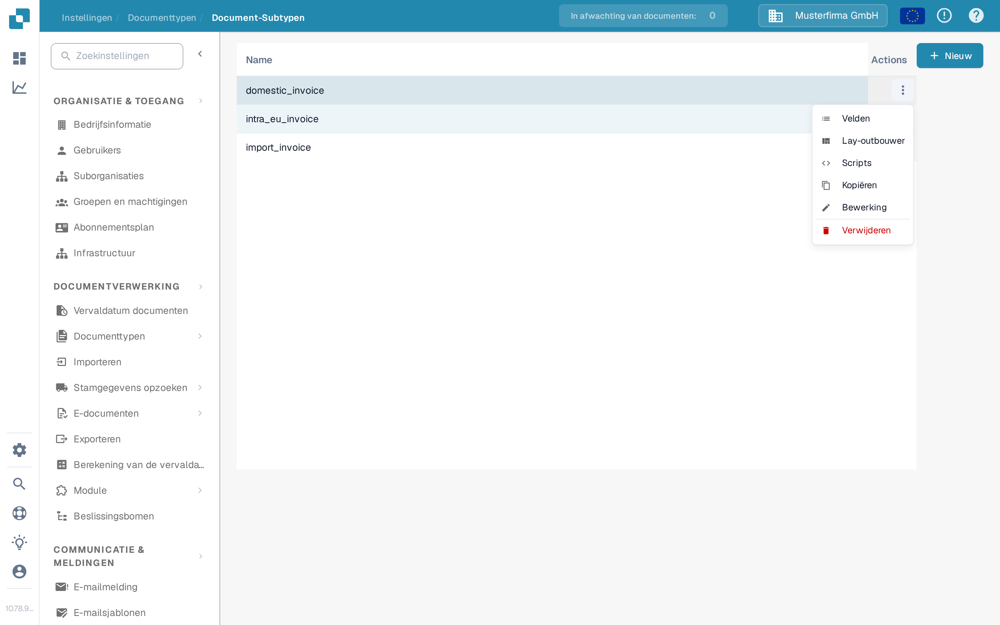
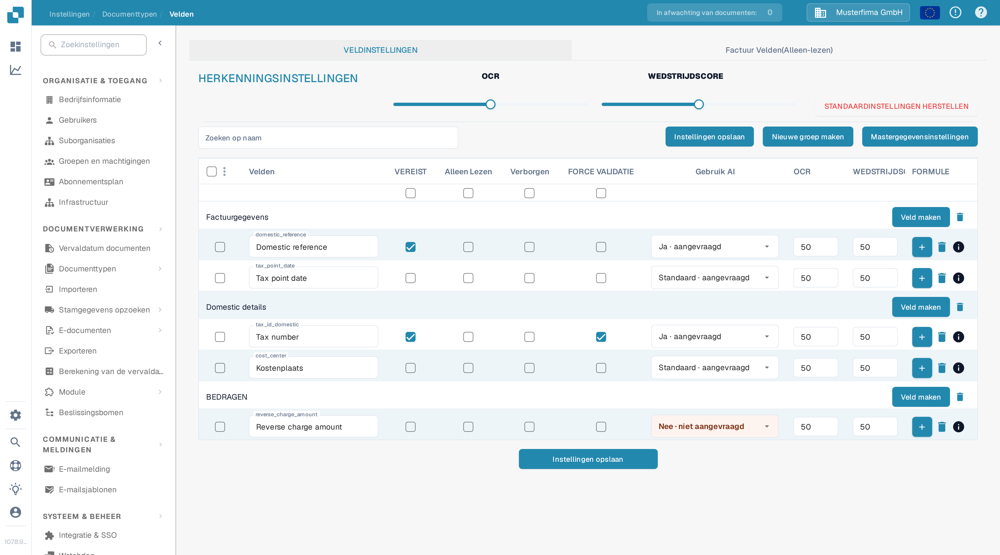
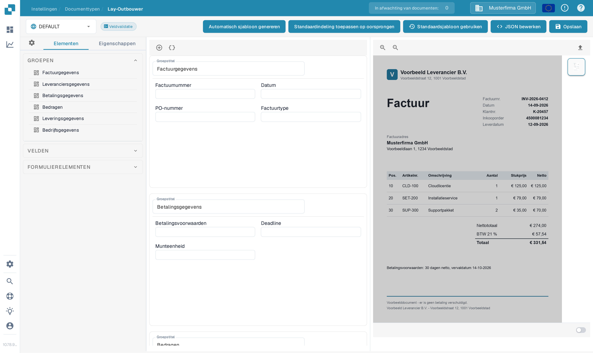
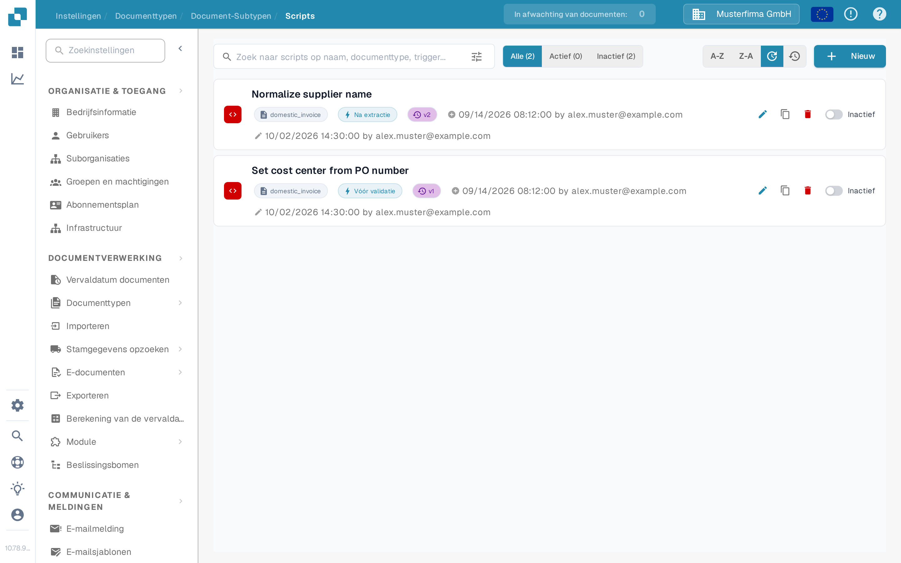

# Subtypes configureren

Gebruik een documentsubtype wanneer facturen van hetzelfde documenttype andere velden, een andere validatielay-out of eigen verwerkingsscripts nodig hebben. Maak eerst een [subtype aan](creating-a-new-sub-type.md), open daarna **Instellingen → Documenttypen**, kies het documenttype en open **Document-Subtypen**. Open in de subtyperij het menu **Actions** (de drie puntjes). Het menu biedt **Velden**, **Lay-outbouwer** en **Scripts**; het bevat ook [Kopiëren, Bewerking en Verwijderen](using-actions.md).

<figure><figcaption>
Kies het deel van het subtype dat u wilt configureren.
</figcaption></figure>

## Velden

Kies **Velden** om te bepalen welke informatie gebruikers voor dit subtype zien en invoeren. U kunt een veld in een groep aanmaken, een bestaand veld als vereist, alleen-lezen of verborgen markeren en de herkenningsopties aanpassen. Kies **Instellingen opslaan** nadat u wijzigingen hebt gemaakt. Gebruik [Velden toevoegen en bewerken](fields/adding-and-editing-fields.md) voor de stappen, [Veldeigenschappen configureren](fields/configuring-field-properties-1.md) voor de kolomopties en [Mastergegevensinstellingen](fields/master-data-settings.md) wanneer een veld opzoekgegevens moet gebruiken.

<figure><figcaption>
Veldinstellingen in de testorganisatie van de documentatie. Er worden geen klantgegevens getoond.
</figcaption></figure>

## Lay-outbouwer

Kies **Lay-outbouwer** om groepen en velden op het documentvalidatiescherm te rangschikken. Aan de linkerkant staan de elementen; aan de rechterkant kunt u een voorbeelddocument toevoegen voor een voorbeeldweergave. Controleer het resultaat en kies **Opslaan** wanneer de lay-out klaar is. De gids [Lay-outbouwer](../../../setup/document-types/layout-builder.md) legt elementen, de documentvoorvertoning en het opslaan van een lay-out uit.

<figure><figcaption>
Subtypelay-out vóór het toevoegen van een voorbeelddocument.
</figcaption></figure>

## Scripts

Kies **Scripts** om de scripts van dit subtype te bekijken. Kies in een lege lijst **Nieuw** om te beginnen. Het zoekveld en de filters **Alle**, **Actief** en **Inactief** helpen bij het vinden van bestaande scripts. Volg [Scripts maken en bewerken](script/creating-and-editing-scripts.md) om er een te maken, en [Scriptactivering en -beheer](script/script-activation-and-management.md) voordat u het inschakelt voor verwerking.

<figure><figcaption>
Er zijn nog geen scripts aangemaakt in het testsubtype van de documentatie.
</figcaption></figure>

## Vertaalfouten van de app

De Nederlandse interface gebruikt op deze pagina's een paar onjuiste of vreemde vertalingen. Deze worden hier woordelijk genoteerd zoals de app ze toont; de documentatie corrigeert de app niet:

* Het actiemenu heet in de app **Actions** en de kopoptie **Bewerking** (in plaats van "Bewerken").
* De herkenningsdrempel heet in de app **WEDSTRIJDSCORE** (letterlijk vertaald van "Match Score").
* De knop voor het terugzetten van de standaardwaarden heet **STANDAARDINSTELLINGEN HERSTELLEN**.
