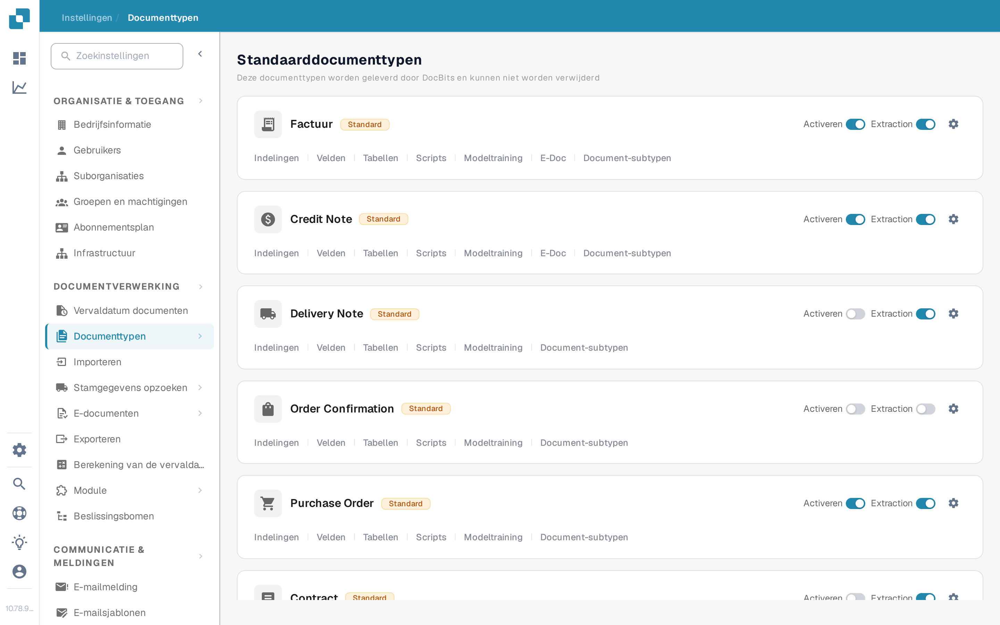
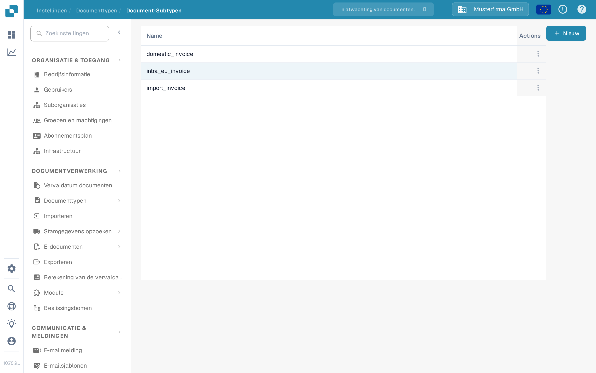
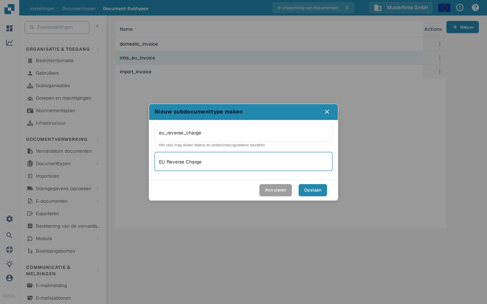

# Een nieuw subtype maken

Maak een documentsubtype aan wanneer een soort document eigen veldinstellingen, een eigen validatielay-out of eigen scripts nodig heeft. U hebt toegang nodig tot **Instellingen → Documenttypen**.

## 1. Open het documenttype

Open **Instellingen → Documenttypen**. Kies in de kaart van het betreffende documenttype **Document-subtypen**. Het voorbeeld hieronder gebruikt **Factuur**; kies het type dat bij uw documenten hoort. Andere links in de kaart leiden naar de instellingen van het hele documenttype.

<figure><figcaption>
Open de subtypen van het documenttype dat u wilt configureren.
</figcaption></figure>

## 2. Start een nieuw subtype

Kies op **Document-subtypen** de knop **+ Nieuw**. Bestaande subtypen verschijnen in de lijst; het menu met drie puntjes (**Actions**) hoort bij een bestaande rij. Als **+ Nieuw** niet reageert op een muisklik, focus de knop dan met het toetsenbord en druk op **Enter**.

<figure><figcaption>
De testorganisatie van de documentatie bevat alleen een synthetisch voorbeeldsubtype.
</figcaption></figure>

## 3. Benoem het en sla het op

Voer een **Name** in met letters en onderstrepingstekens en vul daarna een beschrijvende **Title** in. Beide velden zijn verplicht. De namen in deze schermafbeelding zijn alleen voorbeelden. Kies **Opslaan** om het subtype aan te maken, of **Annuleren** om zonder aan te maken te stoppen.

<figure><figcaption>
Alleen Name en Title worden ingevuld bij het aanmaken.
</figcaption></figure>

Na het opslaan verschijnt het nieuwe subtype in de lijst. Om de velden, de lay-out of de scripts in te stellen, opent u het menu **Actions** en volgt u [Subtypes configureren](configure-subtypes.md). Deze instellingen worden na het aanmaken gedaan, niet in het dialoogvenster **+ Nieuw**.
