# Aangepaste validatieregels



## Overzicht

Met aangepaste validatieregels kan een beheerder **eigen controles** definiëren op de gegevens die DocBits uit een document extraheert — zonder een script te schrijven en zonder te wachten op een productwijziging.

Een regel beantwoordt drie vragen:

1. **Waar** wordt het probleem getoond? Op een headerveld of op een cel van een tabelrij.
2. **Wanneer** is de regel van toepassing? Altijd, of alleen voor documenten (of rijen) die aan een voorwaarde voldoen — zie [Regelvoorwaarden (Applies when)](rule-conditions-applies-when.md).
3. **Wat** moet waar zijn? Een veld moet gevuld zijn, een formaat volgen, binnen een bereik liggen, overeenkomen met een lijst, correct vergelijken met een ander veld of optellen.

Als de controle mislukt, markeert DocBits het veld of de cel op het **validatiescherm** en toont uw bericht — precies zoals bij een ingebouwde controle. Bij de ernst **Fout** kan het document pas worden gevalideerd nadat het probleem is opgelost; bij **Waarschuwing** ziet de gebruiker alleen een melding.

Regels worden per **documenttype** gedefinieerd en worden uitgevoerd op elk document van dat type: tijdens de verwerking en telkens wanneer het document wordt opgeslagen.

### Problemen die ze oplossen

| Zakelijke eis | Zonder aangepaste regels | Met een aangepaste regel |
| --- | --- | --- |
| Duitse facturen boven 250 EUR moeten het btw-nummer van de leverancier vermelden | een script, of gebruikers moeten eraan denken | **Verplicht** op Supplier Tax ID, *applies when* de herkomst DE is en het totaalbedrag groter is dan 250 |
| De factuurnummers van een leverancier zien er altijd uit als `INV-123456` | typefouten bereiken het ERP | **Patroon** `^INV-\d{6}$` op Invoice Number voor die leverancier |
| Elke artikelregel heeft een hoeveelheid groter dan nul nodig | regels met hoeveelheid 0 worden geëxporteerd | **Bereik** (minimum 0.01) op de kolom Quantity |
| De vervaldatum mag niet vóór de factuurdatum liggen | verkeerde betaalruns | **Vergelijk velden**: Due Date op of na Invoice Date |
| De regels moeten optellen tot het nettobedrag | alleen de vaste ingebouwde controle | **Formule** `sum(row.NET_AMOUNT) == header.total_net_amount` met uw eigen tolerantie |
| Alleen valuta's die uw ERP kent zijn toegestaan | exportfouten in het ERP | **Lijst met waarden** op Currency |
| Gebruikers informeren over ongebruikelijke waarden zonder hen te blokkeren | niet mogelijk | elke regel met de ernst **Waarschuwing** |

## Aangepaste validatieregels inschakelen

Aangepaste validatieregels worden **per documenttype** ingeschakeld. Er is geen schakelaar voor de hele organisatie.

1. Ga naar **Instellingen → Algemene instellingen → Documenttypen**.
2. Klik op de kaart van het documenttype op het **instellingen**-pictogram (tandwiel).
3. Open het gedeelte **Aangepaste validatieregels** en zet de schakelaar aan.
4. Klik op **Validatieregels beheren** om de regellijst te openen.

<figure>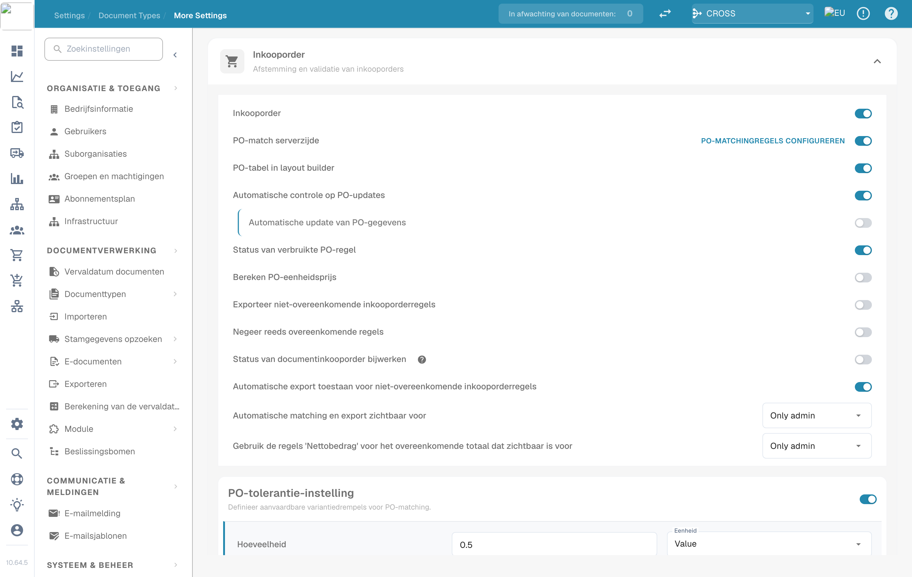<figcaption>
De schakelaars voor Manage Layouts, Custom Validation Rules en Transformation Rules
</figcaption></figure>

Vanaf nu toont de kaart van het documenttype ook een link **Validatieregels**.

<figure>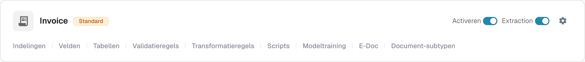<figcaption>
De links op de kaart van het documenttype
</figcaption></figure>


**De schakelaar vervangt de ingebouwde bedragcontroles.** Zolang aangepaste validatieregels voor een documenttype zijn ingeschakeld, worden de vaste controles "totaalbedrag = nettobedrag + btw-bedrag" en de controles op regelbedrag en korting daarvoor **niet** uitgevoerd; de configureerbare regels nemen hun plaats in. Maak de controles waarop u vertrouwt opnieuw aan als regels (zie de [recepten](#recepten)) voordat u de schakelaar aanzet. Door de schakelaar uit te zetten worden de ingebouwde controles hersteld. Alle andere veldvalidaties (verplichte velden, formaten, stamgegevens) blijven gewoon draaien.


## De regellijst

**Documenttypen → (documenttype) → Validatieregels** toont alle regels van het documenttype.

<figure>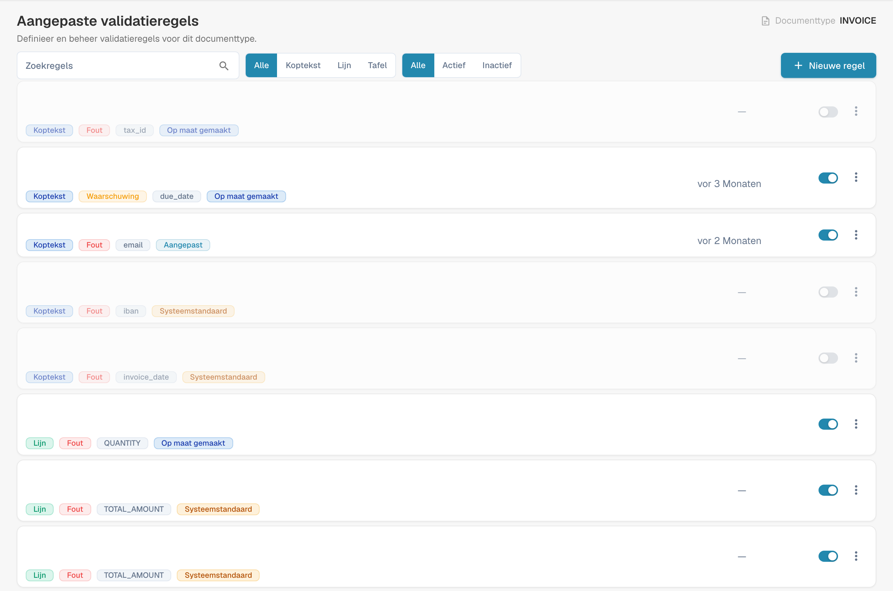<figcaption>
Beheer van validatieregels met afgeschermde geconfigureerde namen. Relatieve datumaanduidingen blijven in deze productweergave Duitstalig.
</figcaption></figure>

Elke kaart toont de naam en beschrijving van de regel en de badges voor het **niveau** (Header / Line / Table), de **ernst** (Error / Warning), het **veld** waaraan de fout is gekoppeld en de **bron**. Gebruik de schakelaar rechts om een regel te activeren of te deactiveren en het menu **⋮** om de regel te dupliceren of te verwijderen. Filter de lijst op niveau (**All / Header / Line / Table**) en op status (**All / Active / Inactive**), of doorzoek hem.

### Systeemstandaard-, aangepaste en eigen regels

| Bron | Wat het is | Wat u kunt doen |
| --- | --- | --- |
| **Systeemstandaard** | Een regel die met DocBits wordt meegeleverd voor alle organisaties. | Kan niet rechtstreeks worden bewerkt — de builder toont "This is a system default rule and cannot be edited." Klik op **Aanpassen** om uw eigen bewerkbare kopie te maken, of schakel de regel uit om hem voor uw organisatie te stoppen. |
| **Op maat gemaakt** | Een systeemstandaard die uw organisatie heeft gewijzigd of uitgeschakeld. | Bewerk hem zoals uw eigen regel. **Terugzetten naar standaardinstellingen** verwijdert uw kopie en brengt het origineel terug. |
| **Aangepast** | Een regel die uw organisatie heeft aangemaakt. | Bewerken, **Dupliceren**, **Verwijderen**. |

Wijzigingen aan systeemstandaarden hebben nooit invloed op andere organisaties.

## Een regel aanmaken

Klik op **Nieuwe regel**. De builder heeft drie stappen. **Testregel** en **Opslaan** staan rechtsboven.

### Stap 1 — Naam en bereik

<figure>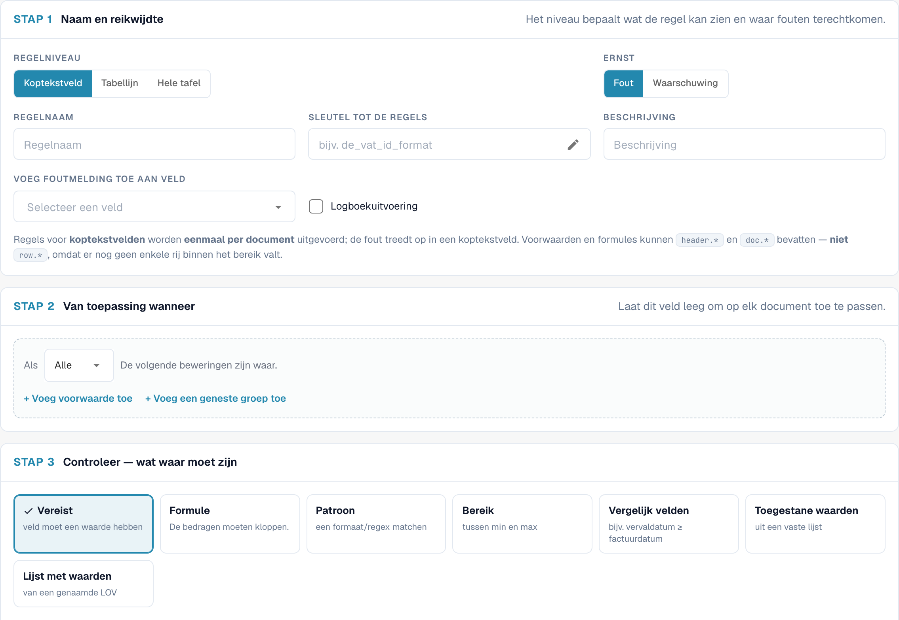<figcaption>
Stap 1 voor een regel op een headerveld
</figcaption></figure>

| Instelling | Wat het doet |
| --- | --- |
| **Regelniveau** | Waar de regel naar kijkt en waar de fout wordt getoond — zie [Regelniveaus](#regelniveaus). |
| **Ernst** | **Fout** markeert het veld als ongeldig en blokkeert de validatie. **Waarschuwing** toont het bericht maar blokkeert nooit. |
| **Regelnaam** | Wordt getoond in de lijst, in de logboeken en aan beheerders. Laat de naam de regel beschrijven ("Btw-nummer leverancier verplicht voor Duitse facturen"). |
| **Regelsleutel** | Een technische sleutel die uit de naam wordt gegenereerd. Hij blijft gelijk wanneer u de regel later hernoemt. Klik op het potlood om vóór de eerste keer opslaan een eigen sleutel te kiezen; daarna staat hij vast. |
| **Beschrijving** | Optionele toelichting voor andere beheerders. |
| **Tabelnaam** | *Alleen tabelregel.* De tabel waarvan de rijen worden gecontroleerd, bijvoorbeeld `INVOICE_TABLE`. |
| **Attach error to field / column** | Het veld (of, bij tabelregels, de kolom) dat de fout op het validatiescherm toont. |

#### Regelniveaus

| Niveau | Wordt uitgevoerd | Fout wordt getoond op | Kan lezen | Typische regel |
| --- | --- | --- | --- | --- |
| **Koptekstveld** | eenmaal per document | een headerveld | `header.*`, `doc.*` | "Het btw-nummer van de leverancier is verplicht voor Duitse facturen" |
| **Tabelrij** | eenmaal voor elke rij van de geselecteerde tabel | de cel van de mislukte rij | `row.*` (de huidige rij), `header.*`, `doc.*` | "De hoeveelheid moet groter zijn dan nul" |
| **Gehele tabel** | eenmaal per document, waarbij alle rijen samen worden bekeken | een headerveld | totalen over de rijen (`sum()`, `count()`, `min()`, `max()`), `header.*`, `doc.*` | "De nettobedragen van de regels moeten optellen tot het nettobedrag" |

<figure>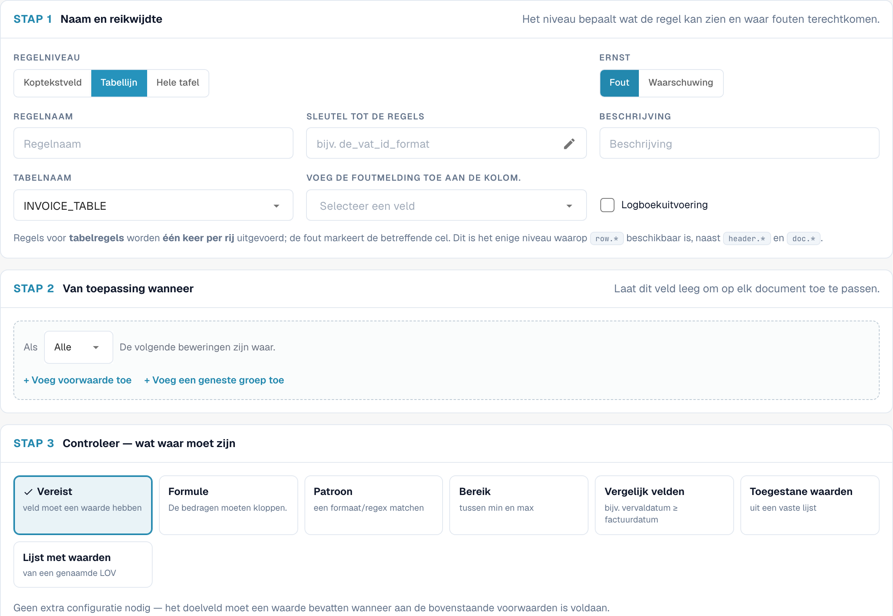<figcaption>
Een tabelregel: de tabel en de kolom die de fout toont
</figcaption></figure>

### Stap 2 — Applies when

Bepaal of de regel voor elk document wordt uitgevoerd of alleen voor sommige. Laat het veld leeg om elk document te controleren. Voeg anders voorwaarderegels toe — bijvoorbeeld "Document Origin is Deutsch" en "Total Amount greater than 250" — en combineer ze met **Alle** / **ANY** en geneste groepen.

<figure>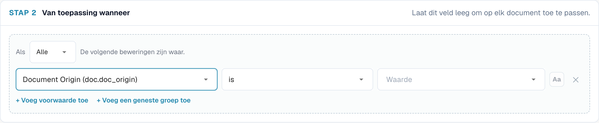<figcaption>
De controle wordt alleen uitgevoerd voor Duitse documenten boven 250 met EUR of zonder valuta
</figcaption></figure>

Voor tabelregels kan de voorwaarde ook de kolommen van de huidige rij gebruiken en wordt hij **rij voor rij** geëvalueerd: rijen die niet overeenkomen worden eenvoudigweg niet gecontroleerd.

<figure>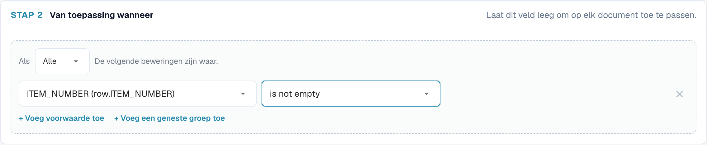<figcaption>
Alleen artikelregels (rijen met een artikelnummer) worden gecontroleerd
</figcaption></figure>

Voorwaarden worden uitgebreid uitgelegd — elk veld, elke operator en elke vergelijkingsregel, met veel voorbeelden — op [Regelvoorwaarden (Applies when)](rule-conditions-applies-when.md).

### Stap 3 — Controle: wat moet waar zijn

Kies één controle. De instellingen onder de kaarten veranderen met de controle die u kiest.

<figure><figcaption>
De zeven controles. Required heeft geen verdere instellingen nodig
</figcaption></figure>

#### Required — veld moet een waarde hebben

<figure><figcaption>
Een Required-controle: geen verdere instellingen
</figcaption></figure>

Mislukt wanneer het veld leeg is (ontbreekt of alleen spaties bevat). Geen verdere instellingen.

Gebruik het samen met **Van toepassing wanneer** om een veld **voorwaardelijk** verplicht te maken. Een veld dat altijd gevuld moet zijn, configureert u beter als verplicht veld in de veldinstellingen.

> *Btw-nummer leverancier is verplicht* — applies when *Document Origin is Deutsch* en *Total Amount greater than 250*.

#### Formula — bedragen moeten optellen

Een rekenkundige vergelijking. De expressie bevat precies **één** vergelijking (`==`, `!=`, `>`, `>=`, `<`, `<=`); beide zijden mogen `+ - * /`, getallen, haakjes en veldverwijzingen gebruiken.

<figure>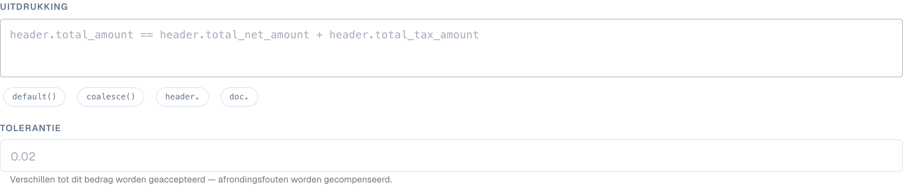<figcaption>
Een formule voor de hele tabel met een tolerantie en plaatsaanduidingen in het bericht
</figcaption></figure>

* Klik op de chips onder de expressie om functies en veldvoorvoegsels in te voegen: `sum()`, `count()`, `min()`, `max()`, `default()`, `coalesce()`, `header.`, `doc.`. Terwijl u een veldnaam typt, opent zich een lijst met passende velden.
* `sum(row.NET_AMOUNT)`, `count(row.ITEM_NUMBER)`, `min(...)`, `max(...)` werken over alle rijen en zijn alleen beschikbaar op het niveau **Gehele tabel**. `count()` telt de rijen waarin de kolom gevuld is.
* `default(header.discount, 0)` gebruikt `0` wanneer het veld leeg is; `coalesce(header.a, header.b, 0)` gebruikt de eerste gevulde waarde.
* **Tolerantie**: bij `==` en `!=` gelden verschillen tot dit bedrag als gelijk. Gebruik `0.01` of `0.05` om afrondingen op te vangen. Het heeft geen effect op `<`, `>`, `<=` en `>=`.
* Lege of onleesbare bedragen tellen als `0`. Een deling door nul slaat de regel over in plaats van een fout te veroorzaken.
* In de foutmelding wordt `{actual}` vervangen door het resultaat van de linkerzijde en `{expected}` door het resultaat van de rechterzijde.

Voorbeelden:

| Doel | Niveau | Expressie | Tolerantie |
| --- | --- | --- | --- |
| Headertotalen zijn consistent | Header field | `header.total_amount == header.total_net_amount + header.total_tax_amount` | 0.01 |
| Regels tellen op tot het nettobedrag | Whole table | `sum(row.NET_AMOUNT) == header.total_net_amount` | 0.05 |
| Regelbedrag = hoeveelheid × eenheidsprijs | Table line | `row.NET_AMOUNT == row.QUANTITY * row.UNIT_PRICE` | 0.01 |
| Btw niet hoger dan 19 % van het nettobedrag | Header field | `header.total_tax_amount <= header.total_net_amount * 0.19` | – |
| Minstens één regel | Whole table | `count(row.ITEM_NUMBER) >= 1` | 0 |

#### Pattern — formaat / regex controleren

<figure>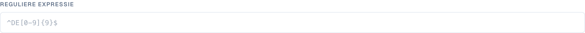<figcaption>
Een Pattern-controle met een reguliere expressie
</figcaption></figure>

De waarde moet overeenkomen met een **reguliere expressie**. De expressie zoekt in de waarde, dus veranker haar met `^` (begin) en `$` (einde) wanneer de hele waarde moet overeenkomen. Vink **Niet-hoofdlettergevoelige overeenkomst** aan als hoofdletters er niet toe doen.

| Formaat | Reguliere expressie |
| --- | --- |
| `INV-` gevolgd door zes cijfers | `^INV-\d{6}$` |
| Duits btw-nummer | `^DE\d{9}$` |
| Inkooporder die met 45 begint en 10 cijfers lang is | `^45\d{8}$` |
| Alleen cijfers | `^\d+$` |
| IBAN (grove controle) | `^[A-Z]{2}\d{2}[A-Z0-9]{11,30}$` |

#### Range — tussen minimum en maximum

De waarde moet een getal zijn tussen **Minimum** en **Maximaal** (beide inbegrepen). Vul er één of beide in. Een waarde die geen getal is, mislukt. Opgemaakte bedragen zoals `1.234,56` worden begrepen.

<figure>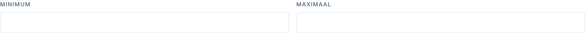<figcaption>
Range met alleen een minimum: hoeveelheden moeten minstens 0.01 zijn
</figcaption></figure>

#### Compare fields — bijv. vervaldatum ≥ factuurdatum

<figure>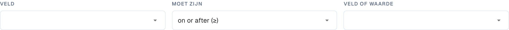<figcaption>
Compare fields: een veld vergelijken met een ander veld, met vandaag of een vaste waarde
</figcaption></figure>

Vergelijkt de waarde van een veld met een ander veld, met **vandaag** of met een vaste waarde, met *gelijk aan*, *niet gelijk aan*, *groter dan*, *kleiner dan*, *op of na (≥)* of *op of vóór (≤)*. Getallen worden als getallen vergeleken en datums als datums.

* Vervaldatum **op of na (≥)** Factuurdatum
* Invoice Date **op of vóór (≤)** vandaag — geen facturen met een datum in de toekomst
* Discount **kleiner dan** 100

#### Toegestane waarden — uit een vaste lijst

<figure>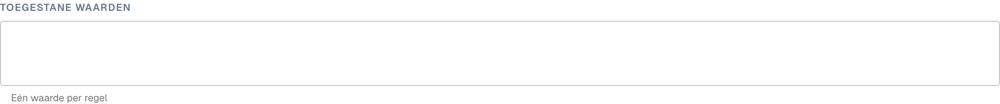<figcaption>
Allowed values: één waarde per regel, eventueel zonder onderscheid tussen hoofd- en kleine letters
</figcaption></figure>

De waarde moet een van de door u getypte waarden zijn, **één waarde per regel**. Optioneel hoofdletterongevoelig. Geschikt voor korte, stabiele lijsten (`EUR`, `CHF`, `USD`).

#### List of Values — uit een benoemde LOV

<figure>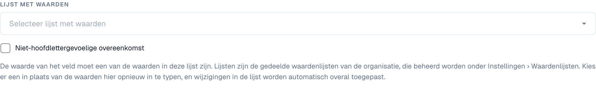<figcaption>
List of Values: de waarden komen uit een benoemde lijst uit de instellingen
</figcaption></figure>

Zoals *Allowed values*, maar de waarden komen uit een gedeelde **Lijst met waarden** die u beheert onder **Settings › List of Values**. Kies de lijst in plaats van haar opnieuw te typen; wanneer de lijst verandert, gebruikt de regel de nieuwe waarden (na een korte cachevertraging). Alleen de waarden van de lijstitems tellen, niet hun labels.


Behalve **Verplicht** **slaagt** elke controle **wanneer de waarde leeg is**. Een Pattern-regel op de inkooporder klaagt niet over facturen zonder inkooporder. Als een lege waarde ook een probleem is, voeg dan een Required-regel toe of beperk de regel met *Applies when … is not empty*.


#### Foutmelding en foutcode

* **Foutmelding die aan de gebruiker wordt getoond** — de tekst op het validatiescherm. Zeg wat er mis is **en** wat te doen: "Btw-nummer leverancier ontbreekt. Duitse facturen boven 250 EUR moeten het vermelden."
* **Foutcode** — een korte technische code, bijvoorbeeld `REQUIRED_CONDITIONAL`, `FORMAT_MISMATCH`, `OUT_OF_RANGE`, `DATE_ORDER`, `LINES_HEADER_MISMATCH`, `VALUE_NOT_ALLOWED`. Hij verschijnt in exports en logboeken en laat u fouten groeperen.

## Regel testen

Klik op **Testregel** om de huidige versie van de regel — opgeslagen of niet — uit te voeren op een document. Voer een **Document-ID** in, of schakel over naar **Per document JSON** en plak geëxtraheerde gegevens. **Er wordt niets opgeslagen** en het document wordt niet gewijzigd.

Het resultaat is een van drie uitkomsten:

| Uitkomst | Betekenis |
| --- | --- |
| **Regel mislukt — er is een foutmelding gegenereerd** | De voorwaarde kwam overeen en de controle mislukte. Het bericht wordt precies getoond zoals de gebruiker het zou zien. |
| **Regel aangenomen** | De voorwaarde kwam overeen en de controle slaagde. Tabelregels tonen het resultaat per rij ("4 of 4 checked rows passed"). |
| **Regel overgeslagen — bereik niet overeenkomend** | De voorwaarde *Applies when* was onwaar voor dit document, dus er is niets gecontroleerd en er is geen fout gemeld. |

<figure>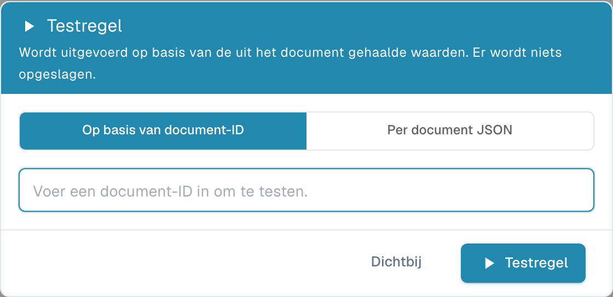<figcaption>
De Duitse factuur heeft geen btw-nummer van de leverancier: de regel mislukt met het geconfigureerde bericht
</figcaption></figure>

<figure><figcaption>
Dezelfde regel met de drempel verhoogd naar 1000: de factuur (469.18) valt buiten het bereik, dus de regel wordt overgeslagen
</figcaption></figure>

<figure>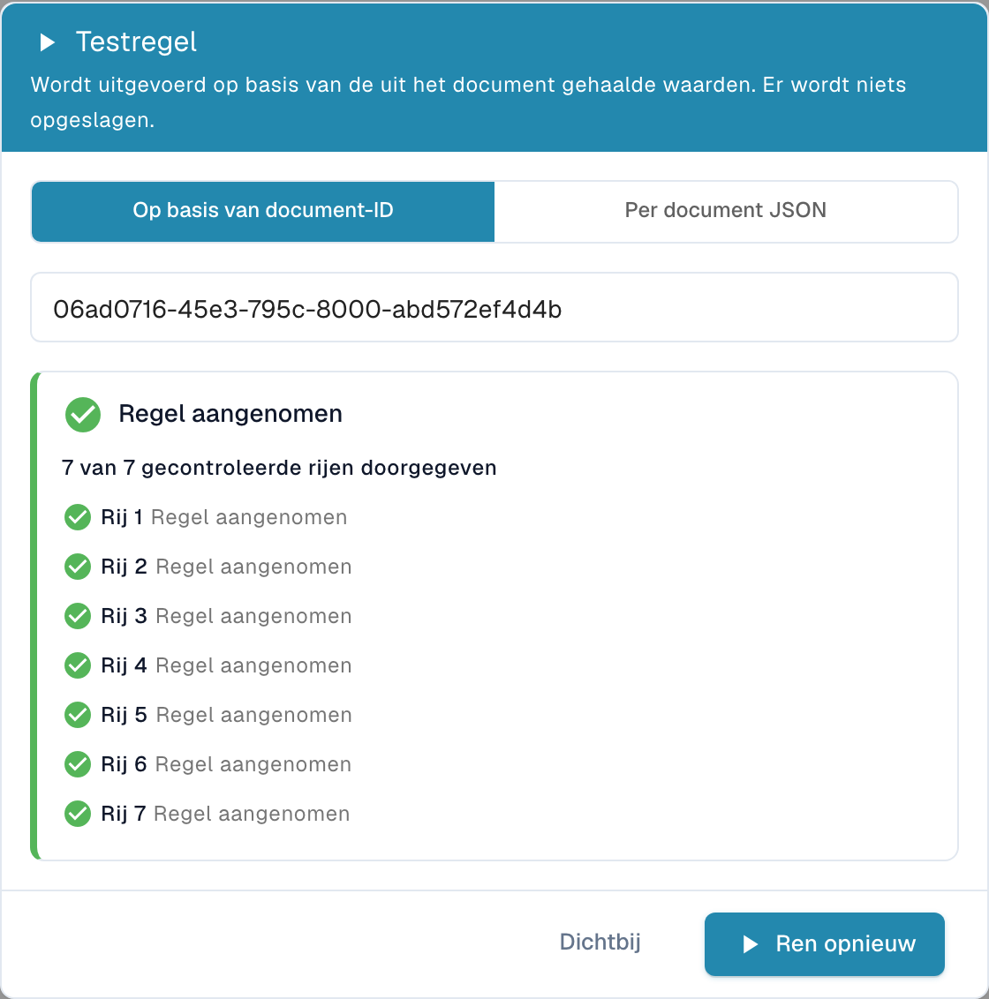<figcaption>
Een tabelregel rapporteert elke gecontroleerde rij
</figcaption></figure>

Test elke nieuwe regel op minstens één document dat moet mislukken, één dat moet slagen en één dat moet worden overgeslagen.

## Wanneer regels worden uitgevoerd

* **Tijdens de verwerking**, samen met de andere validaties, na extractie en transformatieregels.
* **Bij elke keer opslaan** van het document op het validatiescherm.
* **Na een regelwijziging** worden bestaande documenten **niet** allemaal tegelijk opnieuw gecontroleerd. Elk document wordt met de nieuwe regels opnieuw gecontroleerd zodra het de volgende keer wordt opgeslagen of opnieuw wordt verwerkt. Documenten die al zijn geëxporteerd worden niet beïnvloed.
* Regels worden uitgevoerd op volgorde van prioriteit (daarna op sleutel). Een veld toont **één** fout: als twee regels op hetzelfde veld mislukken, wint de eerste; latere regels overschrijven die niet.
* Waarschuwingen worden afzonderlijk verzameld en verbergen nooit een fout.
* Als een regel niet kan worden geëvalueerd — bijvoorbeeld door een deling door nul in een formule — wordt hij overgeslagen. Een kapotte regel markeert een document nooit per ongeluk als ongeldig.

## Recepten

Kopieer deze regels als uitgangspunt. De veld- en kolomsleutels zijn die van het standaarddocumenttype **Factuur**; pas ze aan uw documenttypen aan.

**1. Btw-nummer van de leverancier voor Duitse facturen boven 250 EUR**
Header field · Error · koppelen aan *Supplier Tax ID* · Applies when **Alle**: *Document Origin* is *Deutsch*, *Total Amount* greater than *250* · Controle **Verplicht** · Bericht "Btw-nummer leverancier ontbreekt. Duitse facturen boven 250 EUR moeten het vermelden." · Code `REQUIRED_CONDITIONAL`.

**2. Headertotalen tellen op** (vervangt de ingebouwde controle)
Header field · Error · koppelen aan *Total Amount* · altijd · **Formule** `header.total_amount == header.total_net_amount + header.total_tax_amount`, tolerantie `0.01` · Bericht "Totaal {actual} is niet gelijk aan netto plus btw ({expected})."

**3. Regels tellen op tot het nettobedrag** (vervangt de ingebouwde controle)
Whole table · Error · koppelen aan *Total Net Amount* · altijd · **Formule** `sum(row.NET_AMOUNT) == header.total_net_amount`, tolerantie `0.05` · Bericht "De nettobedragen van de regels tellen op tot {actual}, maar het nettobedrag van de factuur is {expected}." · Code `LINES_HEADER_MISMATCH`.

**4. Hoeveelheid moet positief zijn op artikelregels**
Tabelregel · Fout · tabel `INVOICE_TABLE`, kolom `QUANTITY` · Van toepassing als *row.ITEM_NUMBER* niet leeg is · **Bereik** minimum `0.01` · Code `OUT_OF_RANGE`.

**5. Regelbedrag = hoeveelheid × eenheidsprijs**
Table line · Warning · kolom `NET_AMOUNT` · altijd · **Formule** `row.NET_AMOUNT == row.QUANTITY * row.UNIT_PRICE`, tolerantie `0.01`.

**6. Factuurnummerformaat van één leverancier**
Kopveld · Fout · *Factuurnummer* · Van toepassing als *Leverancier ID* *20723* is · **Patroon** `^INV-\d{6}$`.

**7. Vervaldatum niet vóór factuurdatum**
Header field · Error · *Due Date* · altijd · **Vergelijk velden** Due Date *op of na (≥)* Invoice Date · Code `DATE_ORDER`.

**8. Geen facturen met een datum in de toekomst**
Header field · Error · *Invoice Date* · altijd · **Vergelijk velden** Invoice Date *op of vóór (≤)* vandaag.

**9. Alleen goedgekeurde valuta's (alleen als melding)**
Header field · **Waarschuwing** · *Currency* · altijd · **Lijst met waarden** *approved_currencies* · Code `VALUE_NOT_ALLOWED`.

**10. Inkooporder verplicht boven 5.000**
Header field · Error · *Purchase Order* · Applies when *Total Amount* greater than *5000* · **Verplicht**.

## Aanbevolen werkwijzen

* **Begin als waarschuwing.** Sla een nieuwe regel op met de ernst **Waarschuwing**, volg haar een paar dagen (Test rule, logboeken) en zet haar daarna om naar **Fout**.
* **Eén regel, één bericht.** Meerdere kleine regels met duidelijke berichten zijn gemakkelijker te begrijpen dan één grote formule.
* **Gebruik Applies when in plaats van kopieën.** Eén regel met een voorwaarde is beter dan vijf kopieën voor vijf leveranciers.
* **Wees tolerant met geld.** Geef bedragformules altijd een tolerantie.
* **Noem regels naar de bedrijfsregel**, niet naar de techniek ("Vervaldatum niet vóór factuurdatum", niet "Vergelijkingsregel 3").

## Probleemoplossing

| Symptoom | Wat te controleren |
| --- | --- |
| De regel meldt nooit een fout | Is de functie ingeschakeld voor het documenttype en is de regel **Actief**? Voer **Testregel** uit op het document: "skipped" betekent dat *Applies when* onwaar was. |
| Een leeg veld wordt niet gemeld | Alleen **Verplicht** meldt lege waarden. Voeg een Required-regel toe. |
| De ingebouwde totaalcontroles zijn verdwenen | Verwacht zolang aangepaste regels aan staan. Maak ze opnieuw aan als Formula-regels (recepten 2 en 3). |
| Een gewijzigde regel heeft geen effect op een document | Documenten worden bij hun volgende keer opslaan opnieuw gecontroleerd. Sla het document op of verwerk het opnieuw. |
| Een Pattern komt overeen met waarden die dat niet zouden moeten | Patronen zoeken binnen de waarde. Veranker met `^` en `$`. |
| Van twee fouten wordt er maar één op een veld getoond | Een veld toont alleen de eerste mislukte regel. Pas de prioriteiten aan of koppel een van de regels aan een ander veld. |
| Tabelkolommen ontbreken in *Applies when* | Ze zijn alleen beschikbaar op het niveau **Tabelrij**. |
| De systeemstandaardregel kan niet worden gewijzigd | Klik op **Aanpassen** om uw eigen kopie te maken. |

## Gerelateerd

* [Regelvoorwaarden (Applies when)](rule-conditions-applies-when.md) — voorwaarden in detail
* [Transformatieregels](transformation-rules.md) — waarden corrigeren voordat ze worden gevalideerd
* [Lay-outselectieregels](layout-manager/layout-selection-rules.md) — de lay-out kiezen die een document gebruikt
* [Validatie en matchscore instellen](fields/setting-validation-and-match-score.md) — validatie-instellingen per veld
