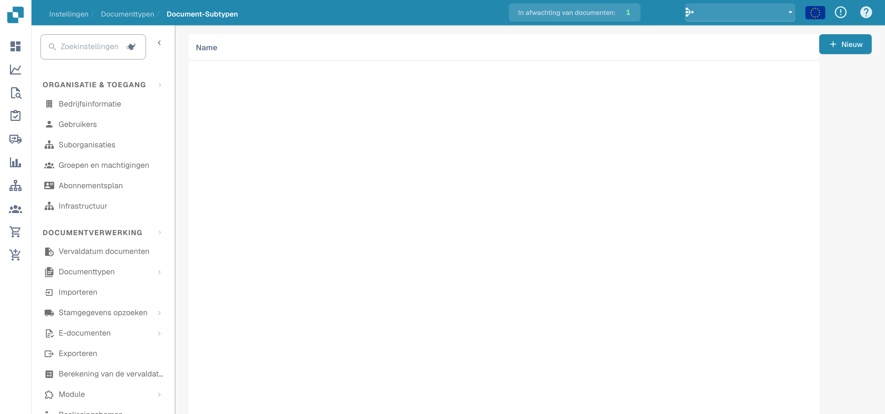
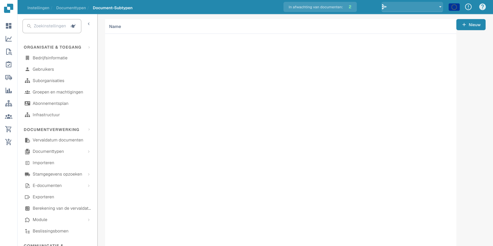

# Documentsubtypen

Subtypen onderscheiden categorieën binnen een documenttype. Open de documenttypen in de instellingen en kies de koppeling naar subtypen van het bedoelde type.

<figure><figcaption>
Overzicht van documentsubtypen. De kolomkop Name blijft Engelstalig in het product.
</figcaption></figure>

De lijst toont de geconfigureerde subtypen. Sommige kolomkoppen kunnen in het product Engelstalig blijven.

<figure><figcaption>
Lijst met documentsubtypen in het beheer. De kolomkop Name blijft Engelstalig in het product.
</figcaption></figure>

Maak een nieuw subtype en controleer naam en configuratie voordat u opslaat. De voorbeelden tonen overzicht en lijst; ze bewijzen geen aangemaakt subtype of opgeslagen instellingen.
