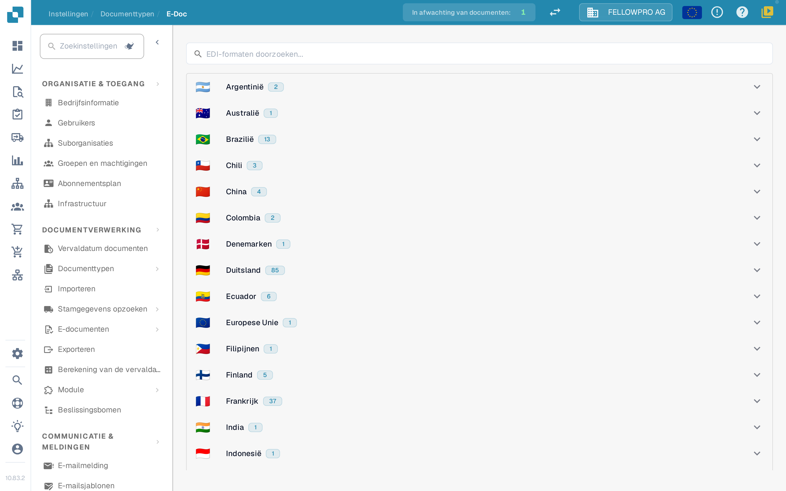
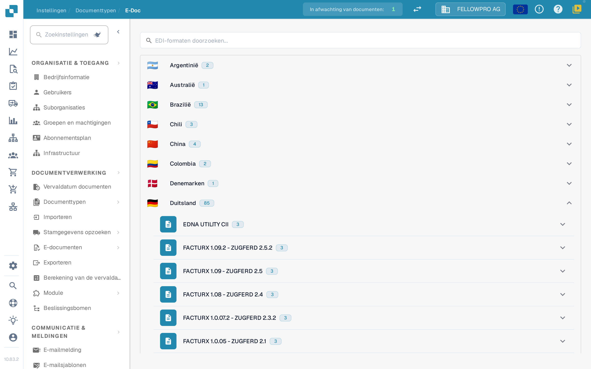
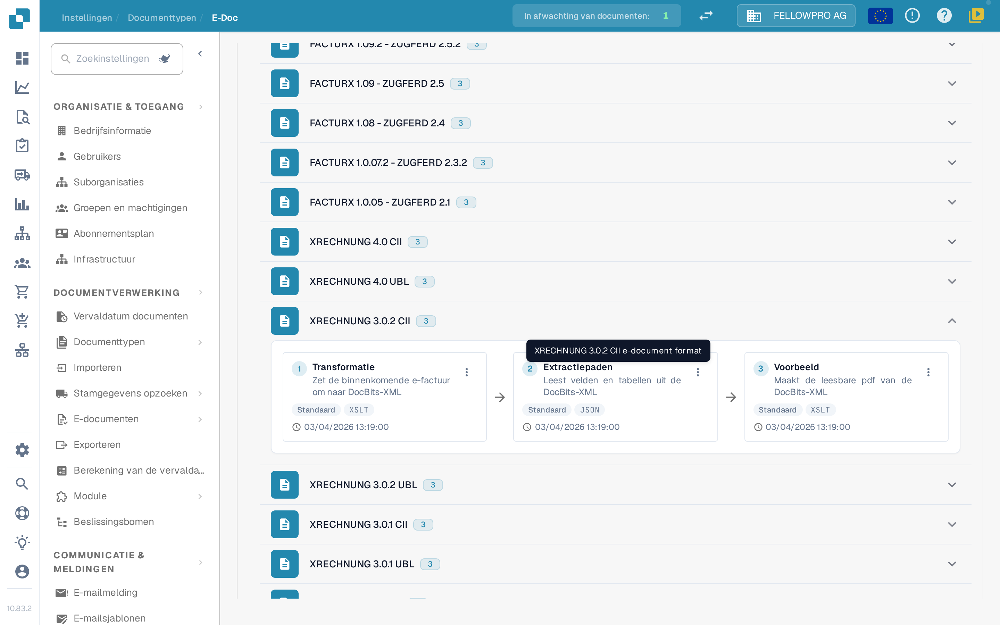
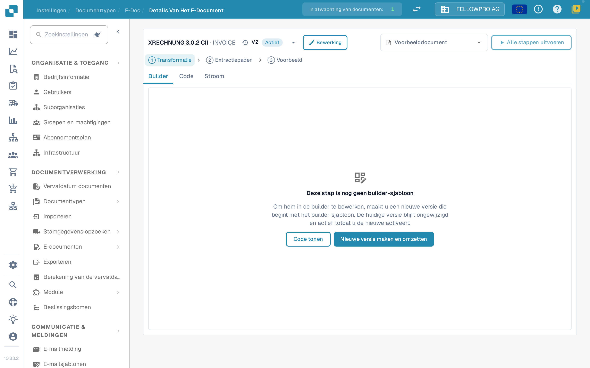
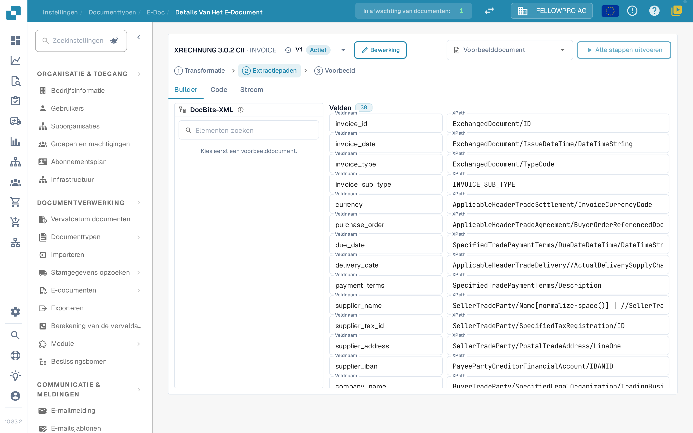

# e-docs

Elektronische documenten zoals XRechnung, ZUGFeRD/Factur-X, CFDI of FatturaPA komen binnen als XML of als hybride PDF. DocBits leest het bestand, extraheert de factuurgegevens en maakt daar een leesbare PDF van. In de **E-Doc**-instellingen staan de regels voor elk formaat dat uw organisatie gebruikt.

## De E-Doc-beheer openen

1. Open **Instellingen → Documenttypen**.
2. Selecteer het documenttype, bijvoorbeeld **Factuur**, en open **E-Doc**.

De formaten zijn per land gegroepeerd. Elk land toont zijn vlag, zijn naam en hoeveel formaten het bevat.

<figure><figcaption>
De formaten zijn per land gegroepeerd en staan aanvankelijk ingeklapt.
</figcaption></figure>

Selecteer een land om de formaten te openen. Binnen een land staat de nieuwste versie vooraan. Gecombineerde formaten zoals Factur-X / ZUGFeRD staan onder Duitsland. Het zoekveld doorzoekt formaat- en landnamen tegelijk.

<figure><figcaption>
Open een land om de formaten te zien.
</figcaption></figure>

## Formaten en hun stappen

Elk formaat toont zijn stappen als drie kaarten met pijlen, in de volgorde waarin DocBits ze uitvoert:

| Stap | Wat hij doet |
| --- | --- |
| **Transformatie** | Zet de inkomende XML om naar de DocBits-XML. |
| **Extractiepaden** | Bepaalt welke waarden DocBits uit de getransformeerde XML haalt. |
| **Voorbeeld** | Bepaalt de lay-out van de leesbare PDF die DocBits maakt. |

De overige attributen van het formaat staan onder de kaarten.

<figure><figcaption>
De drie stappen van een formaat: Transformatie, Extractiepaden en Voorbeeld.
</figcaption></figure>

Selecteer een kaart om die stap te openen.

## Een stap bewerken

De detailpagina heeft voor alle drie de stappen dezelfde opbouw:

* De kop toont het formaat en een dropdown met zijn versies, inclusief de status van elke versie. Via de dropdown kunt u een versie activeren, bewerken of verwijderen.
* **Builder**, **Code** en **Stroom** schakelen tussen de visuele editor, het onderliggende stylesheet of JSON, en het pijplijnresultaat.
* **Voorbeelddocument** biedt de nieuwste documenten van dit formaat aan; u kunt ook een document-ID of URL plakken.
* **Alle stappen uitvoeren** voert transformatie, extractie en voorbeeld voor het voorbeelddocument in één keer uit.
* **Ctrl + S** slaat een concept op.

Een actieve of al gebruikte versie bewerken verandert haar niet: DocBits maakt een conceptkopie en opent die. Een ongebruikt concept wordt ter plekke bewerkt. Een handgeschreven stap blijft in **Code** totdat de builder hem ongewijzigd kan overnemen.

<figure><figcaption>
De detailpagina: versie-dropdown in de kop, tabbladen Builder, Code en Stroom, voorbeelddocument en de stap zelf.
</figcaption></figure>

### Transformatie

De **Builder** toont de bron-XML links, de mapping in het midden en de resulterende XML rechts. Selecteer een element in de bronboom en sleep het naar een veld, of voeg een vaste tekstwaarde toe.

Een veld kan uit meerdere delen bestaan, en elk deel kan een voorwaarde hebben: **bestaat**, **ontbreekt**, **is gelijk aan**, **is niet gelijk aan** of een vrije XPath-expressie, gekoppeld met **alle** of **een**. De drie deelvensters zijn in grootte aan te passen, en het resultaatgebied heeft een **Velden**-lijst en de **XML**-weergave.

### Extractiepaden

De extractiepaden-builder toont de DocBits-XML links, de velden in het midden en het pad dat elk veld gebruikt rechts. Selecteer een veld en stel het pad in; bestaande invoer, ook oudere platte invoer, blijft werken.

<figure><figcaption>
De extractiepaden-builder: DocBits-XML, velden en hun paden.
</figcaption></figure>

### Voorbeeld

De voorbeeld-builder rangschikt de PDF met sleepblokken en toont het resultaat ernaast. Paginagrootte, marges, lettergrootte, kleuren en blokafstand worden voor het hele document ingesteld en gelden voor elk blok.

### Stroom

**Stroom** toont de hele pijplijn voor het gekozen voorbeelddocument: wat de transformatie heeft opgeleverd, welke waarden de extractiepaden vonden en hoe het voorbeeld ze weergeeft. Gebruik dit om een wijziging van begin tot eind te controleren zonder de pagina te verlaten.

## Gerelateerde pagina's

* [eDocs-formaten, versies en landengidsen](supported-electronic-documents/README.md)

De schermafbeeldingen op deze pagina tonen de interface in het Nederlands.
