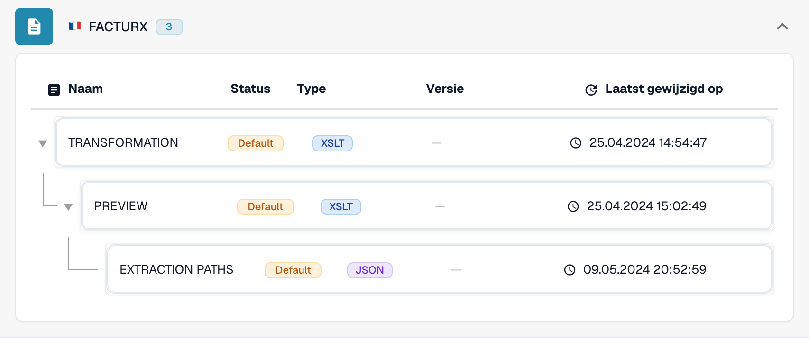
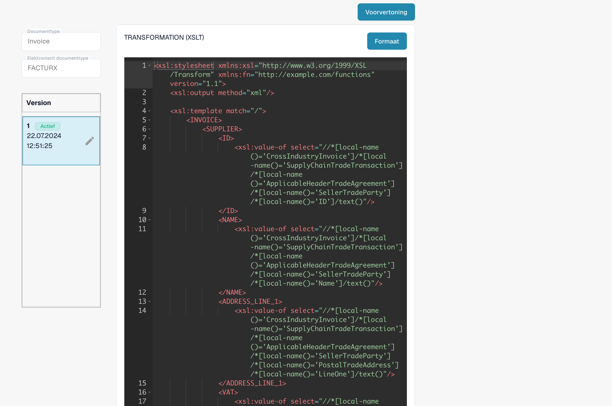

# Elektronische creditnota wordt herkend als factuur

Een elektronische creditnota kan als **Invoice** verschijnen, ook als de oorspronkelijke XML een creditnotacode bevat. Controleer de effectieve configuratie voordat u dit als een productfout beschouwt. Een organisatiespecifieke **TRANSFORMATION** heeft voorrang op de standaard voor dat eDoc-formaat. Een constante zoals `<INVOICE_TYPE>Invoice</INVOICE_TYPE>` kan daardoor de standaardclassificatie overschrijven.

## Controleer de classificatie van elektronische creditnota's


Controleer de classificatie van elektronische creditnota's



WebVTT


## Controleer de documentcode

Lees de typecode in de oorspronkelijke XML, niet alleen in de PDF of de documenttitel. De locatie hangt af van de XML-syntaxis. CII gebruikt `ExchangedDocument/TypeCode`; UBL gebruikt `InvoiceTypeCode` of `CreditNoteTypeCode`. Houd rekening met de XML-naamruimten wanneer u een XPath controleert.

| Code | Betekenis | Classificatiecontrole |
| --- | --- | --- |
| `380` | Commerciële factuur | Invoice |
| `381` | Creditnota | Credit Note |
| `261` | Creditnota bij selfbilling | Credit Note in de standaardtoewijzing (FACTURX/ZUGFeRD) |
| `383` | Debetnota | Wijs deze niet aan Credit Note toe alleen omdat deze een factuur aanpast |
| `384` | Gecorrigeerde factuur | Wijs deze niet aan Credit Note toe alleen omdat deze een factuur corrigeert |

De standaardtoewijzing voor creditnota's in FACTURX/ZUGFeRD omvat **381 en 261**. Een bedrijfsvereiste die alleen 381 noemt, maakt van 383 of 384 geen creditnotacodes. Bespreek elke voorgenomen afwijking met de verantwoordelijke voor uw boekhoudintegratie.

## Zoek waar de waarde verandert

1. **Bepaal het werkelijke formaat.** Open **Instellingen → Documenttypen → Invoice → E-Doc**. Selecteer het formaat dat voor het betreffende document is gedetecteerd, bijvoorbeeld **FACTURX**. Een ZUGFeRD-PDF kan Factur-X-XML bevatten; de regels van een ander formaat verklaren de verwerking van dit document niet.
2. **Controleer de effectieve bron en versie.** Bekijk **TRANSFORMATION**. De lijst maakt onderscheid tussen **Default** en **Custom**. Open de regel en noteer de actieve versie en de bijbehorende bron. Een nieuwer concept is niet noodzakelijk actief. Bepaal bij een historisch document welke bron en versie tijdens die verwerking zijn gebruikt; de huidige actieve versie kan daarvan afwijken. Vergelijk de aangepaste bron van de organisatie met de standaard; ga er niet van uit dat de standaard wordt gebruikt.

<figure><figcaption>De status geeft de bron van elke regel aan. Dit voorbeeld gebruikt standaardregels.</figcaption></figure>

3. **Bekijk de getransformeerde XML.** Zoek voor FACTURX/ZUGFeRD in de effectieve XSLT naar `INVOICE_TYPE`. Bij een oorspronkelijke code 381 is een vaste uitvoer van `<INVOICE_TYPE>Invoice</INVOICE_TYPE>` een configuratieprobleem. Test de voorgestelde transformatie en bekijk de uitvoer; het bedoelde resultaat voor een creditnota is `Credit Note`. Behoud alle andere vereiste organisatiespecifieke toewijzingen.
4. **Controleer Extraction Paths.** Controleer of het DocBits-veld met ID `invoice_type` de bedoelde classificatienode uit de **getransformeerde XML** leest. FACTURX/ZUGFeRD gebruikt vaak `INVOICE_TYPE`; XRechnung kan `TypeCode` (CII), `InvoiceTypeCode` of `CreditNoteTypeCode` (UBL) behouden. Bekijk de effectieve bron en uitvoer voordat u een pad kiest. Na het herstructureren van XML zijn paden naar het oorspronkelijke bestand mogelijk niet meer geldig. Raadpleeg de [handleiding voor Extraction Paths](edi/edi-extraction-paths-file-guide.md).
5. **Controleer de verdere verwerking.** Bekijk scripts die `invoice_type` kunnen instellen en vergelijk vervolgens het opgeslagen veld, het dashboard en de exportgegevens. Een correcte transformatie bewijst op zichzelf niet dat een later script de waarde behoudt. Een weergegeven **Preview** toont de presentatie; deze bewijst niet wat de opgeslagen classificatie is.

<figure><figcaption>Bekijk de geselecteerde bron en versie voordat u een wijziging maakt of activeert.</figcaption></figure>

De [eDocs MCP-tools](../../../../../advanced-functions-and-tools/edocs-mcp/README.md) ondersteunen dezelfde controles: `list_edoc_custom_attributes`, `get_edoc_attribute_source` en `list_edoc_attribute_versions` identificeren de bron; `compare_edoc_extraction` vergelijkt het gedrag van de standaard, de aangepaste bron en de voorgestelde wijziging. Gebruik `test_electronic_document` voor een proefuitvoering vóór activering.

## Veilig corrigeren en activeren

1. Noteer de huidige actieve versie en bewaar de bron zodat u deze kunt herstellen.
2. Maak een **concept** met het potloodpictogram. Wijzig de classificatievoorwaarde of het extractiepad dat uit de diagnose naar voren kwam. Vervang niet de volledige transformatie om slechts één veld te corrigeren.
3. Selecteer het concept en sla het op met **Save**. Het opslaan van een concept activeert het **niet**.
4. Test het concept in een ontwikkel- of testorganisatie met representatieve documenten: codes 380 en 381. Voeg 261, 383 en 384 toe als het gedetecteerde formaat en uw workflow deze ondersteunen. Controleer de classificatie, bedragen en andere aangepaste velden. Vergelijk het resultaat met de actieve versie.
5. Gebruik, nadat de controles geslaagd zijn, het **vinkje** van het concept om het te activeren. Controleer of de bedoelde versie nu **Active** toont. Met MCP gebruikt u `activate_edoc_attribute_version` voor activering; dit is een aparte wijziging, los van een proefuitvoering.
6. Verwerk een nieuw testdocument. Controleer de opgeslagen `invoice_type`, het dashboard, de bedragen en de export naar **Infor ERP / SAP** of uw doelsysteem. Houd de vorige versie beschikbaar om zo nodig terug te kunnen keren.


Zet de regels van een organisatie niet terug naar de standaard zonder de vereiste aanpassingen te vergelijken en te bewaren. Start historische documenten niet in bulk opnieuw. Opnieuw starten verwijdert geëxtraheerde gegevens en exportlogboeken en kan goedkeurings- of exportprocessen herhalen. Controleer voor elk document de exportstatus, goedkeuringen en handmatige wijzigingen voordat u beslist hoe u het opnieuw verwerkt.


## Controleer het teken van bedragen afzonderlijk

Classificatie en het teken van bedragen zijn gerelateerde controles. [Set Negative Sign for Credit Notes](../../../document-processing/module/set-negative-sign-for-credit-notes.md) is standaard ingeschakeld, maar kan worden uitgeschakeld. Wanneer deze instelling is ingeschakeld, worden creditnotabedragen als negatieve waarden opgeslagen. Controleer de daadwerkelijke organisatie-instelling en de tekenconventie van het ontvangende systeem; leid het documenttype niet uitsluitend af uit het teken.

Als het resultaat met de gecontroleerde actieve bron nog steeds onjuist is, bewaar dan de oorspronkelijke XML, het gedetecteerde formaat, de versie-ID's, de getransformeerde uitvoer, de extractietoewijzing en eventuele latere scriptwijzigingen voor support. Hiermee kan worden vastgesteld of de afwijking door de configuratie komt of verder productonderzoek vereist.

<!-- Internal evidence: TRL-72. The organization-specific constant is a likely cause; later scripts/effective historical versions were not conclusively excluded. -->
