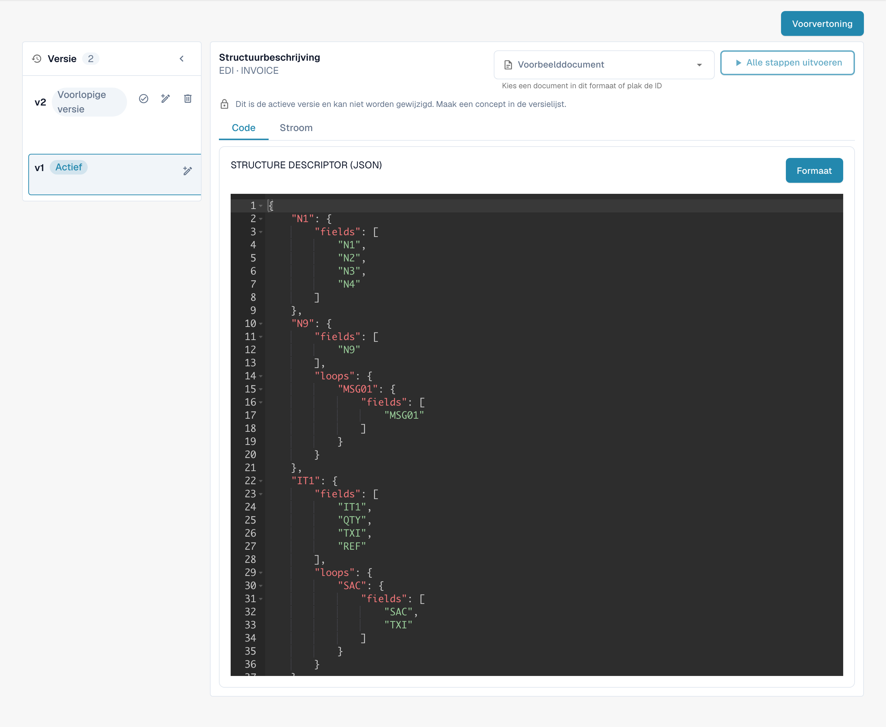
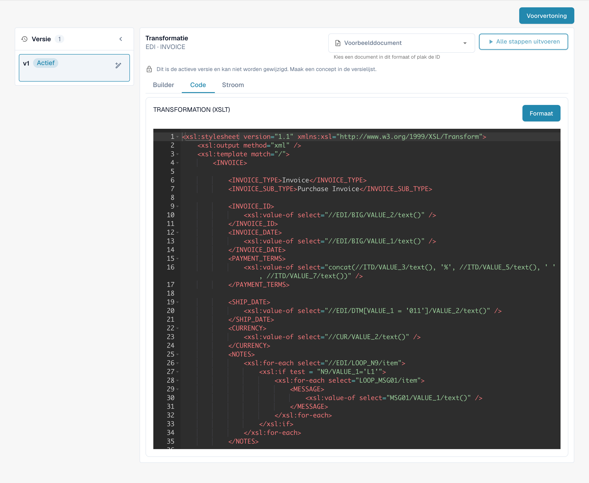
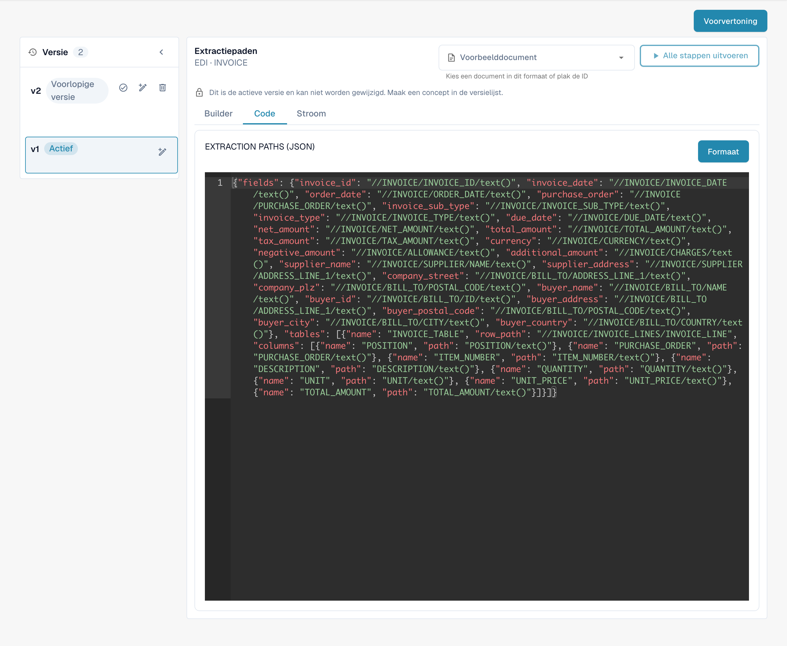

# EDI-sjablonen instellen

## EDI-sjablonen stap voor stap instellen

<figure><figcaption>
Bestaand EDI-formaat met de vier geconfigureerde attributen.
</figcaption></figure>

**De structuur beschrijven:**

* Bepaal het type EDI-bericht waarmee u werkt, bijvoorbeeld ANSI X12, EDIFACT of een eigen formaat.
* Bepaal de segmenten, elementen en subelementen binnen de EDI-structuur.
* Maak een structuurbeschrijving die de hiërarchie en ordening van het EDI-bericht nauwkeurig weergeeft, bijvoorbeeld met XML- of JSON-syntaxis.

<figure><figcaption>
Actief attribuut STRUCTUREDESCRIPTOR: JSON-structuurbeschrijving in de alleen-lezen editor.
</figcaption></figure>

**Transformaties instellen:**

* Gebruik een geschikt hulpmiddel dat EDI-transformaties ondersteunt, zoals een EDI-vertaler.
* Definieer de regels om het EDI-bericht naar het interne formaat van uw systeem om te zetten en omgekeerd.
* Stel de transformaties zo in dat segmenten, elementen en subelementen volgens de systeemvereisten worden geïnterpreteerd en verwerkt. Test grondig of de gegevens correct worden geïnterpreteerd en opgemaakt.

<figure><figcaption>
Actief attribuut TRANSFORMATION: XSLT-broncode voor het transformeren van de tussenliggende XML.
</figcaption></figure>

**Extractiepaden instellen voor optimale gegevensextractie en opmaak:**

* Bepaal welke velden naar uw interne systeem moeten worden geëxtraheerd en overgedragen.
* Definieer paden of regels om de relevante velden uit de EDI-berichten te halen.
* Houd rekening met variaties en formaten in inkomende EDI-berichten en zorg dat de extractiepaden flexibel genoeg zijn om deze te verwerken.
* Valideer de extractieresultaten om te controleren of de juiste velden correct worden geëxtraheerd en opgemaakt.

<figure><figcaption>
Actief attribuut EXTRACTIONPATHS: JSON-configuratie met XPath-expressies voor extractie.
</figcaption></figure>

Door de structuur zorgvuldig te beschrijven en transformaties en extractiepaden goed in te stellen, kunt u de gegevensextractie en opmaak in uw EDI-sjablonen optimaliseren. Dit verbetert de efficiëntie en nauwkeurigheid van elektronische zakelijke communicatie.

De weergaven tonen een bestaande configuratie en versie. De instellingen verschillen per documenttype en formaat. Valideer wijzigingen in een concept voordat u ze activeert.

De afbeeldingen tonen de Nederlandstalige proceskaarten en de actieve, alleen-lezen configuratieversie. De tabnaam Builder, technische attribuutnamen en configuratiecode zijn overgenomen uit de geïllustreerde productversie.
