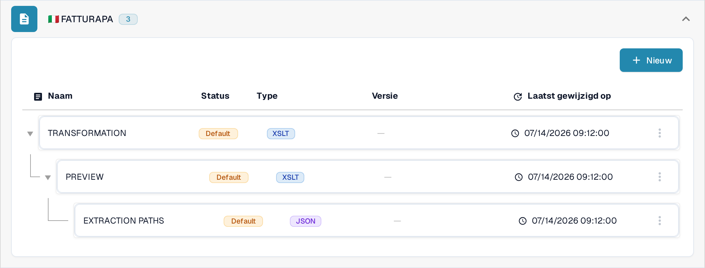
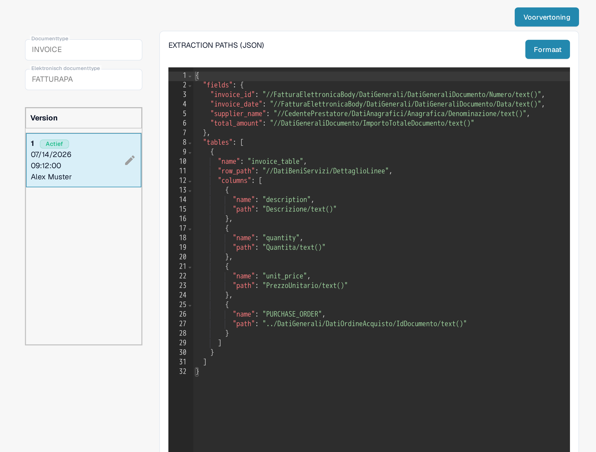
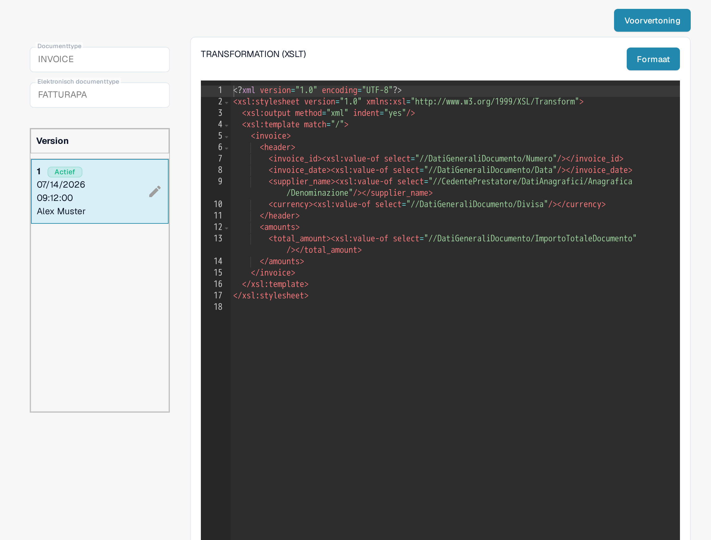
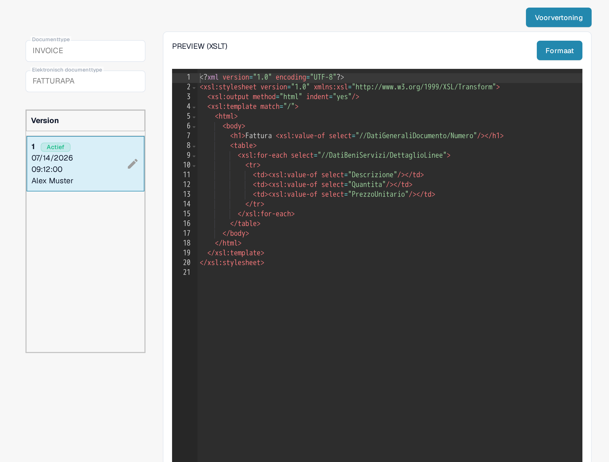

# FatturaPA: een attribuut op factuurregels tonen

FatturaPA is het Italiaanse elektronische factuurformaat. Deze pagina legt uit waar u een regelattribuut, zoals een bestelnummer, kunt controleren voordat u de mapping of het factuurvoorbeeld wijzigt. **Voeg geen tweede `PURCHASE_ORDER`-kolom toe zonder eerst de actieve mapping te controleren:** de huidige Sandbox-mapping bevat er al een.

## De drie FatturaPA-bestanden vinden

Open **Instellingen → Documenttypen → E-Doc**, selecteer **Invoice** en klap **FATTURAPA** uit. De huidige lijst bevat drie verschillende bestanden:

* **TRANSFORMATION (XSLT)** leest de bron-XML van FatturaPA en produceert de genormaliseerde factuurgegevens.
* **PREVIEW (XSLT)** bouwt het visuele HTML/PDF-factuurvoorbeeld op uit die gegevens.
* **EXTRACTION PATHS (JSON)** koppelt de genormaliseerde waarden aan DocBits-velden en tabelkolommen.

<figure><figcaption>
De huidige FATTURAPA-bestandenlijst in de Sandbox.
</figcaption></figure>

## De geëxtraheerde regelwaarde controleren

Open **EXTRACTION PATHS (JSON)**. Zoek in de actieve versie de array `tables` en de bijbehorende `columns`. De zichtbare Sandbox-versie bevat al `{"name": "PURCHASE_ORDER", "path": "PURCHASE_ORDER"}`. Controleer de waarde in een echte testfactuur voordat u deze bewerkt. Als u een ander attribuut nodig hebt, bepaal dan de waarde ervan in de genormaliseerde gegevens en voeg vervolgens in een conceptversie een afzonderlijke kolomnaam met het bijbehorende pad toe.

<figure><figcaption>
De actieve JSON-extractiemapping bevat al een kolom voor het bestelnummer.
</figcaption></figure>

## De transformatie of het voorbeeld alleen wijzigen wanneer nodig

Als de genormaliseerde waarde ontbreekt, inspecteer dan **TRANSFORMATION (XSLT)** en het bron-XML-pad dat deze zou moeten produceren. Een wijziging hier beïnvloedt de gegevens die door latere mapping- en voorbeeldstappen worden gebruikt. Als de waarde correct wordt geëxtraheerd maar ontbreekt in de visuele factuur, inspecteer dan **PREVIEW (XSLT)** en de betreffende tabelrij in dat template. De twee XSLT-bestanden hebben verschillende doelen.

<figure><figcaption>
Transformation leest de bron-XML en bouwt genormaliseerde factuurvelden.
</figcaption></figure>

<figure><figcaption>
Preview bepaalt de visuele factuuruitvoer.
</figcaption></figure>

Gebruik het potlood op een versiekaart om een wijziging voor te bereiden. Controleer het concept en gebruik **Voorvertoning** met een representatieve FatturaPA-factuur voordat u deze activeert. De schermafbeeldingen tonen de huidige actieve versies; in deze Sandbox-sessie is geen concept opgeslagen en is geen voorbeeldtest uitgevoerd.

De vroegere instructie dat alle e-documenten Groot-Brittannië als oorsprong hebben, is geen veilige algemene regel. Controleer het land, de valuta en het getalformaat van de factuur aan de hand van het brondocument en de configuratie van uw organisatie.
