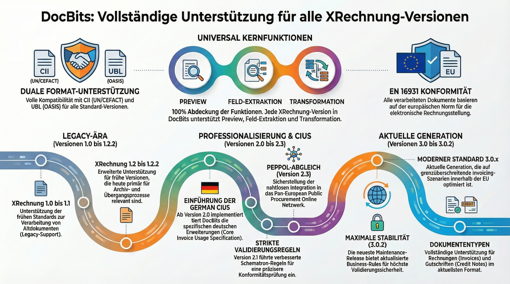

# Ondersteunde elektronische documenten

DocBits ondersteunt **120+ standaarden voor elektronische facturen en documenten** in **30+ landen**. Elk formaat wordt automatisch herkend en verwerkt, en de velden worden geëxtraheerd voor naadloze documentverwerking.

## Hoe elektronische documenten werken in DocBits

1. **Uploaden** — Sleep een XML/EDI-bestand erin of ontvang het via API/e-mail
2. **Automatische detectie** — DocBits herkent de exacte standaard en versie
3. **Voorbeeld** — Er wordt een leesbaar HTML-voorbeeld gegenereerd
4. **Veldextractie** — Belangrijke velden (factuurnummer, bedragen, regelitems) worden geëxtraheerd
5. **Validatie & export** — Gegevens worden gevalideerd en geëxporteerd naar uw ERP-systeem


Zie [EDI-instellingen](../) voor gedetailleerde configuratie. Voor verdiepende informatie over Peppol, XRechnung en ZUGFeRD verwijzen wij naar de speciale pagina's hieronder.


## Snelkoppelingen

| Onderwerp                    | Link                                                                         |
| ---------------------------- | ---------------------------------------------------------------------------- |
| EDI-overzicht                | [EDI-instellingen](../)                                                      |
| XRechnung (alle versies)     | [XRechnung](../xrechnung/)                                                   |
| ZUGFeRD / Factur-X           | [ZUGFeRD](../zugferd/)                                                       |
| Peppol BIS 3.0               | [Peppol BIS Billing](../peppol-bis-billing-3.0)                              |
| Overzicht e-factuurstandaarden | [Momenteel ondersteunde standaarden](../currently-supported-e-invoice-standards/) |

***

## Europa

<figure><figcaption>
Overzicht van Europese e-factuurstandaarden
</figcaption></figure>

### 🇩🇪 Duitsland

<figure><figcaption>
XRechnung — alle 26 versies (CII &#x26; UBL)
</figcaption></figure>

<figure><figcaption>
ZUGFeRD / Factur-X — alle versies
</figcaption></figure>

### 🇦🇹 Oostenrijk

| Standaard              | Pagina                                                |
| ---------------------- | ----------------------------------------------------- |
| ebInterface (overzicht) | [AUSTRIA EBINTERFACE](austria-ebinterface.md)         |
| ebInterface 6.0        | [AUSTRIA EBINTERFACE 6.0](austria-ebinterface-6-0.md) |
| ebInterface 6.1        | [AUSTRIA EBINTERFACE 6.1](austria-ebinterface-6-1.md) |

### 🇩🇰 Denemarken

| Standaard         | Pagina                              |
| ----------------- | ----------------------------------- |
| OIOUBL (overzicht) | [DENMARK OIOUBL](denmark-oioubl.md) |
| OIOUBL 2.1        | [OIOUBL 2.1](oioubl-2-1.md)         |

### 🇫🇮 Finland

| Standaard     | Pagina                            |
| ------------- | --------------------------------- |
| Finvoice 1.3  | [FINVOICE 1.3](finvoice-1-3.md)   |
| Finvoice 2.0  | [FINVOICE 2.0](finvoice-2-0.md)   |
| Finvoice 2.01 | [FINVOICE 2.01](finvoice-2-01.md) |
| Finvoice 3.0  | [FINVOICE 3.0](finvoice-3-0.md)   |
| TEAPPSXML     | [TEAPPSXML](teappsxml.md)         |

### 🇫🇷 Frankrijk

| Standaard                         | Pagina                                                |
| --------------------------------- | ----------------------------------------------------- |
| Factur-X (generiek)               | [FACTURX](facturx.md)                                 |
| Factur-X 1.0.05 / ZUGFeRD 2.1     | [FACTURX 1.0.05](facturx-1-0-05-zugferd-2-1.md)       |
| Factur-X 1.0.07.2 / ZUGFeRD 2.3.2 | [FACTURX 1.0.07.2](facturx-1-0-07-2-zugferd-2-3-2.md) |

### 🇩🇪 Duitsland

| Standaard                       | Pagina                                                    |
| ------------------------------- | --------------------------------------------------------- |
| XRechnung 1.0–3.0.2 (CII & UBL) | [26 versies](xrechnung-1-0-cii.md) — zie volledige lijst hieronder |
| ZUGFeRD 1.0–2.3.2               | [7 versies](zugferd-1-0.md) — zie volledige lijst hieronder |

Alle 26 XRechnung-versies

| Versie  | CII                           | UBL                           |
| ------- | ----------------------------- | ----------------------------- |
| 1.0     | [CII](xrechnung-1-0-cii.md)   | [UBL](xrechnung-1-0-ubl.md)   |
| 1.1     | [CII](xrechnung-1-1-cii.md)   | [UBL](xrechnung-1-1-ubl.md)   |
| 1.2     | [CII](xrechnung-1-2-cii.md)   | [UBL](xrechnung-1-2-ubl.md)   |
| 1.2.1   | [CII](xrechnung-1-2-1-cii.md) | [UBL](xrechnung-1-2-1-ubl.md) |
| 1.2.2   | [CII](xrechnung-1-2-2-cii.md) | [UBL](xrechnung-1-2-2-ubl.md) |
| 2.0     | [CII](xrechnung-2-0-cii.md)   | [UBL](xrechnung-2-0-ubl.md)   |
| 2.0.1   | [CII](xrechnung-2-0-1-cii.md) | [UBL](xrechnung-2-0-1-ubl.md) |
| 2.1     | [CII](xrechnung-2-1-cii.md)   | [UBL](xrechnung-2-1-ubl.md)   |
| 2.2     | [CII](xrechnung-2-2-cii.md)   | [UBL](xrechnung-2-2-ubl.md)   |
| 2.3     | [CII](xrechnung-2-3-cii.md)   | [UBL](xrechnung-2-3-ubl.md)   |
| 3.0     | [CII](xrechnung-3-0-cii.md)   | [UBL](xrechnung-3-0-ubl.md)   |
| 3.0.1   | [CII](xrechnung-3-0-1-cii.md) | [UBL](xrechnung-3-0-1-ubl.md) |
| 3.0.2   | [CII](xrechnung-3-0-2-cii.md) | [UBL](xrechnung-3-0-2-ubl.md) |

Alle 7 ZUGFeRD-versies

| Versie               | Pagina                                          |
| -------------------- | ----------------------------------------------- |
| ZUGFeRD 1.0          | [ZUGFERD 1.0](zugferd-1-0.md)                   |
| ZUGFeRD 1.0 Basic    | [ZUGFERD 1.0 BASIC](zugferd-1-0-basic.md)       |
| ZUGFeRD 1.0 Comfort  | [ZUGFERD 1.0 COMFORT](zugferd-1-0-comfort.md)   |
| ZUGFeRD 1.0 Extended | [ZUGFERD 1.0 EXTENDED](zugferd-1-0-extended.md) |
| ZUGFeRD 2.2          | [ZUGFERD 2.2](zugferd-2-2.md)                   |
| ZUGFeRD 2.3          | [ZUGFERD 2.3](zugferd-2-3.md)                   |
| ZUGFeRD 2.3.2        | [ZUGFERD 2.3.2](zugferd-2-3-2.md)               |

### 🇮🇹 Italië

| Standaard | Pagina                    |
| --------- | ------------------------- |
| FatturaPA | [FATTURAPA](fatturapa.md) |

### 🇳🇱 Nederland

| Standaard  | Pagina                      |
| ---------- | --------------------------- |
| SI-UBL 2.0 | [SI-UBL 2.0](si-ubl-2-0.md) |

### 🇳🇴 Noorwegen

| Standaard       | Pagina                                |
| --------------- | ------------------------------------- |
| EHF Invoice 3.0 | [EHF INVOICE 3.0](ehf-invoice-3-0.md) |

### 🇵🇱 Polen

| Standaard | Pagina                  |
| -------- | ----------------------- |
| KSeF     | [KSEF](ksef.md)         |
| KSeF FA2 | [KSEF FA2](ksef-fa2.md) |
| KSeF FA3 | [KSEF FA3](ksef-fa3.md) |

### 🇪🇸 Spanje

| Standaard           | Pagina                              |
| ------------------- | ----------------------------------- |
| Facturae (overzicht) | [FACTURAE](facturae.md)             |
| Facturae 3.2        | [FACTURAE 3.2](facturae-3-2.md)     |
| Facturae 3.2.1      | [FACTURAE 3.2.1](facturae-3-2-1.md) |
| Facturae 3.2.2      | [FACTURAE 3.2.2](facturae-3-2-2.md) |

### 🇸🇪 Zweden

| Standaard      | Pagina                              |
| -------------- | ----------------------------------- |
| Svefaktura 1.0 | [SVEFAKTURA 1.0](svefaktura-1-0.md) |

***

## Azië-Pacific

<figure><figcaption>
Overzicht van e-factuurstandaarden in Azië-Pacific
</figcaption></figure>

### 🇦🇺 Australië / 🇳🇿 Nieuw-Zeeland

| Standaard              | Pagina                                              |
| ---------------------- | --------------------------------------------------- |
| AUNZ PINT              | [AUNZ PINT](aunz-pint.md)                           |
| AUNZ PINT Self-Billing | [AUNZ PINT SELF-BILLING](aunz-pint-self-billing.md) |
| PINT A-NZ              | [PINT A-NZ](pint-a-nz.md)                           |

### 🇮🇳 India

| Standaard     | Pagina                                        |
| ------------- | --------------------------------------------- |
| GST E-Invoice | [INDIA GST E-INVOICE](india-gst-e-invoice.md) |

### 🇮🇩 Indonesië

| Standaard | Pagina                                      |
| -------- | ------------------------------------------- |
| E-Faktur | [INDONESIA E-FAKTUR](indonesia-e-faktur.md) |

### 🇨🇳 China

| Standaard         | Pagina                          |
| ----------------- | ------------------------------- |
| Fapiao (overzicht) | [CHINA FAPIAO](china-fapiao.md) |

### 🇯🇵 Japan

| Standaard            | Pagina                                          |
| -------------------- | ----------------------------------------------- |
| JP PINT              | [JP PINT](jp-pint.md)                           |
| JP PINT Self-Billing | [JP PINT SELF-BILLING](jp-pint-self-billing.md) |

### 🇰🇷 Korea

| Standaard     | Pagina                                        |
| ------------- | --------------------------------------------- |
| E-Tax Invoice | [KOREA E-TAX INVOICE](korea-e-tax-invoice.md) |
| NTS           | [KOREA NTS](korea-nts.md)                     |

### 🇲🇾 Maleisië

| Standaard | Pagina                  |
| -------- | ----------------------- |
| MyInvois | [MYINVOIS](myinvois.md) |

### 🇵🇭 Filipijnen

| Standaard | Pagina                                |
| -------- | ------------------------------------- |
| EIS      | [PHILIPPINES EIS](philippines-eis.md) |

### 🇸🇬 Singapore

| Standaard     | Pagina                            |
| ------------- | --------------------------------- |
| InvoiceNow    | [INVOICENOW](invoicenow.md)       |
| InvoiceNow SG | [INVOICENOW SG](invoicenow-sg.md) |

### 🇹🇼 Taiwan

| Standaard | Pagina                        |
| -------- | ----------------------------- |
| eGUI     | [TAIWAN EGUI](taiwan-egui.md) |

### 🇹🇭 Thailand

| Standaard     | Pagina                                              |
| ------------- | --------------------------------------------------- |
| E-Tax Invoice | [THAILAND E-TAX INVOICE](thailand-e-tax-invoice.md) |

### 🇻🇳 Vietnam

| Standaard | Pagina                                    |
| --------- | ----------------------------------------- |
| E-Invoice | [VIETNAM E-INVOICE](vietnam-e-invoice.md) |

***

## Latijns-Amerika

<figure><figcaption>
Overzicht van e-factuurstandaarden in Latijns-Amerika
</figcaption></figure>

### 🇦🇷 Argentinië

| Standaard                             | Pagina                                                            |
| ------------------------------------- | ----------------------------------------------------------------- |
| AFIP (Factura A)                      | [ARGENTINA AFIP](argentina-afip.md)                               |
| Factura Electrónica (alle andere typen) | [ARGENTINA FACTURA ELECTRONICA](argentina-factura-electronica.md) |

### 🇧🇷 Brazilië

| Standaard                                    | Pagina                         |
| -------------------------------------------- | ------------------------------ |
| NF-e (Nota Fiscal Eletrônica)                | [BRAZIL NF-E](brazil-nfe.md)   |
| NFC-e (Nota Fiscal de Consumidor Eletrônica) | [BRAZIL NFC-E](brazil-nfce.md) |
| CT-e (Conhecimento de Transporte Eletrônico) | [BRAZIL CT-E](brazil-cte.md)   |
| NFS-e (Nota Fiscal de Serviços Eletrônica)   | [BRAZIL NFS-E](brazil-nfse.md) |

### 🇨🇱 Chili

| Standaard | Pagina                    |
| -------- | ------------------------- |
| DTE      | [CHILE DTE](chile-dte.md) |

### 🇨🇴 Colombia

| Standaard | Pagina                            |
| -------- | --------------------------------- |
| DIAN     | [COLOMBIA DIAN](colombia-dian.md) |

### 🇨🇷 Costa Rica

| Standaard          | Pagina                      |
| ------------------ | --------------------------- |
| Elektronische factuur | [COSTA RICA](costa-rica.md) |

### 🇪🇨 Ecuador

| Standaard | Pagina                        |
| -------- | ----------------------------- |
| SRI      | [ECUADOR SRI](ecuador-sri.md) |

### 🇲🇽 Mexico

| Standaard | Pagina                                |
| -------- | ------------------------------------- |
| CFDI 3.3 | [MEXICO CFDI 3.3](mexico-cfdi-3-3.md) |
| CFDI 4.0 | [MEXICO CFDI 4.0](mexico-cfdi-4-0.md) |

### 🇵🇾 Paraguay

| Standaard | Pagina                                      |
| --------- | ------------------------------------------- |
| DTE       | [PARAGUAY DTE](paraguay-dte.md)             |
| SIFEN     | [PARAGUAY SIFEN](paraguay-sifen.md)         |
| SIFEN 150 | [PARAGUAY SIFEN 150](paraguay-sifen-150.md) |

### 🇵🇪 Peru

| Standaard           | Pagina                                                  |
| ------------------- | ------------------------------------------------------- |
| CPE                 | [PERU CPE](peru-cpe.md)                                 |
| CPE UBL 2.0         | [PERU CPE UBL 2.0](peru-cpe-ubl-2-0.md)                 |
| CPE UBL 2.1         | [PERU CPE UBL 2.1](peru-cpe-ubl-2-1.md)                 |
| Factura Electronica | [PERU FACTURA ELECTRONICA](peru-factura-electronica.md) |

### 🇺🇾 Uruguay

| Standaard      | Pagina                                              |
| -------------- | --------------------------------------------------- |
| CFE            | [URUGUAY CFE](uruguay-cfe.md)                       |
| CFE 24         | [URUGUAY CFE 24](uruguay-cfe-24.md)                 |
| CFE 25         | [URUGUAY CFE 25](uruguay-cfe-25.md)                 |
| E-Factura      | [URUGUAY E-FACTURA](uruguay-e-factura.md)           |
| E-Nota Credito | [URUGUAY E-NOTA CREDITO](uruguay-e-nota-credito.md) |

***

## Midden-Oosten & Centraal-Azië

<figure><figcaption>
Overzicht van e-factuurstandaarden in het Midden-Oosten &#x26; Centraal-Azië
</figcaption></figure>

### 🇰🇿 Kazachstan

| Standaard | Pagina                              |
| -------- | ----------------------------------- |
| ESF      | [KAZAKHSTAN ESF](kazakhstan-esf.md) |

### 🇸🇦 Saoedi-Arabië

| Standaard         | Pagina                                    |
| ----------------- | ----------------------------------------- |
| ZATCA Fatoorah    | [ZATCA FATOORAH](zatca-fatoorah.md)       |
| ZATCA Reporting   | [ZATCA REPORTING](zatca-reporting.md)     |
| ZATCA Simplified  | [ZATCA SIMPLIFIED](zatca-simplified.md)   |
| ZATCA Tax Invoice | [ZATCA TAX INVOICE](zatca-tax-invoice.md) |

### 🇹🇷 Turkije

| Standaard | Pagina                                |
| -------- | ------------------------------------- |
| E-Arsiv  | [TURKEY E-ARSIV](turkey-e-arsiv.md)   |
| E-Fatura | [TURKEY E-FATURA](turkey-e-fatura.md) |

### 🇦🇪 Verenigde Arabische Emiraten

| Standaard   | Pagina                                |
| ----------- | ------------------------------------- |
| VAT Invoice | [UAE VAT INVOICE](uae-vat-invoice.md) |

***

## Internationale standaarden

<figure><figcaption>
Overzicht van internationale standaarden (Peppol, UBL, EDIFACT, SPS Commerce)
</figcaption></figure>

| Standaard              | Pagina                                              |
| ---------------------- | --------------------------------------------------- |
| PEPPOL BIS 3.0         | [PEPPOL BIS 3.0](peppol-bis-3-0.md)                 |
| UBL 2.1                | [UBL 2.1](ubl-2-1.md)                               |
| INVOIC02 (EDIFACT)     | [INVOIC02](invoic02.md)                             |
| SPS Commerce RSX 7.7.4 | [SPS COMMERCE RSX 7.7.4](sps-commerce-rsx-7-7-4.md) |
