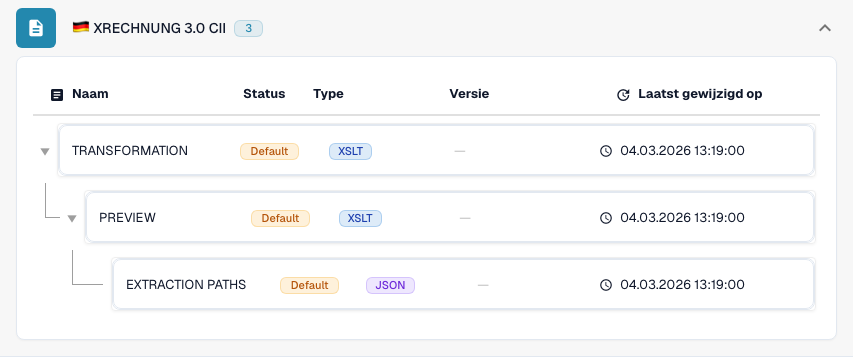

# Duitsland

Gebruik deze gids om de geconfigureerde familie en de versieomvang vast te stellen voordat u een bronbestand test.

[Alle landen en ondersteuningsomvang](../README.md)

## Varianten en versiebeperkingen

XRechnung heeft dertien versielabels van 1.0 tot 3.0.2, elk in CII en UBL. ZUGFeRD omvat oudere profielen en 2.5-vermeldingen voor CII en UBL.

**Syntaxis:** CII / UBL / PDF + XML

Syntaxis, publicatieversie en profiel zijn verschillende keuzes. Leid geen Factur-X-publicatie af uit de gedeelde 1p0-markering.

De tabellen beschrijven een controle van de ontwikkelcatalogus op 17 oktober 2026 en de bijbehorende verwerkingscode. Ze tonen de beschikbare regels en configuratiecomponenten; ze vormen geen certificering van elk bestand, elke wettelijke vereiste of een productie-uitrol. Uw organisatie kan de standaardinstellingen overschrijven.

## Onderzochte regels en componenten

| Exact formaatlabel | Documentsleutel van de regel | Beschikbare componenten |
| --- | --- | --- |
| `EDNA UTILITY CII` | `INVOICE` | C / T / P / E |
| `XRECHNUNG 1.0 CII` | `INVOICE` | C / T / P / E |
| `XRECHNUNG 1.0 UBL` | `INVOICE` | C / T / P / E |
| `XRECHNUNG 1.1 CII` | `INVOICE` | C / T / P / E |
| `XRECHNUNG 1.1 UBL` | `INVOICE` | C / T / P / E |
| `XRECHNUNG 1.2 CII` | `INVOICE` | C / T / P / E |
| `XRECHNUNG 1.2 UBL` | `INVOICE` | C / T / P / E |
| `XRECHNUNG 1.2.1 CII` | `INVOICE` | C / T / P / E |
| `XRECHNUNG 1.2.1 UBL` | `INVOICE` | C / T / P / E |
| `XRECHNUNG 1.2.2 CII` | `INVOICE` | C / T / P / E |
| `XRECHNUNG 1.2.2 UBL` | `INVOICE` | C / T / P / E |
| `XRECHNUNG 2.0 CII` | `INVOICE` | C / T / P / E |
| `XRECHNUNG 2.0 UBL` | `INVOICE` | C / T / P / E |
| `XRECHNUNG 2.0.1 CII` | `INVOICE` | C / T / P / E |
| `XRECHNUNG 2.0.1 UBL` | `INVOICE` | C / T / P / E |
| `XRECHNUNG 2.1 CII` | `INVOICE` | C / T / P / E |
| `XRECHNUNG 2.1 UBL` | `INVOICE` | C / T / P / E |
| `XRECHNUNG 2.2 CII` | `INVOICE` | C / T / P / E |
| `XRECHNUNG 2.2 UBL` | `INVOICE` | C / T / P / E |
| `XRECHNUNG 2.3 CII` | `INVOICE` | C / T / P / E |
| `XRECHNUNG 2.3 UBL` | `INVOICE` | C / T / P / E |
| `XRECHNUNG 3.0 CII` | `INVOICE` | C / T / P / E |
| `XRECHNUNG 3.0 CII CREDITNOTE` | `CREDIT_NOTE` | C / T / P / E |
| `XRECHNUNG 3.0 UBL` | `INVOICE` | C / T / P / E |
| `XRECHNUNG 3.0.1 CII` | `INVOICE` | C / T / P / E |
| `XRECHNUNG 3.0.1 CII CREDITNOTE` | `CREDIT_NOTE` | C / T / P / E |
| `XRECHNUNG 3.0.1 UBL` | `INVOICE` | C / T / P / E |
| `XRECHNUNG 3.0.2 CII` | `INVOICE` | C / T / P / E |
| `XRECHNUNG 3.0.2 CII CREDITNOTE` | `CREDIT_NOTE` | C / T / P / E |
| `XRECHNUNG 3.0.2 UBL` | `INVOICE` | C / T / P / E |
| `XRECHNUNG ORDER` | `PURCHASE_ORDER` | C / T / P / E |
| `XRECHNUNG ORDER RESPONSE` | `ORDER_CONFIRMATION` | C / T / P / E |
| `ZUGFERD 1.0 BASIC` | `INVOICE` | C / T / P / E |
| `ZUGFERD 1.0 COMFORT` | `INVOICE` | C / T / P / E |
| `ZUGFERD 1.0 EXTENDED` | `INVOICE` | C / T / P / E |
| `ZUGFERD 2.2` | `INVOICE` | C / T / P / E |
| `ZUGFERD 2.3.2` | `INVOICE` | C / T / P / E |
| `ZUGFERD 2.4` | `INVOICE` | C / T / P / E |
| `ZUGFERD 2.5 CII` | `INVOICE` | C / T / P / E |
| `ZUGFERD 2.5 UBL` | `INVOICE` | C / T / P / E |

C = classificatie, T = Transformation, P = Preview, E = Extraction Paths. De documentsleutel is de opzoeksleutel voor regels en configuratie; deze garandeert niet de uiteindelijk opgeslagen invoice_type. Een transformatie kan een creditnota classificeren via een INVOICE-toewijzing.

Een streepje betekent dat de statuscontrole geen eigen component voor deze exacte combinatie van formaat en documentsleutel heeft gemeld. Dit sluit een gedeelde of terugvaltoewijzing niet uit. Controleer de daadwerkelijk gebruikte resolver en een representatief bestand voordat u op die route vertrouwt.

### Aanvullende configuratielabels

Deze labels hebben configuratievermeldingen, maar geen zelfstandige classificatieregel in de onderzochte catalogus. Een algemene familie of een verfijning van de formaatidentiteit kan een compatibele route selecteren. Alleen hun aanwezigheid bewijst niet dat deze publicatie of dit profiel automatisch wordt gedetecteerd.

- `ZUGFERD 1.0`
- `ZUGFERD 2.1 BASIC`
- `ZUGFERD 2.1 BASIC WL`
- `ZUGFERD 2.1 EN16931`
- `ZUGFERD 2.1 EXTENDED`
- `ZUGFERD 2.1 MINIMUM`
- `ZUGFERD 2.2 BASIC`
- `ZUGFERD 2.2 BASIC WL`
- `ZUGFERD 2.2 EN16931`
- `ZUGFERD 2.2 EXTENDED`
- `ZUGFERD 2.2 MINIMUM`
- `ZUGFERD 2.3`
- `ZUGFERD 2.3 BASIC`
- `ZUGFERD 2.3 BASIC WL`
- `ZUGFERD 2.3 EN16931`
- `ZUGFERD 2.3 EXTENDED`
- `ZUGFERD 2.3 MINIMUM`
- `ZUGFERD 2.3.2 BASIC`
- `ZUGFERD 2.3.2 BASIC WL`
- `ZUGFERD 2.3.2 EN16931`
- `ZUGFERD 2.3.2 EXTENDED`
- `ZUGFERD 2.3.2 MINIMUM`
- `ZUGFERD 2.4 BASIC`
- `ZUGFERD 2.4 BASIC WL`
- `ZUGFERD 2.4 EN16931`
- `ZUGFERD 2.4 EXTENDED`
- `ZUGFERD 2.4 MINIMUM`
- `ZUGFERD 2.5 CII BASIC`
- `ZUGFERD 2.5 CII BASIC WL`
- `ZUGFERD 2.5 CII EN16931`
- `ZUGFERD 2.5 CII EXTENDED`
- `ZUGFERD 2.5 CII MINIMUM`
- `ZUGFERD 2.5 UBL BASIC`
- `ZUGFERD 2.5 UBL BASIC WL`
- `ZUGFERD 2.5 UBL EN16931`
- `ZUGFERD 2.5 UBL EXTENDED`
- `ZUGFERD 2.5 UBL MINIMUM`

### Factur-X / ZUGFeRD: verzin geen publicatieversie

Een geharmoniseerde CII Guideline ID kan een familie en profiel identificeren, terwijl meerdere versies dezelfde 1p0-markering gebruiken. Factur-X XMP Version 1.0 is een schemamarkering, geen publicatie zoals 1.08 of 1.09. ZUGFeRD XMP kan zijn versie declareren. Behoud het algemene familieresultaat wanneer gezaghebbende metadata ontbreekt en verifieer het oorspronkelijke bestand bij de afzender.

MINIMUM en BASIC WL kunnen regelgegevens weglaten die verderop in de verwerking nodig zijn. BASIC, EN16931/COMFORT en EXTENDED bieden een verschillende gegevensdekking. Een uitgebreider profiel kan velden bevatten die uw extractietoewijzing niet gebruikt. Controleer vereiste velden met echte voorbeelden.

## Zoek de toewijzing in DocBits

<figure><figcaption>
Werkelijke ontwikkelinterface: het representatieve formaat en de beschikbare configuratiecomponenten. Andere versies staan in de matrix.
</figcaption></figure>

## Uitlegvideo per land

Gesproken uitleg en WebVTT-ondertitels in de gekozen taal leggen formaatselectie, configuratie en acceptatiecontroles uit.


Duitsland — Uitlegvideo per land



WebVTT


## Acceptatiecontroles

Een componentcontrole bevestigt dat er configuratie aanwezig is. Het is geen test van de volledige verwerking voor elke versie. Test de exacte gegevensinhoud en de factuur- of creditnotaroute die uw integratie nodig heeft.

## Controleer een formaat in uw organisatie

1. Bewaar de oorspronkelijke XML of de PDF met ingesloten XML. Lees de naamruimte, het schema of de aanpassingsidentificatie en de gedeclareerde versie of het profiel.

2. Open Instellingen → Documenttypen → E-Doc voor het betreffende bedrijfsdocument. Zoek het exacte elektronische documentformaat dat in de gids staat.

3. Controleer de daadwerkelijk gebruikte bron, Default of Custom, en de actieve configuratieversie. Bekijk Transformation, Preview en Extraction Paths. Het opslaan van een concept activeert het niet.

4. Test representatieve bronbestanden voor elke syntaxis, versie en elk bedrijfsdocument dat u nodig hebt. Controleer de belangrijkste velden, bedragen, belastingen, de classificatie als factuur of creditnota en de ERP-export.

5. Bevestig het validatiebeleid en het transport afzonderlijk. Behoud aangepaste toewijzingen en controleer goedkeuringen en de exportgeschiedenis voordat u bestaande documenten opnieuw start.

## Gerelateerde formaatreferentie

- [🇩🇪 XRECHNUNG 1.0 CII](../xrechnung-1-0-cii.md)
- [🇩🇪 XRECHNUNG 1.0 UBL](../xrechnung-1-0-ubl.md)
- [🇩🇪 XRECHNUNG 1.1 CII](../xrechnung-1-1-cii.md)
- [🇩🇪 XRECHNUNG 1.1 UBL](../xrechnung-1-1-ubl.md)
- [🇩🇪 XRECHNUNG 1.2 CII](../xrechnung-1-2-cii.md)
- [🇩🇪 XRECHNUNG 1.2 UBL](../xrechnung-1-2-ubl.md)
- [🇩🇪 XRECHNUNG 1.2.1 CII](../xrechnung-1-2-1-cii.md)
- [🇩🇪 XRECHNUNG 1.2.1 UBL](../xrechnung-1-2-1-ubl.md)
- [🇩🇪 XRECHNUNG 1.2.2 CII](../xrechnung-1-2-2-cii.md)
- [🇩🇪 XRECHNUNG 1.2.2 UBL](../xrechnung-1-2-2-ubl.md)
- [🇩🇪 XRECHNUNG 2.0 CII](../xrechnung-2-0-cii.md)
- [🇩🇪 XRECHNUNG 2.0 UBL](../xrechnung-2-0-ubl.md)
- [🇩🇪 XRECHNUNG 2.0.1 CII](../xrechnung-2-0-1-cii.md)
- [🇩🇪 XRECHNUNG 2.0.1 UBL](../xrechnung-2-0-1-ubl.md)
- [🇩🇪 XRECHNUNG 2.1 CII](../xrechnung-2-1-cii.md)
- [🇩🇪 XRECHNUNG 2.1 UBL](../xrechnung-2-1-ubl.md)
- [🇩🇪 XRECHNUNG 2.2 CII](../xrechnung-2-2-cii.md)
- [🇩🇪 XRECHNUNG 2.2 UBL](../xrechnung-2-2-ubl.md)
- [🇩🇪 XRECHNUNG 2.3 CII](../xrechnung-2-3-cii.md)
- [🇩🇪 XRECHNUNG 2.3 UBL](../xrechnung-2-3-ubl.md)
- [🇩🇪 XRECHNUNG 3.0 CII](../xrechnung-3-0-cii.md)
- [🇩🇪 XRECHNUNG 3.0 UBL](../xrechnung-3-0-ubl.md)
- [🇩🇪 XRECHNUNG 3.0.1 CII](../xrechnung-3-0-1-cii.md)
- [🇩🇪 XRECHNUNG 3.0.1 UBL](../xrechnung-3-0-1-ubl.md)
- [🇩🇪 XRECHNUNG 3.0.2 CII](../xrechnung-3-0-2-cii.md)
- [🇩🇪 XRECHNUNG 3.0.2 UBL](../xrechnung-3-0-2-ubl.md)
- [🇩🇪 ZUGFERD 1.0](../zugferd-1-0.md)
- [🇩🇪 ZUGFERD 1.0 BASIC](../zugferd-1-0-basic.md)
- [🇩🇪 ZUGFERD 1.0 COMFORT](../zugferd-1-0-comfort.md)
- [🇩🇪 ZUGFERD 1.0 EXTENDED](../zugferd-1-0-extended.md)
- [🇩🇪 ZUGFERD 2.2](../zugferd-2-2.md)
- [🇩🇪 ZUGFERD 2.3](../zugferd-2-3.md)
- [🇩🇪 ZUGFERD 2.3.2](../zugferd-2-3-2.md)
- [🇩🇪 ZUGFERD 2.5](../zugferd-2-5.md)
