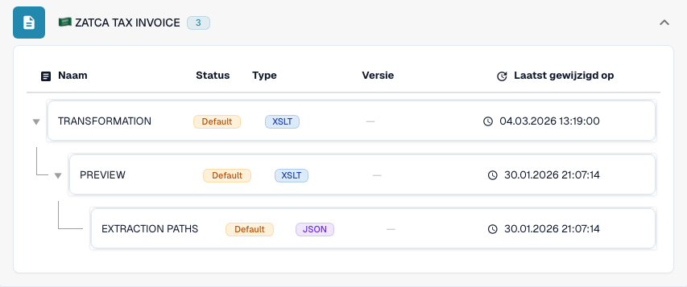

# Saoedi-Arabië

Gebruik deze gids om de geconfigureerde familie en de versieomvang vast te stellen voordat u een bronbestand test.

[Alle landen en ondersteuningsomvang](../README.md)

## Uitlegvideo per land

Gesproken uitleg en WebVTT-ondertitels in de gekozen taal leggen formaatselectie, configuratie en acceptatiecontroles uit.

Deze rondleiding zonder wijzigingen toont de bestaande DocBits-configuratie voor het land. Controleer de gebruikte bron en actieve versie en test representatieve facturen, creditnota’s en exports in uw eigen organisatie.



[Saoedi-Arabië — Uitlegvideo per land](https://docbits-videos.fra1.cdn.digitaloceanspaces.com/settings-assistant/edocs_country_saudi_arabia/v2/nl.mp4)

[WebVTT](https://docbits-videos.fra1.cdn.digitaloceanspaces.com/settings-assistant/edocs_country_saudi_arabia/v2/nl.vtt)

## Varianten en versiebeperkingen

ZATCA Fatoorah, Reporting, Simplified en Tax Invoice hebben afzonderlijke vermeldingen.

**Syntaxis:** UBL XML

Deze labels beschrijven verschillende processen en factuurvarianten. Het parseren bewijst geen ondertekening, fiscale goedkeuring of rapportage via ZATCA.

De tabellen beschrijven een controle van de ontwikkelcatalogus op 17 oktober 2026 en de bijbehorende verwerkingscode. Ze tonen de beschikbare regels en configuratiecomponenten; ze vormen geen certificering van elk bestand, elke wettelijke vereiste of een productie-uitrol. Uw organisatie kan de standaardinstellingen overschrijven.

## Onderzochte regels en componenten

| Exact formaatlabel | Documentsleutel van de regel | Beschikbare componenten |
| --- | --- | --- |
| `ZATCA FATOORAH` | `INVOICE` | C / T / P / E |
| `ZATCA REPORTING` | `INVOICE` | C / T / P / E |
| `ZATCA SIMPLIFIED` | `INVOICE` | C / T / P / E |
| `ZATCA TAX INVOICE` | `INVOICE` | C / T / P / E |

C = classificatie, T = Transformation, P = Preview, E = Extraction Paths. De documentsleutel is de opzoeksleutel voor regels en configuratie; deze garandeert niet de uiteindelijk opgeslagen invoice_type. Een transformatie kan een creditnota classificeren via een INVOICE-toewijzing.

Een streepje betekent dat de statuscontrole geen eigen component voor deze exacte combinatie van formaat en documentsleutel heeft gemeld. Dit sluit een gedeelde of terugvaltoewijzing niet uit. Controleer de daadwerkelijk gebruikte resolver en een representatief bestand voordat u op die route vertrouwt.

## Zoek de toewijzing in DocBits

<figure><figcaption>
Werkelijke ontwikkelinterface: het representatieve formaat en de beschikbare configuratiecomponenten. Andere versies staan in de matrix.
</figcaption></figure>

## Acceptatiecontroles

Een componentcontrole bevestigt dat er configuratie aanwezig is. Het is geen test van de volledige verwerking voor elke versie. Test de exacte gegevensinhoud en de factuur- of creditnotaroute die uw integratie nodig heeft.

## Controleer een formaat in uw organisatie

1. Bewaar de oorspronkelijke XML of de PDF met ingesloten XML. Lees de naamruimte, het schema of de aanpassingsidentificatie en de gedeclareerde versie of het profiel.

2. Open Instellingen → Documenttypen → E-Doc voor het betreffende bedrijfsdocument. Zoek het exacte elektronische documentformaat dat in de gids staat.

3. Controleer de daadwerkelijk gebruikte bron, Default of Custom, en de actieve configuratieversie. Bekijk Transformation, Preview en Extraction Paths. Het opslaan van een concept activeert het niet.

4. Test representatieve bronbestanden voor elke syntaxis, versie en elk bedrijfsdocument dat u nodig hebt. Controleer de belangrijkste velden, bedragen, belastingen, de classificatie als factuur of creditnota en de ERP-export.

5. Bevestig het validatiebeleid en het transport afzonderlijk. Behoud aangepaste toewijzingen en controleer goedkeuringen en de exportgeschiedenis voordat u bestaande documenten opnieuw start.

## Gerelateerde formaatreferentie

- [🇸🇦 ZATCA FATOORAH](../zatca-fatoorah.md)
- [🇸🇦 ZATCA REPORTING](../zatca-reporting.md)
- [🇸🇦 ZATCA SIMPLIFIED](../zatca-simplified.md)
- [🇸🇦 ZATCA TAX INVOICE](../zatca-tax-invoice.md)
