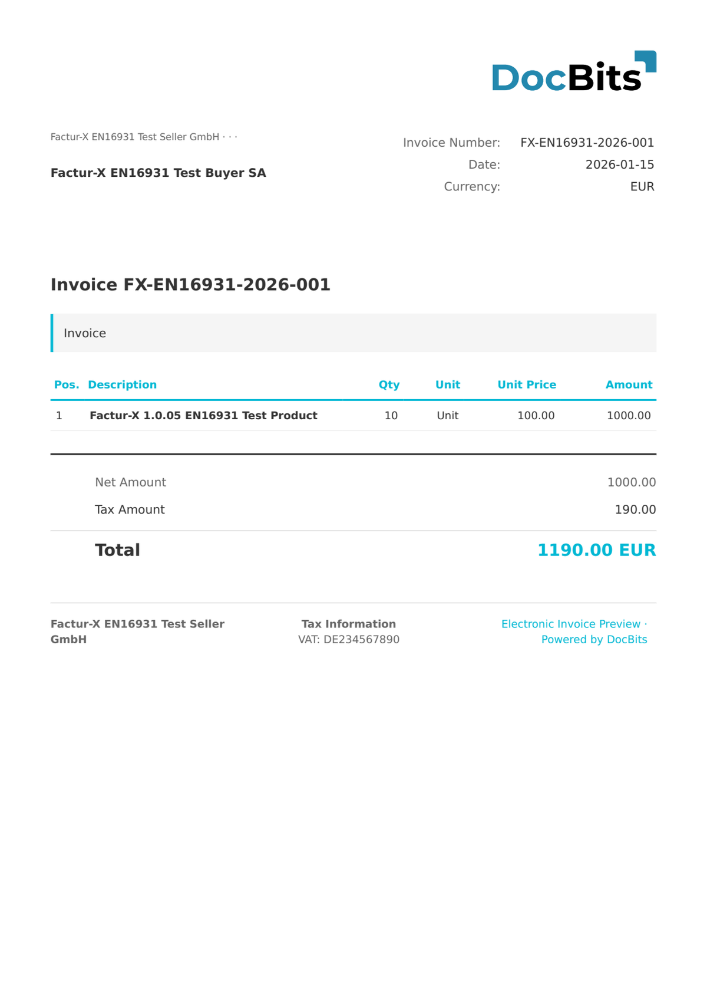

# 🇫🇷 FACTURX

<!-- edocs-country-scope -->


Raadpleeg de landengids voor versiebeperkingen, de daadwerkelijk gebruikte configuratie en de uitlegvideo voor het land. [Frankrijk](countries/france.md). De XML-markering 1p0 en Factur-X XMP Version 1.0 identificeren geen publicatieversie. Behoud het algemene label als de versie onbekend is.


| Eigenschap | Waarde |
|------------|--------|
| **Land / Regio** | Frankrijk / Duitsland |
| **Documenttypen** | Factuur, Creditnota |
| **Formaat** | CII (ingesloten in PDF/A-3) |
| **Standaard** | Factur-X |
| **Gebaseerd op** | EN 16931 |

Een geharmoniseerde CII Guideline ID kan een familie en profiel identificeren, terwijl meerdere versies dezelfde 1p0-markering gebruiken. Factur-X XMP Version 1.0 is een schemamarkering, geen publicatie zoals 1.08 of 1.09. ZUGFeRD XMP kan zijn versie declareren. Behoud het algemene familieresultaat wanneer gezaghebbende metadata ontbreekt en verifieer het oorspronkelijke bestand bij de afzender.

## Ondersteuningsstatus

| Component | Status |
|-----------|--------|
| Voorvertoning | ✅ Ondersteund |
| Veldextractie | ✅ Ondersteund |
| Transformatie | ✅ Ondersteund |

## Standaard voorvertoning

<figure><figcaption>
Standaard DocBits-voorvertoning voor een Franse Factur-X-factuur
</figcaption></figure>

## Gerelateerd

* [ZUGFeRD-configuratie](../zugferd/)
* [ZUGFeRD-veldtoewijzing](../zugferd/README.md)
* [Ondersteunde elektronische documenten](./)
