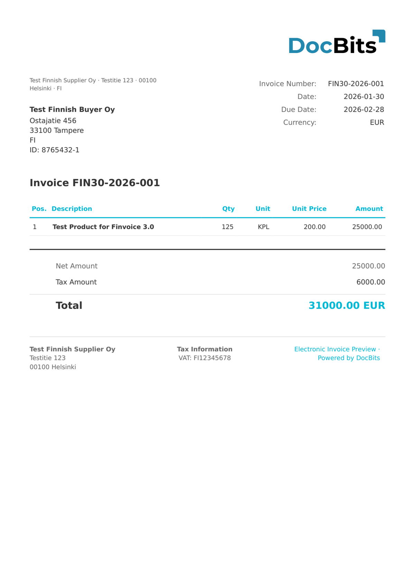

# 🇫🇮 FINVOICE 1.3

| Eigenschap | Waarde |
|------------|--------|
| **Land / Regio** | Finland |
| **Documenttypen** | Factuur |
| **Formaat** | XML (SOAP-envelop) |
| **Standaard** | Finvoice 1.3 |

Finvoice 1.3 is een eerdere versie van de Finse e-factureringsstandaard, beheerd door Finance Finland. Deze gebruikt een SOAP-berichtenenvelop en definieert een gestructureerd XML-formaat voor B2B-facturering tussen Finse banken en hun zakelijke klanten.

## Ondersteuningsstatus

| Component | Status |
|-----------|--------|
| Voorvertoning | ✅ Ondersteund |
| Veldextractie | ✅ Ondersteund |
| Transformatie | ✅ Ondersteund |

## Standaard voorvertoning

<figure><figcaption>
Standaard DocBits-voorvertoning voor een Finse Finvoice 1.3-factuur
</figcaption></figure>

## Gerelateerd

* [Ondersteunde elektronische documenten](./)
