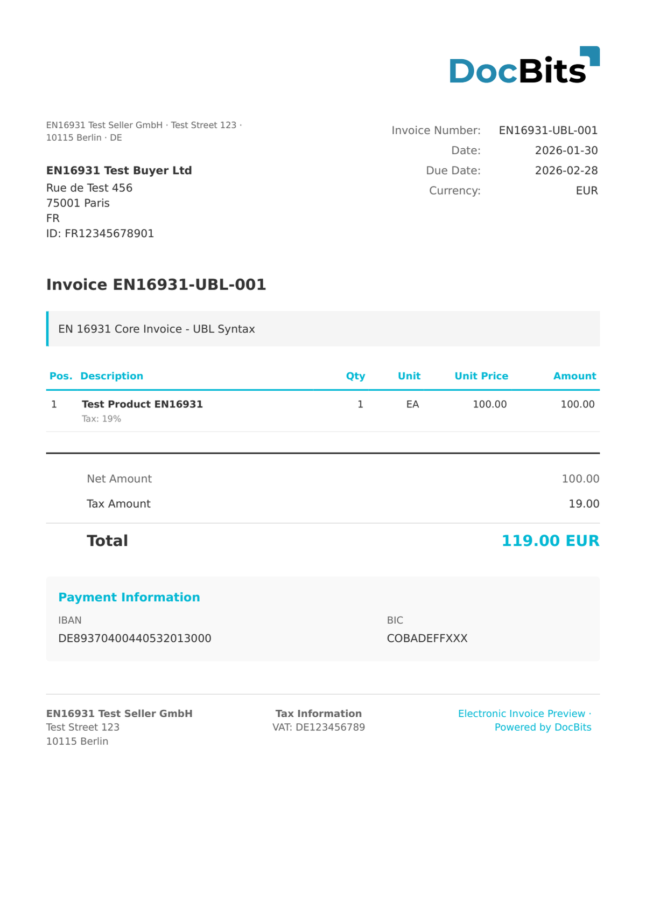

# INVOIC02

| Eigenschap | Waarde |
|------------|--------|
| **Land / Regio** | Internationaal |
| **Documenttypen** | Factuur |
| **Formaat** | EDIFACT |
| **Standaard** | UN/EDIFACT INVOIC D.02B |

INVOIC02 is een UN/EDIFACT-factuurbericht op basis van de directoryversie D.02B. EDIFACT (Electronic Data Interchange for Administration, Commerce and Transport) is een veelgebruikte EDI-standaard in logistiek, retail en productie. DocBits parseert de EDIFACT-segmentstructuur en extraheert header-, factuurregel- en samenvattingsvelden.

## Ondersteuningsstatus

| Component | Status |
|-----------|--------|
| Voorvertoning | ✅ Ondersteund |
| Veldextractie | ✅ Ondersteund |
| Transformatie | ✅ Ondersteund |

## Standaard voorvertoning

<figure><figcaption>
Standaard DocBits-voorvertoning voor een INVOIC02-factuur
</figcaption></figure>

## Gerelateerd

* [Ondersteunde elektronische documenten](./)
