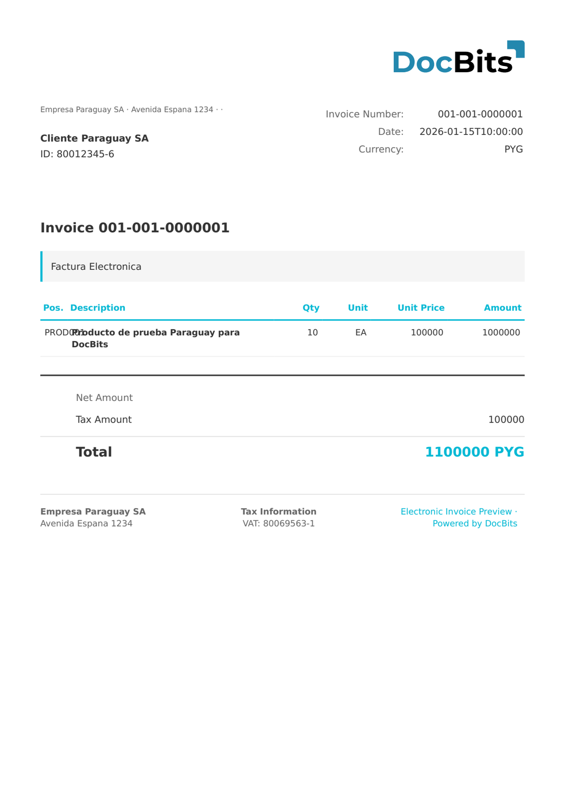

# 🇵🇾 PARAGUAY DTE

<!-- edocs-country-scope -->


Raadpleeg de landengids voor versiebeperkingen, de daadwerkelijk gebruikte configuratie en de uitlegvideo voor het land. [Paraguay](countries/paraguay.md). Classificatievermeldingen voor creditnota’s hebben in de onderzochte status geen eigen extractiebundels. Controleer de daadwerkelijk gebruikte toewijzing en beschouw de labels niet als onderling uitwisselbaar.


| Eigenschap           | Waarde                                 |
| -------------------- | -------------------------------------- |
| **Land / Regio**     | Paraguay                               |
| **Documenttypen**    | Factuur, Creditnota                    |
| **Formaat**          | XML                                    |
| **Standaard**        | DTE (Documento Tributario Electrónico) |

Paraguay DTE is de Paraguayaanse standaard voor elektronische belastingdocumenten, gereguleerd door de Subsecretaría de Estado de Tributación (SET). De standaard omvat elektronische facturen en creditnota's met Paraguayaanse eisen voor de belastingidentificatie (RUC) en de belastingcategorie.

## Ondersteuningsstatus

| Component     | Status         |
| ------------- | -------------- |
| Voorbeeld     | ✅ Ondersteund |
| Veldextractie | ✅ Ondersteund |
| Transformatie | ✅ Ondersteund |

## Standaardvoorbeeld

<figure><figcaption>
Standaard DocBits-voorbeeld voor een Paraguay DTE-factuur
</figcaption></figure>

## Gerelateerd

* [Ondersteunde elektronische documenten](./)
