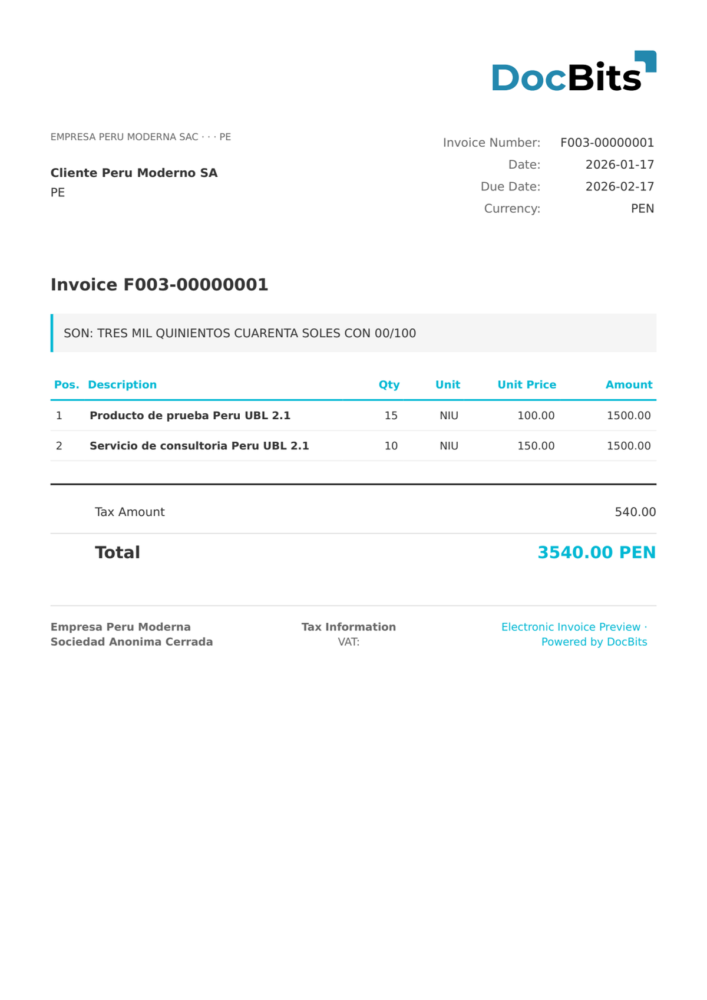

# 🇵🇪 PERU CPE UBL 2.1

| Eigenschap           | Waarde                           |
| -------------------- | -------------------------------- |
| **Land / Regio**     | Peru                             |
| **Documenttypen**    | Factuur, Creditnota, Debetnota   |
| **Formaat**          | UBL 2.1 XML                      |
| **Standaard**        | CPE UBL 2.1                      |

Peru CPE UBL 2.1 is het huidige formaat voor Peruaanse elektronische facturen die bij de SUNAT worden ingediend. Het gebruikt de OASIS UBL 2.1-standaard met Peruaanse uitbreidingen voor RUC-identificatie, IGV-belastingberekeningen (btw) en de inhoudingsmechanismen detracción/retención.

## Ondersteuningsstatus

| Component     | Status         |
| ------------- | -------------- |
| Voorbeeld     | ✅ Ondersteund |
| Veldextractie | ✅ Ondersteund |
| Transformatie | ✅ Ondersteund |

## Standaardvoorbeeld

<figure><figcaption>
Standaard DocBits-voorbeeld voor een Peru CPE UBL 2.1-factuur
</figcaption></figure>

## Gerelateerd

* [Ondersteunde elektronische documenten](./)
