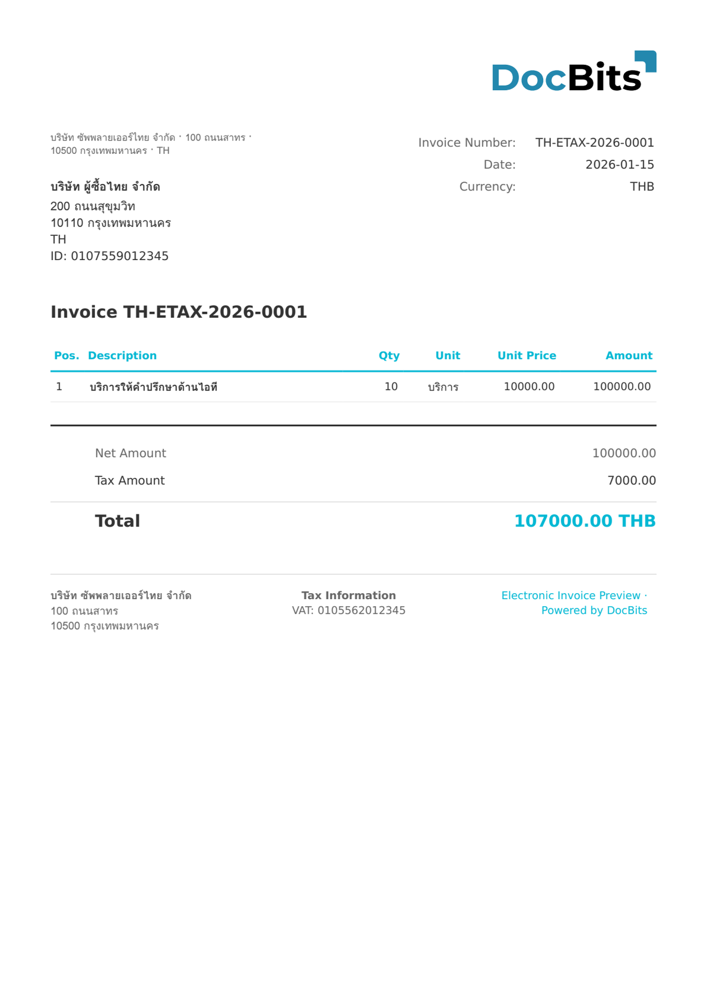

# 🇹🇭 THAILAND E-TAX INVOICE

| Eigenschap | Waarde |
| ---------- | ------ |
| **Land / Regio** | Thailand |
| **Documenttypen** | Belastingfactuur, Ontvangstbewijs |
| **Formaat** | XML (ingebed in PDF/A-3) |
| **Standaard** | e-Tax Invoice & e-Receipt (Revenue Department) |

Thailand e-Tax Invoice is de elektronische belastingfactuur- en ontvangstbewijsstandaard die wordt gereguleerd door het Revenue Department. De standaard gebruikt een hybride formaat dat lijkt op ZUGFeRD, waarbij gestructureerde XML-gegevens in een PDF/A-3-document worden ingebed. Het systeem vereist digitaal ondertekenen met een certificaat van een Thaise certificeringsinstantie (CA).

## Ondersteuningsstatus

| Component | Status |
| --------- | ------ |
| Voorvertoning | ✅ Ondersteund |
| Veldextractie | ✅ Ondersteund |
| Transformatie | ✅ Ondersteund |

## Standaard voorvertoning

<figure><figcaption>
Standaard DocBits-voorvertoning voor een Thailand e-Tax Invoice
</figcaption></figure>

## Gerelateerd

* [Ondersteunde elektronische documenten](./)
