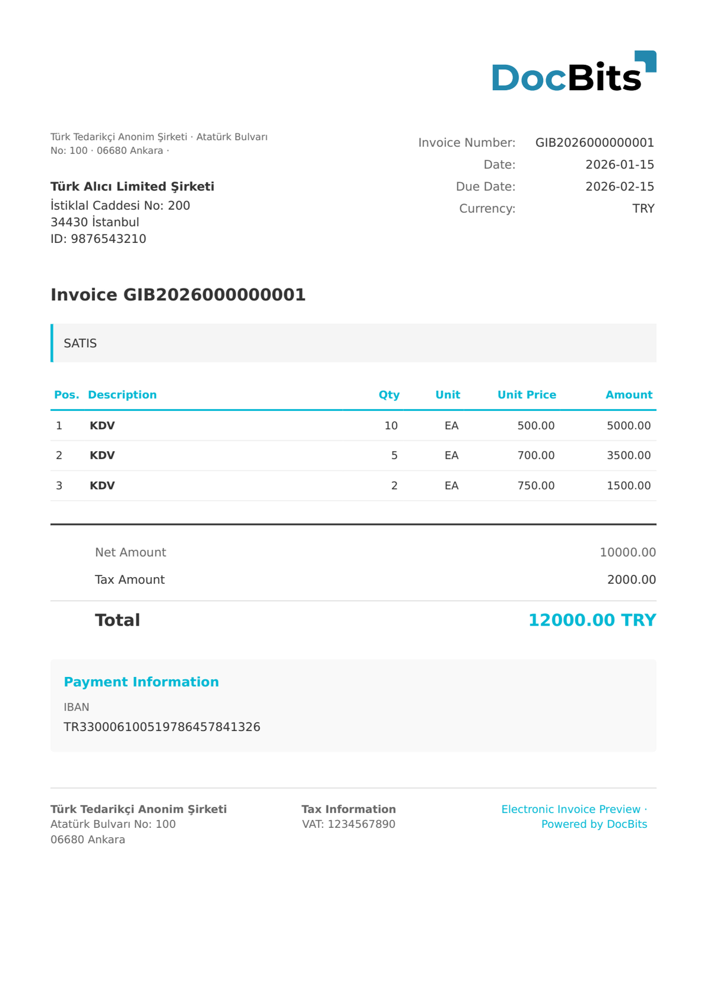

# 🇹🇷 TURKEY E-FATURA

| Eigenschap | Waarde |
| ---------- | ------ |
| **Land / Regio** | Turkije |
| **Documenttypen** | Factuur, Creditnota |
| **Formaat** | UBL-TR 1.2 XML |
| **Standaard** | e-Fatura (GİB - Belastingdienst) |

Turkey e-Fatura is de primaire elektronische factuurstandaard die door de GİB (Belastingdienst) verplicht is gesteld voor B2B-transacties tussen geregistreerde belastingplichtigen. Facturen worden uitgewisseld via geregistreerde integrators en het GİB-platform. Het formaat gebruikt UBL-TR, de gelokaliseerde Turkse versie van UBL, met Turkse specifieke velden voor TCKN/VKN-belastingidentificatie.

## Ondersteuningsstatus

| Component | Status |
| --------- | ------ |
| Voorvertoning | ✅ Ondersteund |
| Veldextractie | ✅ Ondersteund |
| Transformatie | ✅ Ondersteund |

## Standaard voorvertoning

<figure><figcaption>
Standaard DocBits-voorvertoning voor een Turkse E-Fatura-factuur
</figcaption></figure>

## Gerelateerd

* [Ondersteunde elektronische documenten](./)
* [TURKEY E-ARSIV](turkey-e-arsiv.md)
