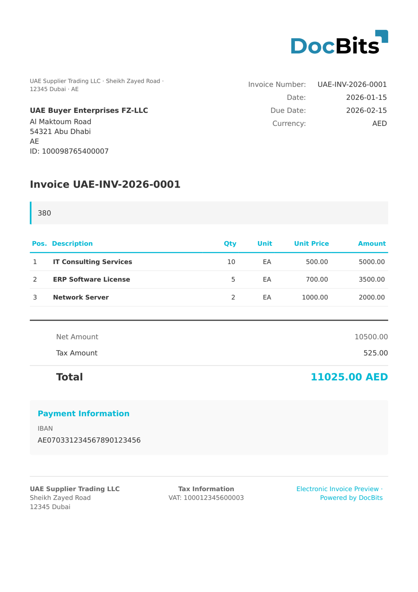

# 🇦🇪 UAE VAT INVOICE

| Eigenschap | Waarde |
| ---------- | ------ |
| **Land / Regio** | Verenigde Arabische Emiraten |
| **Documenttypen** | Belastingfactuur, Vereenvoudigde belastingfactuur |
| **Formaat** | XML/JSON |
| **Standaard** | FTA VAT Invoice (Federal Tax Authority) |

UAE VAT Invoice is het elektronische factuurformaat dat is afgestemd op de eisen van de Federal Tax Authority (FTA). Hoewel de Verenigde Arabische Emiraten nog geen specifiek e-factuurformaat verplicht hebben gesteld, ondersteunt DocBits de verwerking van gestructureerde btw-factuurdocumenten die voldoen aan de FTA-btw-regelgeving, inclusief identificatie via het TRN (Tax Registration Number) en btw-berekeningen tegen 5%.

## Ondersteuningsstatus

| Component | Status |
| --------- | ------ |
| Voorvertoning | ✅ Ondersteund |
| Veldextractie | ✅ Ondersteund |
| Transformatie | ✅ Ondersteund |

## Standaard voorvertoning

<figure><figcaption>
Standaard DocBits-voorvertoning voor een UAE VAT Invoice
</figcaption></figure>

## Gerelateerd

* [Ondersteunde elektronische documenten](./)
